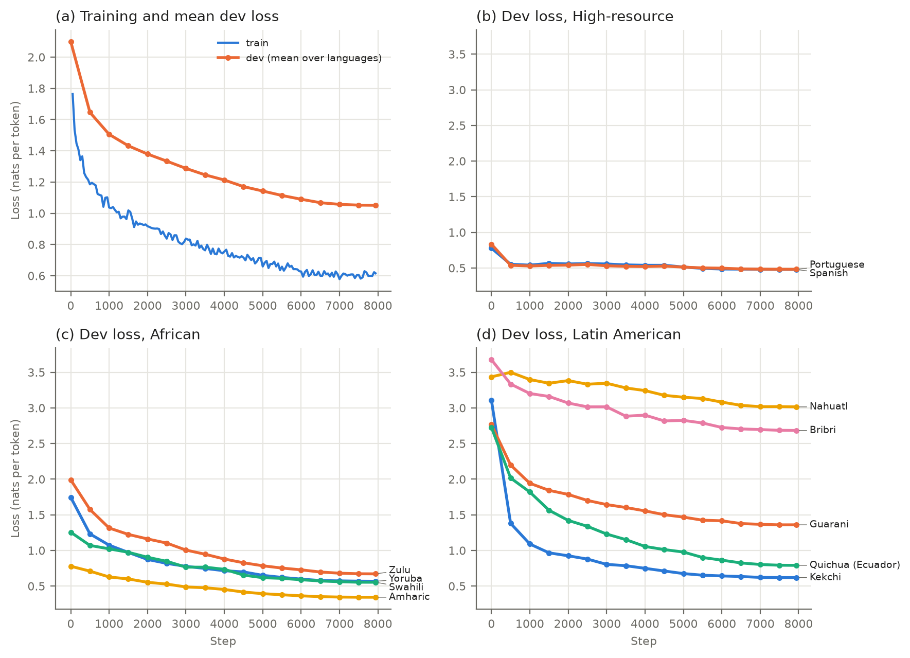
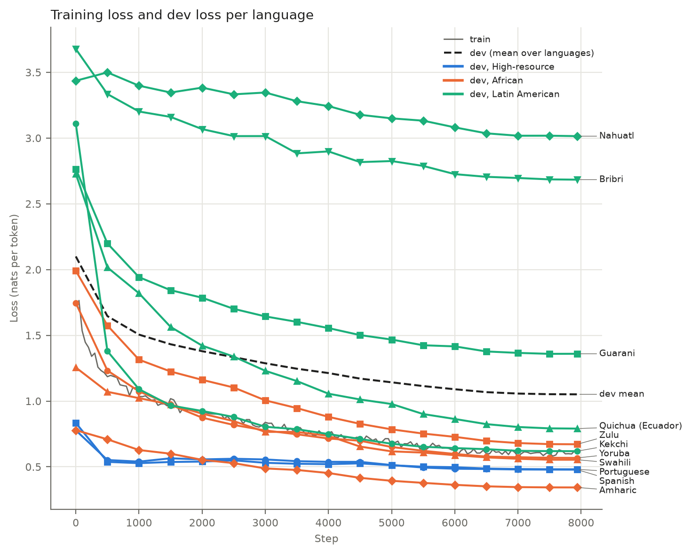
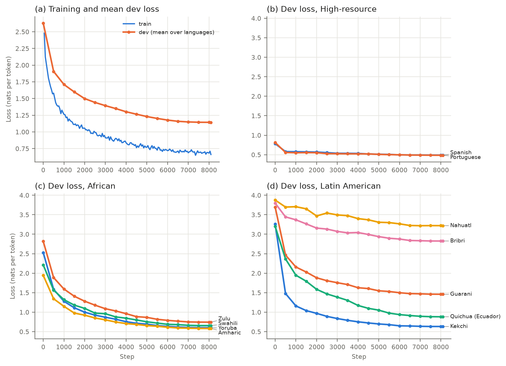
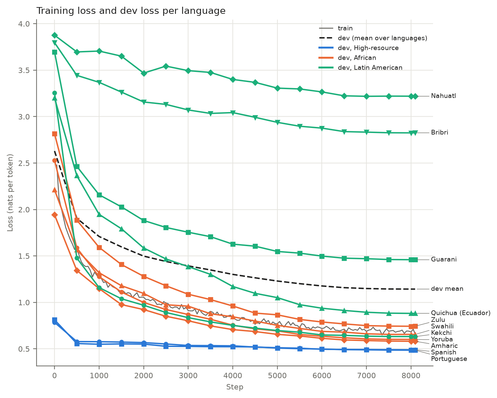

Models. We evaluate two base (not instruction-tuned) models: Llama 3.1 8B (`meta-llama/Llama-3.1-8B`, Grattafiori et al., 2024), our core model, and Qwen 2.5 7B (`Qwen/Qwen2.5-7B`, Qwen Team, 2024), a second model family used to check that results are not specific to Llama. We also evaluate a LoRA fine-tune of Llama 3.1 8B and of Qwen 2.5 7B on the project language. The quantization code was developed and tested on GPT-2 small (`openai-community/gpt2`, Radford et al., 2019).

Quantization. We apply weight-only post-training quantization at 4 and 3 bits to every linear layer in the decoder blocks. Embeddings, `lm_head` and normalization layers stay in bf16, and activations are not quantized. Weights use an asymmetric uniform grid with one scale and zero-point per group of 128 consecutive input columns within each row. We compare three methods. Round-to-nearest (RTN) applies the grid directly and needs no calibration. GPTQ (Frantar et al., 2023) runs in natural column order, without act-order. AWQ (Lin et al., 2024) searches the activation-aware scale per linear layer and divides it back into the weights, without the clipping search.
GPTQ and AWQ are calibrated on 128 windows of 2,048 tokens, each from a random position in a random English C4 document (Raffel et al., 2020). For Llama each window is preceded by the BOS token, as at inference (Qwen has none). GPTQ and AWQ are each run with five calibration seeds (0–4) that draw different windows, and the spread across seeds is our noise baseline. RTN needs no calibration and is run once. Each model therefore has 11 quantized versions per bit width (1 RTN + 5 GPTQ + 5 AWQ), 22 across 4 and 3 bits. With its full-precision original, each of the four models (Llama, Qwen, Llama + LoRA, Qwen + LoRA) has 23 versions, and all 92 are evaluated on the same test sets. 
We simulate quantization (fake quantization): weights are rounded to the grid and stored back in bf16. Since weight-only kernels dequantize weights to 16-bit before the matrix product, this produces the same outputs as packed inference. We do not measure memory or speed. As a check on our implementations, we report perplexity on the WikiText-2 test set (raw v1, Merity et al., 2017) over non-overlapping 2,048-token windows.

| Model | FP | RTN 4 | GPTQ 4 | AWQ 4 | RTN 3 | GPTQ 3 | AWQ 3 |
|---|---:|---:|---:|---:|---:|---:|---:|
| Llama 3.1 8B | 6.24 | 6.93 | 7.18 ± 0.03 | 6.65 ± 0.01 | 14.98 | 22.81 ± 2.84 | 8.61 ± 0.03 |
| Qwen 2.5 7B | 6.85 | 7.21 | 7.11 ± 0.02 | 7.10 ± 0.01 | 8.98 | 8.19 ± 0.05 | 8.32 ± 0.01 |
| Llama 3.1 8B + LoRA | 8.84 | 9.94 | 10.27 ± 0.05 | 9.42 ± 0.03 | 22.04 | 34.12 ± 7.26 | 12.15 ± 0.06 |
| Qwen 2.5 7B + LoRA | 8.62 | 9.17 | 8.90 ± 0.04 | 8.93 ± 0.01 | 11.51 | 10.13 ± 0.10 | 10.43 ± 0.04 |

*Table 1. WikiText-2 test perplexity (lower is better). FP is the full-precision model. GPTQ and AWQ show the mean ± standard deviation over the five calibration seeds. FP and RTN are run once.*

Languages. English is the anchor and the other side of every translation pair. The other twelve languages fall into three groups. The first is three high-resource Romance languages. Two of them are high-resource controls, and the third, French, is the forgetting control: it is left out of fine-tuning, so any change on French shows what fine-tuning costs a language the model was not trained on. The second group is four African languages from two families, Niger-Congo and Afro-Asiatic, one of them written in the Ge'ez script. All four are covered by FLORES+ and by AfriCOMET (Wang et al., 2024), a COMET metric trained on African languages, so their translations can be scored with a learned metric and not only with string overlap. The third group is five Latin American Indigenous languages from five unrelated families (Mayan, Tupian, Uto-Aztecan, Quechuan and Chibchan). These are very low-resource, and only one of them is in FLORES+. None of the nine low-resource languages is among the eight languages Llama 3.1 officially supports. Table 2 lists every language with its code and corpora.

Datasets. We use five parallel corpora. The church corpus holds English–X human translations of religious text, it covers every language except Nahuatl and Bribri, is our main training set. We use FLORES+ (NLLB Team, 2022) as our main test set for eight of the languages it covers. We also used the AmericasNLP 2021 (Mager et al., 2021) dataset (Spanish–x) for Guarani, Nahuatl and Bribri. We also used MayanV that holds Spanish–Kekchi corpus. The Napo Kichwa dataset for Spanish-Quichua (Eciador). Two datasets were used for quantization calibration and perplexity evaluation, C4 (Raffel et al., 2020) web text for GPTQ and AWQ calibration, and WikiText-2 (Merity et al., 2017) for the perplexity check in Table 1.

AmericasNLP, MayanV and the Kichwa datasets pair each language with Spanish, not English. We translated their Spanish side to English with Qwen3-32B (`Qwen/Qwen3-32B`), using greedy decoding, three FLORES+ Spanish–English examples in the prompt and thinking mode off. This covered 47,913 distinct sentences, and 115 sentences over 1,000 characters were dropped. The X side stays human-written, but for kek, nah and bzd the English side of the test sets is machine-translated.

| Language | Code | Corpora |
|---|---|---|
| French | fra | church, FLORES+ |
| Spanish | spa | church, FLORES+ |
| Portuguese | por | church, FLORES+ |
| Yoruba | yor | church, FLORES+ |
| Zulu | zul | church, FLORES+ |
| Swahili | swh | church, FLORES+ |
| Amharic | amh | church, FLORES+ |
| Kekchi | kek | church, MayanV |
| Guarani | grn | church, FLORES+, AmericasNLP |
| Nahuatl | nah | AmericasNLP |
| Bribri | bzd | AmericasNLP |
| Quichua (Ecuador) | qug | church, Kichwa lexicon |

*Table 2. Languages, codes and the corpora each one uses.*

Splits. We used the data to fine-tune Llama 3.1 8B and Qwen 2.5 7B and to evaluate translation. We keep the published train, dev and test splits when a dataset has them. For FLORES+ we use dev as our dev and devtest as our test. For the church corpus we shuffle each language's pairs with a fixed seed and take 1,000 for dev, 1,000 for test and the rest for train. For the external we ran a cleaning pipeline, which removes [what it removes, to check]. Finally, we remove any train pair that also appears in a dev or test set of any language.

Fine-tuning uses the train splits of every language except French, with Spanish, Portuguese and Swahili capped at a random 100,000 pairs. To track fine-tuning, we compute the loss every 500 steps on 400 random dev pairs per language, from the church dev set, or the AmericasNLP dev set for Nahuatl and Bribri (Guarani uses both). The fine-tuned model is then evaluated on the same test sets as the base models. The dev splits are also used in evaluation. The three few-shot examples in each prompt are the first three dev pairs of the same corpus as the test set, and the dev pairs set the generation length limit. We evaluate every model on two groups of test sets, the public ones (FLORES+, MayanV and AmericasNLP) and the church ones, each where it covers the language. Quichua (Ecuador) has only a church test set, and Nahuatl and Bribri only AmericasNLP. Table 3 gives the sizes.

| Language | Fine-tune train | Fine-tune dev | Test |
|---|---|---|---|
| French | — | — | FLORES+ (1,012), church (1,000) |
| Spanish | church (100,000) | church | FLORES+ (1,012), church (1,000) |
| Portuguese | church (100,000) | church | FLORES+ (1,012), church (1,000) |
| Yoruba | church (89,832) | church | FLORES+ (1,012), church (1,000) |
| Zulu | church (100,099) | church | FLORES+ (1,012), church (1,000) |
| Swahili | church (100,000) | church | FLORES+ (1,012), church (1,000) |
| Amharic | church (173,590) | church | FLORES+ (1,012), church (1,000) |
| Kekchi | church (213,543), MayanV (1,965) | church | MayanV (1,000), church (1,000) |
| Guarani | church (109,702), AmericasNLP (11,787) | church, AmericasNLP | FLORES+ (1,012), church (1,000) |
| Quichua (Ecuador) | church (14,735), Kichwa lexicon (2,007) | church | church (1,000) |
| Nahuatl | AmericasNLP (12,637) | AmericasNLP | AmericasNLP (995) |
| Bribri | AmericasNLP (6,125) | AmericasNLP | AmericasNLP (1,003) |

*Table 3. Data per language. Fine-tune train gives the corpora and the number of pairs after cleaning, decontamination and the 100,000-pair cap. Fine-tune dev is the corpus of the 400 dev pairs used to track the fine-tuning loss.*

Fine-tuning. We fine-tune Llama 3.1 8B and Qwen 2.5 7B with LoRA (Hu et al., 2022) on the train splits in Table 3. The adapters have rank 64, alpha 128 and dropout 0.05, and are applied to every linear layer of the decoder blocks. This trains 168M of Llama's 8.2B parameters (2.05%) and 161M of Qwen's 7.8B (2.08%). Each training row is written exactly like an evaluation prompt, three example pairs followed by the pair to translate, in a random direction. The loss is computed only on the translation of the last pair. Rows longer than 1,024 tokens are dropped (4,987 of 259,003 for Llama and 50 for Qwen, mostly Amharic). We train for one epoch (7,938 steps for Llama, 8,093 for Qwen) with AdamW, a learning rate of 2e-4 with 3% linear warmup and cosine decay to 0, batches of 32 rows (128 pairs), gradient clipping at 1.0 and bf16. The dev loss is computed on 100 rows (400 pairs) per language and drops from 2.10 before training to 1.05 at the end for Llama, and from 2.63 to 1.14 for Qwen. Each finetuned model is then quantized and evaluated exactly like the base models.

*Figure 1. Fine-tuning loss of Llama 3.1 8B. (a) Training loss and dev loss averaged over languages. (b)–(d) Dev loss per language, by group, on the same scale. Losses are per token, so levels are not comparable across languages, only trends within one.*

*Figure 2. The curves of Figure 1 in one panel. Colour is the language group and the marker the language.*

*Figure 3. Fine-tuning loss of Qwen 2.5 7B, with the same panels as Figure 1.*

*Figure 4. The curves of Figure 3 in one panel.*

Evaluation. Every model translates every test set in both directions, English→X and X→English, and each direction is scored separately. The models are base models, so we prompt them without a chat template. The prompt has three example pairs from the dev split followed by the source sentence, `<eng>…</eng> <yor>…</yor>` three times, then `<eng>{source}</eng> <yor>`. Decoding is greedy. Generation stops at the closing tag, or at twice the expected length of the translation, estimated from the source length and the average target/source token ratio of the dev pairs. All models run in bf16.

Metrics. For every model, test set and direction we record three groups of metrics. Translation quality: chrF++ (Popović, 2017) and BLEU (Papineni et al., 2002), computed with sacreBLEU (Post, 2018), AfriCOMET (Wang et al., 2024) for French and the four African languages, and the off-target rate measured with GlotLID (Kargaran et al., 2023). For English→X the off-target rate is the share of outputs identified as English, and for X→English the share not identified as English. The other two groups need no generation. Reference likelihood: the negative log-likelihood (NLL) the model gives the human reference translation after the prompt, per word and per byte, and its perplexity per token. Sentence likelihood: the perplexity of each test sentence on its own, after only a start-of-text token, for both its English and its X side, with its NLL per word and per byte. We report per-word and per-byte values because tokenizers split low-resource languages into many more tokens, so per-token values cannot be compared across languages.

Five tables. The four translation tables cover French and the African languages, and Spanish, Portuguese and the Latin American languages, at 4 and 3 bits. Their columns are the metrics, with Llama 3.1 8B, Llama 3.1 8B + LoRA and Qwen 2.5 7B side by side under each. Rows are split into English→X and X→English, and each language and test set has one row per method: full precision (FP), RTN, GPTQ and AWQ. Reference NLL (per word and per byte) and reference perplexity (per token) score the human reference given the prompt. The fifth table gives the perplexity and the NLL per word and per byte of the English and X side of every test set, each sentence on its own, with one row per model version at both bit widths. GPTQ and AWQ are the mean over the five calibration seeds. Lower NLL and perplexity are better. Five more tables, marked (Qwen), repeat these with Qwen 2.5 7B and Qwen 2.5 7B + LoRA side by side.

#### African languages, 4-bit

| Language (test set) | Method | chrF++ Llama | chrF++ LoRA | chrF++ Qwen | BLEU Llama | BLEU LoRA | BLEU Qwen | AfriCOMET Llama | AfriCOMET LoRA | AfriCOMET Qwen | off-target % Llama | off-target % LoRA | off-target % Qwen | reference NLL per word Llama | reference NLL per word LoRA | reference NLL per word Qwen | reference NLL per byte Llama | reference NLL per byte LoRA | reference NLL per byte Qwen | reference perplexity Llama | reference perplexity LoRA | reference perplexity Qwen |
|---|---|---:|---:|---:|---:|---:|---:|---:|---:|---:|---:|---:|---:|---:|---:|---:|---:|---:|---:|---:|---:|---:|
| **English→X** | | | | | | | | | | | | | | | | | | | | | | |
| French (FLORES+) | FP | 64.0 | 63.0 | 62.0 | 42.8 | 41.0 | 40.2 | 77.1 | 76.2 | 76.2 | 0.0 | 0.0 | 0.0 | 1.18 | 1.21 | 1.27 | 0.18 | 0.19 | 0.20 | 2.00 | 2.04 | 2.11 |
|  | RTN | 62.4 | 62.1 | 60.8 | 40.5 | 39.9 | 38.6 | 76.1 | 75.5 | 75.5 | 0.2 | 0.0 | 0.0 | 1.24 | 1.27 | 1.30 | 0.19 | 0.20 | 0.20 | 2.07 | 2.11 | 2.15 |
|  | GPTQ | 63.0 | 62.3 | 61.0 | 41.4 | 40.1 | 38.7 | 76.5 | 75.7 | 75.8 | 0.0 | 0.0 | 0.0 | 1.19 | 1.24 | 1.29 | 0.19 | 0.19 | 0.20 | 2.02 | 2.08 | 2.13 |
|  | AWQ | 63.0 | 62.4 | 61.0 | 41.4 | 40.1 | 38.9 | 76.7 | 76.0 | 75.7 | 0.0 | 0.0 | 0.0 | 1.20 | 1.24 | 1.29 | 0.19 | 0.19 | 0.20 | 2.03 | 2.07 | 2.14 |
| French (church) | FP | 56.9 | 58.6 | 55.2 | 35.4 | 36.6 | 32.7 | 70.5 | 71.3 | 69.8 | 1.0 | 0.9 | 0.9 | 1.52 | 1.54 | 1.65 | 0.25 | 0.25 | 0.27 | 2.46 | 2.48 | 2.63 |
|  | RTN | 56.5 | 58.0 | 54.2 | 34.9 | 35.7 | 31.6 | 70.2 | 70.5 | 68.9 | 0.6 | 0.8 | 0.9 | 1.57 | 1.59 | 1.69 | 0.26 | 0.26 | 0.28 | 2.53 | 2.56 | 2.70 |
|  | GPTQ | 56.2 | 58.0 | 50.1 | 34.3 | 35.6 | 26.6 | 69.9 | 70.6 | 67.0 | 0.8 | 1.0 | 0.6 | 1.55 | 1.56 | 1.67 | 0.26 | 0.26 | 0.27 | 2.50 | 2.52 | 2.66 |
|  | AWQ | 55.8 | 58.1 | 50.1 | 34.2 | 35.8 | 26.8 | 69.7 | 70.7 | 67.0 | 0.9 | 1.1 | 0.4 | 1.56 | 1.56 | 1.68 | 0.26 | 0.26 | 0.28 | 2.51 | 2.52 | 2.67 |
| Yoruba (FLORES+) | FP | 13.2 | 25.6 | 7.1 | 1.5 | 6.1 | 0.5 | 39.5 | 64.6 | 27.7 | 0.2 | 0.0 | 0.0 | 7.20 | 7.08 | 9.60 | 1.08 | 1.06 | 1.43 | 11.65 | 11.17 | 26.07 |
|  | RTN | 11.6 | 24.6 | 6.1 | 1.3 | 5.9 | 0.4 | 35.0 | 63.1 | 25.9 | 0.1 | 0.1 | 0.1 | 8.04 | 7.19 | 9.75 | 1.20 | 1.07 | 1.46 | 15.48 | 11.60 | 27.41 |
|  | GPTQ | 11.5 | 25.3 | 6.6 | 1.3 | 6.1 | 0.5 | 36.9 | 64.1 | 26.6 | 0.1 | 0.0 | 0.2 | 7.73 | 7.15 | 9.79 | 1.15 | 1.07 | 1.46 | 13.92 | 11.47 | 27.83 |
|  | AWQ | 11.1 | 25.4 | 6.0 | 1.3 | 6.1 | 0.5 | 35.7 | 64.3 | 25.8 | 0.2 | 0.0 | 0.1 | 7.60 | 7.16 | 9.79 | 1.14 | 1.07 | 1.46 | 13.34 | 11.47 | 27.80 |
| Yoruba (church) | FP | 15.1 | 60.1 | 7.1 | 3.4 | 40.2 | 1.6 | 46.4 | 82.6 | 28.4 | 0.5 | 0.1 | 1.1 | 6.69 | 2.21 | 9.72 | 0.94 | 0.31 | 1.37 | 7.98 | 1.99 | 19.62 |
|  | RTN | 11.7 | 58.7 | 6.8 | 2.6 | 38.7 | 1.4 | 39.1 | 82.1 | 26.9 | 0.6 | 0.1 | 1.5 | 7.61 | 2.31 | 9.90 | 1.07 | 0.33 | 1.39 | 10.62 | 2.05 | 20.76 |
|  | GPTQ | 12.6 | 59.2 | 4.4 | 2.8 | 39.3 | 1.0 | 42.1 | 82.2 | 23.6 | 0.6 | 0.1 | 0.4 | 7.26 | 2.28 | 9.96 | 1.02 | 0.32 | 1.40 | 9.53 | 2.03 | 21.15 |
|  | AWQ | 12.5 | 59.1 | 6.4 | 2.8 | 39.3 | 1.1 | 39.4 | 82.3 | 27.4 | 0.5 | 0.1 | 0.6 | 7.13 | 2.26 | 9.94 | 1.00 | 0.32 | 1.40 | 9.15 | 2.02 | 21.04 |
| Zulu (FLORES+) | FP | 15.1 | 33.9 | 11.2 | 0.8 | 5.8 | 0.6 | 22.1 | 49.7 | 16.6 | 0.9 | 0.1 | 0.5 | 9.40 | 7.05 | 13.62 | 1.00 | 0.75 | 1.45 | 12.37 | 6.59 | 36.00 |
|  | RTN | 14.4 | 31.9 | 11.4 | 0.9 | 5.5 | 0.6 | 21.0 | 45.9 | 17.9 | 0.7 | 0.1 | 0.7 | 10.68 | 7.33 | 13.91 | 1.14 | 0.78 | 1.48 | 17.44 | 7.10 | 38.80 |
|  | GPTQ | 13.4 | 32.4 | 11.2 | 0.7 | 5.5 | 0.6 | 20.2 | 47.0 | 17.8 | 0.5 | 0.1 | 0.7 | 10.22 | 7.25 | 13.97 | 1.09 | 0.77 | 1.49 | 15.40 | 6.94 | 39.43 |
|  | AWQ | 14.8 | 32.5 | 10.8 | 0.8 | 5.4 | 0.5 | 22.1 | 47.7 | 17.5 | 0.8 | 0.2 | 0.9 | 10.10 | 7.22 | 13.93 | 1.08 | 0.77 | 1.49 | 14.91 | 6.90 | 39.01 |
| Zulu (church) | FP | 15.4 | 56.5 | 11.6 | 2.2 | 28.8 | 1.6 | 22.9 | 69.2 | 18.6 | 5.3 | 0.5 | 1.0 | 9.08 | 3.53 | 12.89 | 1.04 | 0.41 | 1.48 | 12.67 | 2.69 | 34.62 |
|  | RTN | 15.4 | 55.1 | 11.4 | 2.8 | 27.4 | 2.1 | 23.4 | 67.4 | 18.7 | 5.6 | 0.5 | 2.2 | 10.15 | 3.70 | 13.25 | 1.17 | 0.42 | 1.52 | 17.07 | 2.81 | 38.27 |
|  | GPTQ | 14.9 | 55.6 | 11.6 | 2.3 | 27.9 | 1.9 | 22.4 | 68.1 | 18.2 | 4.5 | 0.5 | 0.8 | 9.79 | 3.65 | 13.25 | 1.13 | 0.42 | 1.52 | 15.45 | 2.77 | 38.25 |
|  | AWQ | 15.9 | 55.8 | 10.8 | 2.5 | 28.3 | 1.4 | 23.8 | 68.2 | 18.5 | 5.9 | 0.6 | 0.9 | 9.63 | 3.63 | 13.12 | 1.11 | 0.42 | 1.51 | 14.77 | 2.76 | 36.89 |
| Swahili (FLORES+) | FP | 37.4 | 47.2 | 14.9 | 11.8 | 19.9 | 1.3 | 50.1 | 60.8 | 17.1 | 0.8 | 0.0 | 0.1 | 3.66 | 3.24 | 7.13 | 0.56 | 0.50 | 1.10 | 4.41 | 3.73 | 17.09 |
|  | RTN | 31.6 | 45.9 | 15.1 | 7.8 | 18.9 | 1.4 | 40.5 | 57.7 | 17.4 | 0.5 | 0.0 | 0.6 | 4.20 | 3.41 | 7.39 | 0.65 | 0.52 | 1.14 | 5.51 | 3.99 | 18.92 |
|  | GPTQ | 32.6 | 46.2 | 15.5 | 8.4 | 19.2 | 1.4 | 42.1 | 58.3 | 17.5 | 0.5 | 0.0 | 0.5 | 3.99 | 3.36 | 7.38 | 0.61 | 0.52 | 1.13 | 5.04 | 3.91 | 18.87 |
|  | AWQ | 32.1 | 46.6 | 14.6 | 8.2 | 19.4 | 1.4 | 41.1 | 59.2 | 17.1 | 0.8 | 0.0 | 0.6 | 3.94 | 3.34 | 7.40 | 0.61 | 0.51 | 1.14 | 4.94 | 3.88 | 19.05 |
| Swahili (church) | FP | 37.0 | 66.7 | 16.6 | 15.1 | 46.1 | 3.5 | 50.6 | 75.6 | 20.6 | 1.5 | 0.2 | 1.2 | 3.77 | 1.94 | 7.29 | 0.57 | 0.30 | 1.11 | 4.36 | 2.14 | 16.30 |
|  | RTN | 30.8 | 65.4 | 17.4 | 10.8 | 44.3 | 4.1 | 41.0 | 74.0 | 21.1 | 1.3 | 0.2 | 1.5 | 4.35 | 2.03 | 7.55 | 0.66 | 0.31 | 1.15 | 5.48 | 2.21 | 18.00 |
|  | GPTQ | 33.9 | 65.6 | 17.5 | 13.1 | 44.8 | 4.1 | 44.4 | 74.3 | 20.8 | 1.5 | 0.3 | 0.9 | 4.10 | 2.01 | 7.55 | 0.63 | 0.31 | 1.15 | 4.98 | 2.19 | 18.00 |
|  | AWQ | 32.4 | 65.6 | 16.5 | 11.5 | 44.7 | 3.8 | 43.5 | 75.0 | 20.4 | 1.5 | 0.5 | 1.0 | 4.05 | 2.00 | 7.54 | 0.62 | 0.30 | 1.15 | 4.88 | 2.19 | 17.95 |
| Amharic (FLORES+) | FP | 6.5 | 19.5 | 2.8 | 0.3 | 2.8 | 0.1 | 17.8 | 44.9 | 11.7 | 0.0 | 0.0 | 0.0 | 7.52 | 5.88 | 12.72 | 0.58 | 0.45 | 0.98 | 1.88 | 1.64 | 7.20 |
|  | RTN | 3.7 | 17.4 | 3.1 | 0.1 | 2.3 | 0.1 | 13.2 | 40.2 | 11.4 | 0.0 | 0.0 | 0.0 | 10.70 | 6.38 | 13.16 | 0.82 | 0.49 | 1.01 | 2.46 | 1.71 | 7.69 |
|  | GPTQ | 4.1 | 17.6 | 2.8 | 0.1 | 2.4 | 0.0 | 13.5 | 40.3 | 11.9 | 0.0 | 0.0 | 0.0 | 9.67 | 6.22 | 13.46 | 0.74 | 0.48 | 1.03 | 2.25 | 1.69 | 8.06 |
|  | AWQ | 4.5 | 17.7 | 2.3 | 0.1 | 2.3 | 0.1 | 14.2 | 40.4 | 12.4 | 0.0 | 0.0 | 0.0 | 9.02 | 6.15 | 13.28 | 0.69 | 0.47 | 1.02 | 2.14 | 1.68 | 7.85 |
| Amharic (church) | FP | 6.3 | 38.5 | 3.0 | 0.2 | 17.6 | 0.0 | 19.4 | 67.3 | 12.9 | 0.0 | 0.0 | 0.5 | 8.53 | 3.71 | 13.96 | 0.63 | 0.27 | 1.02 | 1.97 | 1.34 | 8.10 |
|  | RTN | 3.5 | 37.0 | 2.8 | 0.0 | 16.6 | 0.0 | 15.7 | 64.3 | 11.5 | 0.0 | 0.0 | 1.0 | 12.03 | 4.02 | 14.49 | 0.88 | 0.29 | 1.06 | 2.61 | 1.38 | 8.77 |
|  | GPTQ | 4.2 | 36.9 | 3.1 | 0.1 | 16.3 | 0.0 | 15.6 | 64.9 | 13.2 | 0.0 | 0.0 | 0.3 | 10.81 | 3.92 | 14.76 | 0.79 | 0.29 | 1.08 | 2.37 | 1.37 | 9.13 |
|  | AWQ | 4.8 | 37.3 | 2.8 | 0.1 | 16.4 | 0.0 | 15.7 | 65.1 | 13.3 | 0.0 | 0.0 | 0.5 | 10.15 | 3.86 | 14.52 | 0.75 | 0.28 | 1.06 | 2.25 | 1.36 | 8.82 |
| **X→English** | | | | | | | | | | | | | | | | | | | | | | |
| French (FLORES+) | FP | 64.4 | 65.4 | 63.8 | 42.7 | 43.4 | 41.2 | 78.4 | 79.5 | 78.4 | 0.0 | 0.0 | 0.2 | 1.29 | 1.40 | 1.36 | 0.21 | 0.23 | 0.23 | 2.83 | 3.10 | 2.95 |
|  | RTN | 63.5 | 65.0 | 63.2 | 41.4 | 42.6 | 40.6 | 78.0 | 79.2 | 78.2 | 0.0 | 0.0 | 0.2 | 1.34 | 1.43 | 1.38 | 0.22 | 0.24 | 0.23 | 2.94 | 3.16 | 3.00 |
|  | GPTQ | 64.1 | 65.1 | 63.5 | 42.2 | 42.9 | 40.8 | 78.2 | 79.3 | 78.3 | 0.0 | 0.0 | 0.2 | 1.30 | 1.42 | 1.37 | 0.22 | 0.24 | 0.23 | 2.86 | 3.14 | 2.96 |
|  | AWQ | 64.3 | 65.1 | 63.5 | 42.3 | 42.9 | 40.7 | 78.3 | 79.3 | 78.2 | 0.0 | 0.0 | 0.2 | 1.31 | 1.42 | 1.37 | 0.22 | 0.24 | 0.23 | 2.86 | 3.14 | 2.96 |
| French (church) | FP | 61.6 | 69.1 | 62.7 | 41.5 | 53.4 | 43.1 | 73.5 | 76.5 | 74.1 | 3.1 | 2.6 | 2.9 | 1.33 | 1.29 | 1.42 | 0.23 | 0.22 | 0.25 | 2.81 | 2.73 | 2.93 |
|  | RTN | 60.5 | 67.6 | 62.5 | 39.4 | 50.8 | 42.2 | 72.6 | 75.8 | 73.9 | 3.0 | 2.7 | 2.5 | 1.41 | 1.33 | 1.46 | 0.25 | 0.23 | 0.25 | 2.99 | 2.81 | 3.02 |
|  | GPTQ | 60.8 | 68.5 | 57.9 | 40.0 | 52.5 | 34.7 | 73.2 | 76.3 | 70.5 | 3.1 | 2.8 | 3.0 | 1.38 | 1.31 | 1.43 | 0.24 | 0.23 | 0.25 | 2.93 | 2.77 | 2.95 |
|  | AWQ | 61.1 | 68.4 | 58.1 | 40.6 | 52.3 | 34.8 | 73.2 | 76.3 | 70.4 | 2.8 | 2.8 | 2.9 | 1.37 | 1.31 | 1.45 | 0.24 | 0.23 | 0.25 | 2.91 | 2.76 | 3.00 |
| Yoruba (FLORES+) | FP | 28.3 | 33.3 | 21.2 | 9.1 | 12.2 | 4.8 | 50.9 | 52.9 | 41.6 | 0.4 | 0.1 | 0.9 | 2.84 | 2.82 | 3.49 | 0.47 | 0.47 | 0.58 | 9.89 | 9.68 | 15.90 |
|  | RTN | 24.6 | 31.6 | 20.4 | 5.8 | 10.8 | 4.1 | 45.0 | 50.0 | 40.7 | 0.6 | 0.5 | 0.7 | 3.13 | 2.97 | 3.52 | 0.52 | 0.49 | 0.58 | 12.51 | 10.93 | 16.27 |
|  | GPTQ | 26.9 | 32.4 | 20.9 | 7.5 | 11.5 | 4.4 | 48.8 | 52.0 | 41.5 | 0.5 | 0.3 | 0.7 | 2.97 | 2.87 | 3.50 | 0.49 | 0.47 | 0.58 | 10.92 | 10.10 | 16.04 |
|  | AWQ | 27.2 | 32.3 | 21.2 | 7.6 | 11.5 | 4.5 | 49.1 | 51.7 | 41.7 | 0.4 | 0.2 | 0.7 | 2.95 | 2.88 | 3.52 | 0.49 | 0.48 | 0.58 | 10.79 | 10.15 | 16.29 |
| Yoruba (church) | FP | 29.9 | 70.1 | 18.7 | 12.9 | 57.9 | 5.0 | 47.6 | 76.0 | 35.5 | 3.3 | 1.1 | 4.5 | 2.15 | 1.17 | 3.31 | 0.39 | 0.21 | 0.59 | 5.41 | 2.50 | 12.75 |
|  | RTN | 23.1 | 67.5 | 18.5 | 5.8 | 53.9 | 4.1 | 38.3 | 74.2 | 35.2 | 3.2 | 1.4 | 4.8 | 2.72 | 1.24 | 3.38 | 0.49 | 0.22 | 0.60 | 8.41 | 2.65 | 13.49 |
|  | GPTQ | 26.3 | 69.1 | 18.4 | 8.9 | 56.4 | 3.5 | 43.0 | 75.3 | 32.9 | 4.3 | 1.2 | 6.6 | 2.49 | 1.20 | 3.36 | 0.44 | 0.21 | 0.60 | 7.01 | 2.56 | 13.27 |
|  | AWQ | 26.6 | 69.1 | 18.2 | 9.2 | 56.4 | 3.4 | 43.8 | 75.3 | 32.4 | 3.7 | 1.2 | 7.9 | 2.43 | 1.20 | 3.36 | 0.43 | 0.21 | 0.60 | 6.73 | 2.56 | 13.35 |
| Zulu (FLORES+) | FP | 31.1 | 41.6 | 22.6 | 11.9 | 19.8 | 5.9 | 49.2 | 57.8 | 38.6 | 0.3 | 0.3 | 0.2 | 2.56 | 2.22 | 3.36 | 0.43 | 0.37 | 0.56 | 7.90 | 5.97 | 14.39 |
|  | RTN | 26.2 | 39.7 | 22.1 | 7.9 | 18.1 | 5.4 | 43.3 | 55.2 | 37.8 | 0.4 | 0.2 | 0.3 | 2.91 | 2.33 | 3.38 | 0.48 | 0.39 | 0.56 | 10.46 | 6.54 | 14.61 |
|  | GPTQ | 29.5 | 40.6 | 22.1 | 9.8 | 19.1 | 5.5 | 47.4 | 56.9 | 38.1 | 0.7 | 0.1 | 0.3 | 2.69 | 2.27 | 3.39 | 0.45 | 0.38 | 0.56 | 8.78 | 6.22 | 14.75 |
|  | AWQ | 29.8 | 40.3 | 22.3 | 10.1 | 19.0 | 5.7 | 48.1 | 56.4 | 38.1 | 0.3 | 0.1 | 0.3 | 2.67 | 2.26 | 3.40 | 0.44 | 0.38 | 0.56 | 8.64 | 6.20 | 14.86 |
| Zulu (church) | FP | 34.4 | 68.1 | 22.4 | 18.6 | 55.7 | 9.3 | 46.8 | 73.0 | 35.9 | 4.4 | 1.8 | 3.7 | 2.08 | 1.18 | 2.96 | 0.37 | 0.21 | 0.53 | 5.11 | 2.53 | 9.87 |
|  | RTN | 29.0 | 66.0 | 21.4 | 12.6 | 52.9 | 8.8 | 40.5 | 71.3 | 35.8 | 4.1 | 1.7 | 3.4 | 2.49 | 1.25 | 3.00 | 0.45 | 0.22 | 0.54 | 7.08 | 2.66 | 10.17 |
|  | GPTQ | 32.2 | 66.5 | 21.7 | 15.5 | 53.8 | 7.5 | 44.6 | 72.1 | 33.6 | 3.8 | 1.6 | 4.4 | 2.28 | 1.22 | 3.04 | 0.41 | 0.22 | 0.55 | 6.00 | 2.60 | 10.44 |
|  | AWQ | 32.4 | 66.8 | 21.5 | 15.1 | 54.0 | 7.7 | 44.4 | 72.1 | 33.3 | 3.4 | 1.6 | 4.3 | 2.30 | 1.20 | 3.04 | 0.42 | 0.22 | 0.55 | 6.09 | 2.58 | 10.43 |
| Swahili (FLORES+) | FP | 53.6 | 54.2 | 30.8 | 32.0 | 32.7 | 11.3 | 71.5 | 70.2 | 49.2 | 0.2 | 0.0 | 0.1 | 1.62 | 1.76 | 2.68 | 0.27 | 0.29 | 0.44 | 3.70 | 4.14 | 8.38 |
|  | RTN | 44.9 | 51.4 | 30.2 | 23.8 | 29.0 | 10.7 | 64.9 | 67.2 | 48.5 | 0.3 | 0.1 | 0.4 | 1.91 | 1.88 | 2.75 | 0.32 | 0.31 | 0.46 | 4.66 | 4.57 | 8.83 |
|  | GPTQ | 50.5 | 52.6 | 30.0 | 28.9 | 30.8 | 10.7 | 69.1 | 69.2 | 48.2 | 0.2 | 0.0 | 0.3 | 1.73 | 1.81 | 2.74 | 0.29 | 0.30 | 0.45 | 4.02 | 4.32 | 8.74 |
|  | AWQ | 51.3 | 52.5 | 30.1 | 29.4 | 30.9 | 10.9 | 69.7 | 69.0 | 48.3 | 0.2 | 0.1 | 0.3 | 1.70 | 1.81 | 2.74 | 0.28 | 0.30 | 0.45 | 3.94 | 4.29 | 8.74 |
| Swahili (church) | FP | 60.3 | 75.2 | 36.3 | 43.7 | 63.4 | 20.7 | 70.8 | 79.0 | 50.7 | 2.3 | 1.6 | 2.9 | 1.25 | 1.06 | 2.18 | 0.22 | 0.19 | 0.39 | 2.67 | 2.31 | 5.37 |
|  | RTN | 52.6 | 73.5 | 34.9 | 34.1 | 60.8 | 19.4 | 65.8 | 77.7 | 49.2 | 2.6 | 1.8 | 3.2 | 1.51 | 1.12 | 2.29 | 0.27 | 0.20 | 0.41 | 3.28 | 2.42 | 5.83 |
|  | GPTQ | 57.0 | 74.6 | 34.0 | 39.9 | 62.6 | 17.3 | 68.8 | 78.5 | 47.9 | 2.3 | 1.5 | 3.4 | 1.39 | 1.09 | 2.25 | 0.25 | 0.19 | 0.40 | 2.99 | 2.36 | 5.64 |
|  | AWQ | 56.9 | 74.7 | 34.5 | 38.9 | 62.8 | 17.6 | 68.4 | 78.6 | 48.0 | 2.9 | 1.5 | 3.5 | 1.37 | 1.07 | 2.25 | 0.24 | 0.19 | 0.40 | 2.94 | 2.33 | 5.65 |
| Amharic (FLORES+) | FP | 28.7 | 36.1 | 19.8 | 7.7 | 13.8 | 2.8 | 52.6 | 57.6 | 38.7 | 0.9 | 0.0 | 0.2 | 2.66 | 2.41 | 3.48 | 0.44 | 0.40 | 0.58 | 8.52 | 7.00 | 15.83 |
|  | RTN | 22.2 | 34.2 | 19.6 | 3.3 | 12.1 | 2.7 | 41.0 | 54.9 | 38.5 | 0.4 | 0.1 | 0.0 | 3.23 | 2.52 | 3.56 | 0.54 | 0.42 | 0.59 | 13.53 | 7.65 | 16.76 |
|  | GPTQ | 24.4 | 35.2 | 19.3 | 4.7 | 12.9 | 2.5 | 45.5 | 56.2 | 38.0 | 1.0 | 0.1 | 0.2 | 2.98 | 2.47 | 3.53 | 0.49 | 0.41 | 0.58 | 11.00 | 7.34 | 16.49 |
|  | AWQ | 25.9 | 35.1 | 19.7 | 5.7 | 12.9 | 2.9 | 47.4 | 55.9 | 38.4 | 0.4 | 0.2 | 0.1 | 2.90 | 2.48 | 3.52 | 0.48 | 0.41 | 0.58 | 10.36 | 7.36 | 16.29 |
| Amharic (church) | FP | 27.4 | 59.1 | 19.7 | 9.9 | 42.7 | 4.4 | 48.5 | 72.1 | 38.3 | 5.6 | 1.4 | 2.5 | 2.22 | 1.42 | 3.06 | 0.40 | 0.25 | 0.55 | 5.71 | 3.05 | 10.63 |
|  | RTN | 19.0 | 56.4 | 18.6 | 3.0 | 39.6 | 3.4 | 36.5 | 70.3 | 37.2 | 3.8 | 2.0 | 2.4 | 2.90 | 1.49 | 3.17 | 0.52 | 0.27 | 0.57 | 9.78 | 3.22 | 11.61 |
|  | GPTQ | 21.9 | 57.7 | 18.8 | 5.9 | 40.8 | 3.1 | 41.7 | 71.4 | 35.0 | 6.8 | 1.9 | 4.5 | 2.63 | 1.46 | 3.15 | 0.47 | 0.26 | 0.56 | 7.89 | 3.16 | 11.38 |
|  | AWQ | 23.7 | 57.5 | 19.0 | 6.4 | 40.7 | 3.2 | 43.5 | 71.4 | 34.8 | 5.6 | 1.6 | 6.1 | 2.54 | 1.45 | 3.14 | 0.45 | 0.26 | 0.56 | 7.36 | 3.13 | 11.32 |

#### African languages, 3-bit

| Language (test set) | Method | chrF++ Llama | chrF++ LoRA | chrF++ Qwen | BLEU Llama | BLEU LoRA | BLEU Qwen | AfriCOMET Llama | AfriCOMET LoRA | AfriCOMET Qwen | off-target % Llama | off-target % LoRA | off-target % Qwen | reference NLL per word Llama | reference NLL per word LoRA | reference NLL per word Qwen | reference NLL per byte Llama | reference NLL per byte LoRA | reference NLL per byte Qwen | reference perplexity Llama | reference perplexity LoRA | reference perplexity Qwen |
|---|---|---:|---:|---:|---:|---:|---:|---:|---:|---:|---:|---:|---:|---:|---:|---:|---:|---:|---:|---:|---:|---:|
| **English→X** | | | | | | | | | | | | | | | | | | | | | | |
| French (FLORES+) | FP | 64.0 | 63.0 | 62.0 | 42.8 | 41.0 | 40.2 | 77.1 | 76.2 | 76.2 | 0.0 | 0.0 | 0.0 | 1.18 | 1.21 | 1.27 | 0.18 | 0.19 | 0.20 | 2.00 | 2.04 | 2.11 |
|  | RTN | 54.5 | 54.1 | 55.6 | 30.2 | 29.9 | 31.6 | 66.7 | 64.4 | 71.6 | 1.1 | 0.1 | 0.1 | 1.62 | 1.79 | 1.48 | 0.25 | 0.28 | 0.23 | 2.59 | 2.87 | 2.39 |
|  | GPTQ | 58.2 | 59.1 | 55.5 | 34.9 | 35.9 | 31.8 | 73.2 | 72.5 | 72.2 | 0.2 | 0.0 | 0.0 | 1.40 | 1.42 | 1.42 | 0.22 | 0.22 | 0.22 | 2.28 | 2.31 | 2.30 |
|  | AWQ | 58.1 | 59.1 | 56.6 | 35.2 | 36.0 | 32.8 | 73.4 | 72.2 | 71.5 | 0.2 | 0.0 | 0.0 | 1.35 | 1.40 | 1.41 | 0.21 | 0.22 | 0.22 | 2.22 | 2.29 | 2.29 |
| French (church) | FP | 56.9 | 58.6 | 55.2 | 35.4 | 36.6 | 32.7 | 70.5 | 71.3 | 69.8 | 1.0 | 0.9 | 0.9 | 1.52 | 1.54 | 1.65 | 0.25 | 0.25 | 0.27 | 2.46 | 2.48 | 2.63 |
|  | RTN | 50.6 | 49.6 | 50.1 | 27.3 | 25.8 | 27.0 | 62.2 | 60.5 | 66.0 | 0.3 | 1.8 | 0.8 | 2.04 | 2.11 | 1.86 | 0.34 | 0.35 | 0.31 | 3.34 | 3.50 | 2.98 |
|  | GPTQ | 52.8 | 55.7 | 51.0 | 29.7 | 32.9 | 28.3 | 67.0 | 67.5 | 66.8 | 0.7 | 1.5 | 1.1 | 1.78 | 1.76 | 1.80 | 0.29 | 0.29 | 0.30 | 2.87 | 2.84 | 2.88 |
|  | AWQ | 52.9 | 55.5 | 49.3 | 30.4 | 32.8 | 25.6 | 66.9 | 67.6 | 64.6 | 1.1 | 1.4 | 0.7 | 1.73 | 1.73 | 1.80 | 0.28 | 0.28 | 0.30 | 2.78 | 2.78 | 2.87 |
| Yoruba (FLORES+) | FP | 13.2 | 25.6 | 7.1 | 1.5 | 6.1 | 0.5 | 39.5 | 64.6 | 27.7 | 0.2 | 0.0 | 0.0 | 7.20 | 7.08 | 9.60 | 1.08 | 1.06 | 1.43 | 11.65 | 11.17 | 26.07 |
|  | RTN | 10.8 | 11.1 | 4.6 | 0.3 | 1.4 | 0.2 | 34.1 | 34.1 | 21.6 | 7.0 | 0.4 | 0.3 | 11.29 | 8.94 | 10.77 | 1.68 | 1.33 | 1.61 | 46.85 | 21.07 | 38.77 |
|  | GPTQ | 5.3 | 22.2 | 3.9 | 0.5 | 5.1 | 0.2 | 24.4 | 58.0 | 21.8 | 0.5 | 0.1 | 0.2 | 9.71 | 7.65 | 10.57 | 1.45 | 1.14 | 1.58 | 27.43 | 13.56 | 36.21 |
|  | AWQ | 7.6 | 22.8 | 5.3 | 0.6 | 5.2 | 0.3 | 27.8 | 59.6 | 23.4 | 0.2 | 0.1 | 0.2 | 9.35 | 7.52 | 10.50 | 1.39 | 1.12 | 1.57 | 24.24 | 12.98 | 35.34 |
| Yoruba (church) | FP | 15.1 | 60.1 | 7.1 | 3.4 | 40.2 | 1.6 | 46.4 | 82.6 | 28.4 | 0.5 | 0.1 | 1.1 | 6.69 | 2.21 | 9.72 | 0.94 | 0.31 | 1.37 | 7.98 | 1.99 | 19.62 |
|  | RTN | 6.8 | 29.4 | 5.1 | 0.6 | 10.8 | 0.6 | 32.9 | 58.4 | 24.7 | 3.8 | 0.9 | 0.4 | 11.75 | 4.16 | 11.08 | 1.66 | 0.59 | 1.56 | 38.45 | 3.63 | 29.84 |
|  | GPTQ | 6.2 | 51.8 | 4.9 | 1.4 | 32.1 | 0.8 | 27.4 | 78.6 | 24.4 | 1.0 | 0.2 | 0.9 | 9.85 | 2.79 | 10.87 | 1.39 | 0.39 | 1.53 | 21.35 | 2.38 | 27.94 |
|  | AWQ | 9.2 | 54.4 | 4.6 | 1.6 | 34.5 | 0.4 | 34.2 | 80.1 | 24.2 | 0.6 | 0.0 | 0.1 | 9.18 | 2.61 | 10.78 | 1.29 | 0.37 | 1.52 | 17.29 | 2.25 | 27.21 |
| Zulu (FLORES+) | FP | 15.1 | 33.9 | 11.2 | 0.8 | 5.8 | 0.6 | 22.1 | 49.7 | 16.6 | 0.9 | 0.1 | 0.5 | 9.40 | 7.05 | 13.62 | 1.00 | 0.75 | 1.45 | 12.37 | 6.59 | 36.00 |
|  | RTN | 12.4 | 16.2 | 8.2 | 0.4 | 1.2 | 0.3 | 24.2 | 22.8 | 17.3 | 6.5 | 0.9 | 3.6 | 16.20 | 10.20 | 15.61 | 1.73 | 1.09 | 1.67 | 76.36 | 15.31 | 60.69 |
|  | GPTQ | 9.9 | 27.3 | 8.8 | 0.5 | 3.7 | 0.3 | 17.4 | 37.1 | 16.7 | 1.9 | 0.4 | 0.9 | 13.91 | 8.27 | 15.35 | 1.49 | 0.88 | 1.64 | 41.34 | 9.16 | 56.84 |
|  | AWQ | 10.5 | 27.9 | 10.0 | 0.4 | 4.0 | 0.5 | 18.1 | 39.3 | 17.4 | 1.1 | 0.4 | 0.6 | 12.84 | 8.11 | 15.17 | 1.37 | 0.86 | 1.62 | 31.06 | 8.75 | 54.14 |
| Zulu (church) | FP | 15.4 | 56.5 | 11.6 | 2.2 | 28.8 | 1.6 | 22.9 | 69.2 | 18.6 | 5.3 | 0.5 | 1.0 | 9.08 | 3.53 | 12.89 | 1.04 | 0.41 | 1.48 | 12.67 | 2.69 | 34.62 |
|  | RTN | 8.0 | 36.6 | 8.3 | 0.4 | 12.4 | 1.1 | 17.3 | 45.4 | 17.6 | 1.2 | 1.0 | 2.7 | 15.76 | 5.63 | 14.71 | 1.81 | 0.65 | 1.69 | 82.01 | 4.82 | 57.16 |
|  | GPTQ | 10.8 | 50.0 | 8.7 | 1.9 | 22.7 | 1.1 | 19.1 | 60.5 | 17.1 | 4.6 | 0.6 | 2.5 | 13.11 | 4.33 | 14.59 | 1.50 | 0.50 | 1.68 | 39.13 | 3.35 | 55.38 |
|  | AWQ | 12.1 | 51.3 | 9.9 | 1.8 | 24.5 | 1.2 | 20.2 | 62.8 | 17.7 | 4.0 | 0.4 | 0.7 | 12.06 | 4.17 | 14.45 | 1.38 | 0.48 | 1.66 | 29.15 | 3.21 | 53.26 |
| Swahili (FLORES+) | FP | 37.4 | 47.2 | 14.9 | 11.8 | 19.9 | 1.3 | 50.1 | 60.8 | 17.1 | 0.8 | 0.0 | 0.1 | 3.66 | 3.24 | 7.13 | 0.56 | 0.50 | 1.10 | 4.41 | 3.73 | 17.09 |
|  | RTN | 9.8 | 22.5 | 9.5 | 0.2 | 4.3 | 0.4 | 13.9 | 25.5 | 15.0 | 0.4 | 0.1 | 1.0 | 9.10 | 5.50 | 8.79 | 1.40 | 0.85 | 1.35 | 40.13 | 9.31 | 33.15 |
|  | GPTQ | 18.4 | 39.9 | 11.6 | 2.3 | 13.9 | 0.7 | 20.6 | 47.3 | 14.7 | 1.0 | 0.1 | 0.4 | 6.03 | 4.04 | 8.56 | 0.93 | 0.62 | 1.32 | 11.60 | 5.15 | 30.30 |
|  | AWQ | 18.5 | 40.8 | 13.0 | 2.5 | 15.0 | 0.9 | 22.1 | 49.1 | 15.4 | 3.3 | 0.3 | 0.2 | 5.51 | 3.90 | 8.55 | 0.85 | 0.60 | 1.31 | 9.35 | 4.87 | 30.01 |
| Swahili (church) | FP | 37.0 | 66.7 | 16.6 | 15.1 | 46.1 | 3.5 | 50.6 | 75.6 | 20.6 | 1.5 | 0.2 | 1.2 | 3.77 | 1.94 | 7.29 | 0.57 | 0.30 | 1.11 | 4.36 | 2.14 | 16.30 |
|  | RTN | 11.9 | 41.9 | 11.0 | 1.6 | 19.9 | 1.9 | 17.0 | 47.2 | 19.1 | 3.1 | 0.6 | 1.8 | 8.86 | 3.45 | 8.82 | 1.35 | 0.53 | 1.34 | 32.02 | 3.86 | 29.30 |
|  | GPTQ | 19.6 | 60.3 | 12.7 | 5.4 | 38.5 | 2.5 | 24.8 | 67.4 | 18.5 | 2.5 | 0.5 | 2.4 | 6.33 | 2.45 | 8.82 | 0.97 | 0.37 | 1.34 | 11.90 | 2.61 | 29.31 |
|  | AWQ | 20.4 | 61.2 | 13.7 | 5.4 | 39.9 | 2.5 | 27.2 | 68.8 | 18.4 | 4.1 | 0.3 | 0.7 | 5.70 | 2.33 | 8.75 | 0.87 | 0.36 | 1.33 | 9.29 | 2.48 | 28.51 |
| Amharic (FLORES+) | FP | 6.5 | 19.5 | 2.8 | 0.3 | 2.8 | 0.1 | 17.8 | 44.9 | 11.7 | 0.0 | 0.0 | 0.0 | 7.52 | 5.88 | 12.72 | 0.58 | 0.45 | 0.98 | 1.88 | 1.64 | 7.20 |
|  | RTN | 0.4 | 2.1 | 1.9 | 0.0 | 0.1 | 0.0 | 13.4 | 11.2 | 10.6 | 0.0 | 0.0 | 0.4 | 20.93 | 14.34 | 15.74 | 1.61 | 1.10 | 1.21 | 5.81 | 3.34 | 11.48 |
|  | GPTQ | 1.3 | 7.5 | 1.3 | 0.0 | 0.3 | 0.0 | 11.4 | 17.9 | 11.3 | 0.0 | 0.0 | 0.6 | 18.53 | 9.15 | 16.93 | 1.43 | 0.70 | 1.30 | 4.76 | 2.16 | 13.84 |
|  | AWQ | 1.5 | 10.1 | 1.7 | 0.0 | 0.7 | 0.0 | 10.2 | 23.9 | 10.6 | 0.0 | 0.0 | 0.2 | 16.25 | 7.93 | 16.03 | 1.25 | 0.61 | 1.23 | 3.92 | 1.95 | 12.03 |
| Amharic (church) | FP | 6.3 | 38.5 | 3.0 | 0.2 | 17.6 | 0.0 | 19.4 | 67.3 | 12.9 | 0.0 | 0.0 | 0.5 | 8.53 | 3.71 | 13.96 | 0.63 | 0.27 | 1.02 | 1.97 | 1.34 | 8.10 |
|  | RTN | 0.6 | 5.7 | 1.9 | 0.0 | 0.9 | 0.0 | 11.2 | 16.1 | 14.4 | 0.0 | 0.0 | 0.2 | 22.25 | 11.27 | 17.06 | 1.63 | 0.83 | 1.25 | 5.89 | 2.46 | 12.89 |
|  | GPTQ | 1.3 | 18.7 | 1.5 | 0.0 | 5.2 | 0.0 | 13.8 | 35.3 | 12.1 | 0.0 | 0.0 | 1.2 | 20.12 | 6.62 | 18.43 | 1.48 | 0.49 | 1.35 | 4.99 | 1.70 | 15.87 |
|  | AWQ | 1.8 | 27.5 | 1.8 | 0.0 | 9.6 | 0.0 | 14.7 | 50.7 | 11.0 | 0.0 | 0.0 | 1.8 | 17.24 | 5.15 | 17.53 | 1.27 | 0.38 | 1.28 | 3.95 | 1.51 | 13.85 |
| **X→English** | | | | | | | | | | | | | | | | | | | | | | |
| French (FLORES+) | FP | 64.4 | 65.4 | 63.8 | 42.7 | 43.4 | 41.2 | 78.4 | 79.5 | 78.4 | 0.0 | 0.0 | 0.2 | 1.29 | 1.40 | 1.36 | 0.21 | 0.23 | 0.23 | 2.83 | 3.10 | 2.95 |
|  | RTN | 56.4 | 57.5 | 60.3 | 29.9 | 33.3 | 36.2 | 71.2 | 73.0 | 76.3 | 0.9 | 0.1 | 1.1 | 1.67 | 1.79 | 1.44 | 0.28 | 0.30 | 0.24 | 3.85 | 4.23 | 3.14 |
|  | GPTQ | 62.5 | 63.6 | 60.2 | 39.8 | 40.6 | 36.3 | 77.3 | 78.4 | 76.0 | 0.2 | 0.0 | 0.9 | 1.39 | 1.51 | 1.40 | 0.23 | 0.25 | 0.23 | 3.08 | 3.37 | 3.04 |
|  | AWQ | 62.8 | 63.1 | 59.7 | 39.5 | 40.2 | 35.1 | 77.6 | 78.0 | 74.5 | 0.1 | 0.0 | 1.6 | 1.36 | 1.49 | 1.41 | 0.23 | 0.25 | 0.23 | 3.00 | 3.33 | 3.06 |
| French (church) | FP | 61.6 | 69.1 | 62.7 | 41.5 | 53.4 | 43.1 | 73.5 | 76.5 | 74.1 | 3.1 | 2.6 | 2.9 | 1.33 | 1.29 | 1.42 | 0.23 | 0.22 | 0.25 | 2.81 | 2.73 | 2.93 |
|  | RTN | 55.0 | 59.0 | 59.2 | 29.9 | 40.5 | 36.2 | 67.5 | 69.6 | 72.0 | 2.8 | 3.2 | 2.8 | 1.90 | 1.69 | 1.57 | 0.33 | 0.29 | 0.27 | 4.37 | 3.73 | 3.29 |
|  | GPTQ | 57.8 | 66.3 | 59.5 | 35.5 | 48.8 | 38.2 | 71.4 | 75.0 | 72.3 | 2.4 | 2.8 | 3.1 | 1.61 | 1.42 | 1.54 | 0.28 | 0.24 | 0.27 | 3.50 | 3.01 | 3.21 |
|  | AWQ | 59.2 | 65.9 | 55.7 | 36.0 | 48.7 | 31.5 | 71.4 | 74.9 | 68.9 | 3.3 | 2.9 | 3.9 | 1.54 | 1.39 | 1.49 | 0.27 | 0.24 | 0.26 | 3.32 | 2.94 | 3.10 |
| Yoruba (FLORES+) | FP | 28.3 | 33.3 | 21.2 | 9.1 | 12.2 | 4.8 | 50.9 | 52.9 | 41.6 | 0.4 | 0.1 | 0.9 | 2.84 | 2.82 | 3.49 | 0.47 | 0.47 | 0.58 | 9.89 | 9.68 | 15.90 |
|  | RTN | 18.5 | 18.9 | 19.1 | 0.4 | 3.4 | 1.9 | 30.2 | 32.0 | 35.2 | 2.5 | 9.1 | 2.3 | 4.31 | 4.15 | 3.76 | 0.71 | 0.69 | 0.62 | 32.32 | 28.41 | 19.79 |
|  | GPTQ | 20.9 | 28.8 | 19.4 | 4.0 | 8.5 | 3.1 | 39.9 | 47.2 | 37.3 | 2.1 | 0.5 | 3.0 | 3.52 | 3.18 | 3.63 | 0.58 | 0.53 | 0.60 | 17.01 | 12.94 | 17.86 |
|  | AWQ | 23.3 | 28.8 | 18.4 | 4.4 | 8.5 | 2.8 | 41.0 | 46.8 | 34.5 | 1.7 | 1.2 | 9.1 | 3.39 | 3.14 | 3.66 | 0.56 | 0.52 | 0.61 | 15.36 | 12.53 | 18.15 |
| Yoruba (church) | FP | 29.9 | 70.1 | 18.7 | 12.9 | 57.9 | 5.0 | 47.6 | 76.0 | 35.5 | 3.3 | 1.1 | 4.5 | 2.15 | 1.17 | 3.31 | 0.39 | 0.21 | 0.59 | 5.41 | 2.50 | 12.75 |
|  | RTN | 14.3 | 26.8 | 17.1 | 1.6 | 11.5 | 2.6 | 28.9 | 39.7 | 29.3 | 2.7 | 6.1 | 10.7 | 4.41 | 2.78 | 3.76 | 0.79 | 0.50 | 0.67 | 31.54 | 8.80 | 18.15 |
|  | GPTQ | 18.9 | 60.0 | 18.0 | 4.5 | 44.1 | 3.8 | 33.3 | 69.1 | 33.4 | 8.1 | 1.3 | 7.0 | 3.55 | 1.47 | 3.62 | 0.63 | 0.26 | 0.65 | 16.11 | 3.16 | 16.24 |
|  | AWQ | 21.0 | 62.4 | 16.2 | 4.9 | 47.2 | 2.8 | 35.9 | 71.1 | 29.1 | 5.7 | 1.4 | 15.5 | 3.23 | 1.36 | 3.64 | 0.58 | 0.24 | 0.65 | 12.55 | 2.91 | 16.56 |
| Zulu (FLORES+) | FP | 31.1 | 41.6 | 22.6 | 11.9 | 19.8 | 5.9 | 49.2 | 57.8 | 38.6 | 0.3 | 0.3 | 0.2 | 2.56 | 2.22 | 3.36 | 0.43 | 0.37 | 0.56 | 7.90 | 5.97 | 14.39 |
|  | RTN | 18.3 | 21.8 | 20.0 | 0.9 | 4.3 | 2.6 | 27.4 | 31.4 | 33.2 | 16.5 | 3.3 | 2.1 | 4.22 | 3.65 | 3.68 | 0.70 | 0.60 | 0.61 | 30.01 | 18.90 | 18.53 |
|  | GPTQ | 22.0 | 36.0 | 20.6 | 4.7 | 14.3 | 4.0 | 37.2 | 51.4 | 34.5 | 0.9 | 0.1 | 2.9 | 3.32 | 2.56 | 3.54 | 0.55 | 0.43 | 0.59 | 14.51 | 7.89 | 16.65 |
|  | AWQ | 24.8 | 35.5 | 20.0 | 5.4 | 14.0 | 3.6 | 39.2 | 50.6 | 33.0 | 1.2 | 0.3 | 4.9 | 3.16 | 2.53 | 3.53 | 0.52 | 0.42 | 0.59 | 12.77 | 7.67 | 16.45 |
| Zulu (church) | FP | 34.4 | 68.1 | 22.4 | 18.6 | 55.7 | 9.3 | 46.8 | 73.0 | 35.9 | 4.4 | 1.8 | 3.7 | 2.08 | 1.18 | 2.96 | 0.37 | 0.21 | 0.53 | 5.11 | 2.53 | 9.87 |
|  | RTN | 14.7 | 31.6 | 19.7 | 0.8 | 15.2 | 4.7 | 21.6 | 41.4 | 31.6 | 6.1 | 5.4 | 5.3 | 4.21 | 2.51 | 3.44 | 0.76 | 0.45 | 0.62 | 27.44 | 7.18 | 14.22 |
|  | GPTQ | 20.9 | 58.7 | 17.8 | 7.2 | 42.9 | 6.2 | 33.2 | 66.0 | 31.8 | 3.3 | 1.6 | 4.3 | 3.22 | 1.46 | 3.34 | 0.58 | 0.26 | 0.60 | 12.57 | 3.15 | 13.23 |
|  | AWQ | 25.0 | 60.1 | 17.7 | 7.4 | 45.5 | 4.4 | 36.5 | 67.6 | 28.2 | 3.4 | 1.6 | 8.5 | 2.94 | 1.37 | 3.37 | 0.53 | 0.25 | 0.61 | 10.11 | 2.95 | 13.50 |
| Swahili (FLORES+) | FP | 53.6 | 54.2 | 30.8 | 32.0 | 32.7 | 11.3 | 71.5 | 70.2 | 49.2 | 0.2 | 0.0 | 0.1 | 1.62 | 1.76 | 2.68 | 0.27 | 0.29 | 0.44 | 3.70 | 4.14 | 8.38 |
|  | RTN | 19.2 | 23.6 | 24.2 | 1.1 | 5.4 | 5.0 | 28.5 | 32.9 | 39.2 | 3.4 | 6.3 | 1.3 | 3.97 | 3.46 | 3.21 | 0.66 | 0.57 | 0.53 | 24.60 | 16.32 | 12.77 |
|  | GPTQ | 35.0 | 45.9 | 25.4 | 14.4 | 23.3 | 6.7 | 53.8 | 62.1 | 41.7 | 0.4 | 0.1 | 3.2 | 2.41 | 2.10 | 3.03 | 0.40 | 0.35 | 0.50 | 6.98 | 5.47 | 11.07 |
|  | AWQ | 37.6 | 45.3 | 24.9 | 15.6 | 22.8 | 6.2 | 55.8 | 61.1 | 39.8 | 0.8 | 0.1 | 4.0 | 2.26 | 2.10 | 3.03 | 0.37 | 0.35 | 0.50 | 6.19 | 5.44 | 11.01 |
| Swahili (church) | FP | 60.3 | 75.2 | 36.3 | 43.7 | 63.4 | 20.7 | 70.8 | 79.0 | 50.7 | 2.3 | 1.6 | 2.9 | 1.25 | 1.06 | 2.18 | 0.22 | 0.19 | 0.39 | 2.67 | 2.31 | 5.37 |
|  | RTN | 18.5 | 34.1 | 27.1 | 3.6 | 18.0 | 10.0 | 29.4 | 43.8 | 41.6 | 6.0 | 7.2 | 3.9 | 3.80 | 2.47 | 2.81 | 0.67 | 0.44 | 0.50 | 19.88 | 6.98 | 8.70 |
|  | GPTQ | 37.8 | 68.7 | 29.5 | 20.1 | 54.5 | 14.1 | 51.4 | 74.0 | 44.7 | 2.7 | 1.7 | 3.0 | 2.22 | 1.27 | 2.62 | 0.39 | 0.22 | 0.46 | 5.74 | 2.71 | 7.49 |
|  | AWQ | 42.0 | 69.6 | 27.8 | 23.6 | 56.3 | 11.1 | 55.5 | 74.8 | 41.3 | 3.5 | 1.8 | 5.1 | 2.01 | 1.22 | 2.63 | 0.36 | 0.22 | 0.46 | 4.88 | 2.62 | 7.54 |
| Amharic (FLORES+) | FP | 28.7 | 36.1 | 19.8 | 7.7 | 13.8 | 2.8 | 52.6 | 57.6 | 38.7 | 0.9 | 0.0 | 0.2 | 2.66 | 2.41 | 3.48 | 0.44 | 0.40 | 0.58 | 8.52 | 7.00 | 15.83 |
|  | RTN | 14.8 | 15.4 | 18.2 | 0.5 | 0.8 | 1.6 | 24.0 | 27.2 | 35.0 | 9.6 | 6.2 | 0.2 | 4.69 | 4.55 | 3.91 | 0.78 | 0.75 | 0.65 | 43.77 | 39.09 | 22.27 |
|  | GPTQ | 15.5 | 25.5 | 17.9 | 0.9 | 5.1 | 1.7 | 32.0 | 43.5 | 34.7 | 0.7 | 0.3 | 3.0 | 4.04 | 3.10 | 3.78 | 0.67 | 0.52 | 0.63 | 25.98 | 12.21 | 19.98 |
|  | AWQ | 17.3 | 29.3 | 17.2 | 1.3 | 8.2 | 1.7 | 33.8 | 48.8 | 32.9 | 1.2 | 0.5 | 4.6 | 3.89 | 2.81 | 3.80 | 0.64 | 0.46 | 0.63 | 22.93 | 9.60 | 20.37 |
| Amharic (church) | FP | 27.4 | 59.1 | 19.7 | 9.9 | 42.7 | 4.4 | 48.5 | 72.1 | 38.3 | 5.6 | 1.4 | 2.5 | 2.22 | 1.42 | 3.06 | 0.40 | 0.25 | 0.55 | 5.71 | 3.05 | 10.63 |
|  | RTN | 1.4 | 17.0 | 16.2 | 0.0 | 3.2 | 1.3 | 13.4 | 29.5 | 31.9 | 61.3 | 9.2 | 1.6 | 4.56 | 3.61 | 3.65 | 0.81 | 0.64 | 0.65 | 36.05 | 17.13 | 16.70 |
|  | GPTQ | 9.9 | 37.8 | 16.3 | 0.7 | 18.3 | 2.3 | 26.6 | 54.1 | 33.9 | 4.5 | 1.8 | 3.3 | 3.94 | 2.16 | 3.50 | 0.70 | 0.39 | 0.62 | 22.20 | 5.46 | 14.91 |
|  | AWQ | 13.9 | 49.5 | 15.6 | 1.3 | 30.7 | 1.7 | 30.2 | 65.6 | 30.0 | 4.5 | 2.5 | 9.4 | 3.64 | 1.70 | 3.50 | 0.65 | 0.30 | 0.62 | 17.46 | 3.81 | 14.92 |

#### Latin American languages, 4-bit

| Language (test set) | Method | chrF++ Llama | chrF++ LoRA | chrF++ Qwen | BLEU Llama | BLEU LoRA | BLEU Qwen | off-target % Llama | off-target % LoRA | off-target % Qwen | reference NLL per word Llama | reference NLL per word LoRA | reference NLL per word Qwen | reference NLL per byte Llama | reference NLL per byte LoRA | reference NLL per byte Qwen | reference perplexity Llama | reference perplexity LoRA | reference perplexity Qwen |
|---|---|---:|---:|---:|---:|---:|---:|---:|---:|---:|---:|---:|---:|---:|---:|---:|---:|---:|---:|
| **English→X** | | | | | | | | | | | | | | | | | | | |
| Spanish (FLORES+) | FP | 51.9 | 51.5 | 51.2 | 25.6 | 25.7 | 25.4 | 0.2 | 0.1 | 0.1 | 1.73 | 1.73 | 1.80 | 0.28 | 0.28 | 0.29 | 2.94 | 2.93 | 3.05 |
|  | RTN | 51.1 | 51.3 | 50.7 | 25.0 | 25.4 | 24.7 | 0.0 | 0.1 | 0.1 | 1.80 | 1.77 | 1.84 | 0.29 | 0.29 | 0.30 | 3.07 | 3.01 | 3.13 |
|  | GPTQ | 51.3 | 51.4 | 50.8 | 25.1 | 25.4 | 24.8 | 0.0 | 0.1 | 0.1 | 1.76 | 1.75 | 1.82 | 0.29 | 0.28 | 0.30 | 3.00 | 2.97 | 3.09 |
|  | AWQ | 51.5 | 51.2 | 50.6 | 25.3 | 25.2 | 24.9 | 0.1 | 0.0 | 0.1 | 1.74 | 1.76 | 1.82 | 0.28 | 0.29 | 0.30 | 2.97 | 2.99 | 3.09 |
| Spanish (church) | FP | 64.1 | 70.7 | 61.7 | 43.4 | 53.9 | 40.3 | 1.5 | 0.6 | 1.2 | 1.44 | 1.05 | 1.57 | 0.24 | 0.18 | 0.26 | 2.42 | 1.91 | 2.59 |
|  | RTN | 62.8 | 70.5 | 61.0 | 41.8 | 53.4 | 39.8 | 1.5 | 0.6 | 1.5 | 1.51 | 1.09 | 1.61 | 0.25 | 0.18 | 0.27 | 2.52 | 1.95 | 2.65 |
|  | GPTQ | 63.3 | 70.5 | 58.6 | 42.5 | 53.7 | 36.4 | 1.5 | 0.6 | 1.1 | 1.48 | 1.07 | 1.59 | 0.25 | 0.18 | 0.26 | 2.47 | 1.93 | 2.62 |
|  | AWQ | 63.1 | 70.4 | 58.5 | 42.3 | 53.4 | 36.2 | 2.0 | 0.6 | 1.3 | 1.46 | 1.07 | 1.61 | 0.24 | 0.18 | 0.27 | 2.44 | 1.93 | 2.65 |
| Portuguese (FLORES+) | FP | 64.3 | 64.3 | 63.7 | 41.9 | 42.4 | 41.3 | 0.3 | 0.0 | 0.1 | 1.39 | 1.27 | 1.45 | 0.22 | 0.20 | 0.23 | 2.25 | 2.10 | 2.34 |
|  | RTN | 62.5 | 63.6 | 62.7 | 39.4 | 41.5 | 40.3 | 0.8 | 0.0 | 0.5 | 1.45 | 1.31 | 1.51 | 0.23 | 0.21 | 0.24 | 2.33 | 2.15 | 2.42 |
|  | GPTQ | 63.4 | 63.4 | 63.1 | 40.8 | 41.4 | 40.8 | 0.5 | 0.0 | 0.2 | 1.42 | 1.29 | 1.49 | 0.23 | 0.20 | 0.24 | 2.30 | 2.13 | 2.39 |
|  | AWQ | 63.7 | 63.5 | 63.0 | 41.2 | 41.5 | 40.6 | 0.7 | 0.0 | 0.1 | 1.42 | 1.29 | 1.49 | 0.23 | 0.21 | 0.24 | 2.29 | 2.13 | 2.39 |
| Portuguese (church) | FP | 62.5 | 70.8 | 61.5 | 41.9 | 53.8 | 40.4 | 1.3 | 0.5 | 0.6 | 1.59 | 1.15 | 1.71 | 0.26 | 0.19 | 0.28 | 2.49 | 1.93 | 2.64 |
|  | RTN | 61.3 | 70.4 | 60.7 | 40.2 | 53.5 | 39.3 | 1.3 | 0.4 | 0.9 | 1.66 | 1.19 | 1.78 | 0.27 | 0.19 | 0.29 | 2.60 | 1.98 | 2.75 |
|  | GPTQ | 61.8 | 70.2 | 58.5 | 40.8 | 53.1 | 36.5 | 1.4 | 0.4 | 0.6 | 1.62 | 1.16 | 1.75 | 0.27 | 0.19 | 0.29 | 2.54 | 1.95 | 2.70 |
|  | AWQ | 62.0 | 70.2 | 58.6 | 41.3 | 53.1 | 36.5 | 1.6 | 0.4 | 0.7 | 1.61 | 1.17 | 1.75 | 0.26 | 0.19 | 0.29 | 2.52 | 1.96 | 2.71 |
| Kekchi (MayanV) | FP | 7.9 | 18.5 | 4.6 | 0.2 | 1.0 | 0.0 | 0.0 | 0.1 | 0.0 | 15.22 | 10.16 | 15.35 | 2.42 | 1.62 | 2.45 | 92.03 | 20.49 | 225.69 |
|  | RTN | 5.7 | 17.9 | 5.1 | 0.1 | 0.8 | 0.0 | 0.1 | 0.1 | 0.1 | 15.08 | 10.39 | 15.43 | 2.40 | 1.66 | 2.46 | 88.24 | 21.93 | 231.78 |
|  | GPTQ | 6.3 | 18.3 | 5.2 | 0.1 | 0.9 | 0.0 | 0.0 | 0.1 | 0.0 | 15.23 | 9.99 | 15.41 | 2.43 | 1.59 | 2.46 | 92.31 | 19.48 | 229.84 |
|  | AWQ | 5.2 | 18.3 | 5.1 | 0.1 | 0.8 | 0.1 | 0.0 | 0.1 | 0.0 | 15.27 | 10.30 | 15.53 | 2.43 | 1.64 | 2.47 | 93.72 | 21.33 | 240.23 |
| Kekchi (church) | FP | 13.7 | 61.6 | 13.3 | 1.7 | 41.3 | 1.9 | 3.0 | 0.1 | 3.1 | 11.45 | 1.76 | 12.28 | 1.83 | 0.28 | 1.97 | 61.46 | 1.88 | 79.44 |
|  | RTN | 14.0 | 60.9 | 12.5 | 2.0 | 40.5 | 1.6 | 3.8 | 0.2 | 2.8 | 11.77 | 1.82 | 12.44 | 1.88 | 0.29 | 1.99 | 68.78 | 1.92 | 83.83 |
|  | GPTQ | 13.2 | 61.2 | 10.7 | 1.7 | 41.1 | 1.5 | 3.0 | 0.2 | 2.2 | 11.67 | 1.79 | 12.39 | 1.87 | 0.29 | 1.98 | 66.36 | 1.90 | 82.45 |
|  | AWQ | 13.9 | 61.2 | 10.9 | 1.6 | 41.1 | 1.5 | 3.2 | 0.3 | 2.6 | 11.65 | 1.79 | 12.43 | 1.86 | 0.29 | 1.99 | 65.89 | 1.90 | 83.75 |
| Guarani (FLORES+) | FP | 14.4 | 33.5 | 14.4 | 1.6 | 8.3 | 1.4 | 0.2 | 0.1 | 0.3 | 9.63 | 6.61 | 14.65 | 1.18 | 0.81 | 1.80 | 19.90 | 7.79 | 87.09 |
|  | RTN | 15.9 | 32.7 | 14.4 | 1.6 | 7.9 | 1.3 | 0.2 | 0.0 | 0.2 | 10.65 | 6.73 | 14.83 | 1.31 | 0.83 | 1.82 | 27.35 | 8.10 | 91.98 |
|  | GPTQ | 15.4 | 32.7 | 14.0 | 1.7 | 7.8 | 1.3 | 0.1 | 0.1 | 0.3 | 10.23 | 6.67 | 14.74 | 1.25 | 0.82 | 1.81 | 24.01 | 7.94 | 89.35 |
|  | AWQ | 14.1 | 32.8 | 13.6 | 1.6 | 7.9 | 1.1 | 0.0 | 0.1 | 0.4 | 10.22 | 6.69 | 14.90 | 1.25 | 0.82 | 1.83 | 23.95 | 8.00 | 93.75 |
| Guarani (church) | FP | 11.3 | 51.9 | 13.2 | 2.5 | 24.8 | 2.1 | 1.3 | 0.8 | 1.0 | 10.71 | 3.35 | 15.62 | 1.30 | 0.41 | 1.90 | 24.99 | 2.74 | 103.78 |
|  | RTN | 12.8 | 51.1 | 11.7 | 2.4 | 24.2 | 2.0 | 1.7 | 0.8 | 1.7 | 11.85 | 3.47 | 15.79 | 1.44 | 0.42 | 1.92 | 35.23 | 2.83 | 109.45 |
|  | GPTQ | 11.5 | 51.3 | 9.4 | 2.6 | 24.4 | 1.4 | 1.2 | 0.7 | 0.8 | 11.42 | 3.42 | 15.75 | 1.39 | 0.42 | 1.91 | 31.03 | 2.80 | 108.09 |
|  | AWQ | 11.8 | 51.5 | 9.0 | 2.0 | 24.5 | 1.3 | 1.1 | 0.8 | 0.7 | 11.31 | 3.43 | 15.80 | 1.37 | 0.42 | 1.92 | 29.99 | 2.80 | 109.70 |
| Quichua (Ecuador) (church) | FP | 13.1 | 57.4 | 14.8 | 0.3 | 19.9 | 0.3 | 0.3 | 0.0 | 0.1 | 12.90 | 3.64 | 14.44 | 1.42 | 0.40 | 1.59 | 36.94 | 2.77 | 56.49 |
|  | RTN | 15.2 | 55.6 | 14.3 | 0.2 | 18.5 | 0.2 | 0.2 | 0.0 | 0.3 | 13.43 | 3.83 | 14.72 | 1.48 | 0.42 | 1.62 | 42.88 | 2.92 | 61.05 |
|  | GPTQ | 12.7 | 56.6 | 14.3 | 0.4 | 19.2 | 0.3 | 0.2 | 0.0 | 0.1 | 13.14 | 3.74 | 14.57 | 1.45 | 0.41 | 1.60 | 39.55 | 2.85 | 58.46 |
|  | AWQ | 14.8 | 56.6 | 14.6 | 0.4 | 19.1 | 0.3 | 0.2 | 0.0 | 0.1 | 13.16 | 3.74 | 14.63 | 1.45 | 0.41 | 1.61 | 39.72 | 2.84 | 59.54 |
| Nahuatl (AmericasNLP) | FP | 13.2 | 13.4 | 11.2 | 0.7 | 0.3 | 0.4 | 1.5 | 0.1 | 1.0 | 14.38 | 13.67 | 16.21 | 1.78 | 1.69 | 2.00 | 95.08 | 75.95 | 155.77 |
|  | RTN | 13.3 | 11.9 | 10.8 | 0.7 | 0.3 | 0.6 | 1.6 | 0.2 | 1.2 | 14.94 | 13.93 | 16.48 | 1.84 | 1.72 | 2.04 | 113.25 | 82.36 | 169.46 |
|  | GPTQ | 12.5 | 12.8 | 10.6 | 0.6 | 0.4 | 0.4 | 1.7 | 0.2 | 1.0 | 14.76 | 13.80 | 16.42 | 1.82 | 1.71 | 2.03 | 107.02 | 79.16 | 166.11 |
|  | AWQ | 12.4 | 12.8 | 10.7 | 0.6 | 0.4 | 0.4 | 1.4 | 0.1 | 1.3 | 14.68 | 13.82 | 16.37 | 1.81 | 1.71 | 2.02 | 104.35 | 79.63 | 163.36 |
| Bribri (AmericasNLP) | FP | 7.7 | 11.7 | 10.5 | 0.6 | 1.1 | 0.9 | 0.1 | 0.3 | 5.3 | 13.36 | 9.53 | 13.77 | 2.36 | 1.69 | 2.44 | 125.19 | 31.34 | 147.73 |
|  | RTN | 8.0 | 11.2 | 11.0 | 0.6 | 1.1 | 0.9 | 0.8 | 0.5 | 7.7 | 13.82 | 9.69 | 13.95 | 2.45 | 1.71 | 2.47 | 147.86 | 33.18 | 157.29 |
|  | GPTQ | 8.3 | 11.4 | 10.2 | 0.5 | 1.0 | 0.7 | 0.3 | 0.3 | 4.0 | 13.42 | 9.63 | 13.79 | 2.38 | 1.70 | 2.44 | 128.06 | 32.43 | 148.36 |
|  | AWQ | 7.3 | 11.0 | 9.5 | 0.4 | 1.0 | 0.5 | 0.2 | 0.3 | 6.9 | 13.55 | 9.67 | 13.88 | 2.40 | 1.71 | 2.46 | 134.21 | 32.98 | 153.70 |
| **X→English** | | | | | | | | | | | | | | | | | | | |
| Spanish (FLORES+) | FP | 57.2 | 58.1 | 57.2 | 30.6 | 31.6 | 30.7 | 0.2 | 0.0 | 0.0 | 1.57 | 1.63 | 1.63 | 0.26 | 0.27 | 0.27 | 3.54 | 3.73 | 3.66 |
|  | RTN | 56.7 | 57.5 | 56.4 | 29.6 | 30.6 | 29.8 | 0.1 | 0.0 | 0.1 | 1.60 | 1.67 | 1.66 | 0.27 | 0.28 | 0.28 | 3.63 | 3.85 | 3.73 |
|  | GPTQ | 57.1 | 57.8 | 57.1 | 30.3 | 31.5 | 30.4 | 0.1 | 0.0 | 0.0 | 1.58 | 1.65 | 1.64 | 0.26 | 0.27 | 0.27 | 3.57 | 3.77 | 3.67 |
|  | AWQ | 57.2 | 57.7 | 57.1 | 30.6 | 31.5 | 30.3 | 0.1 | 0.0 | 0.1 | 1.58 | 1.65 | 1.64 | 0.26 | 0.27 | 0.27 | 3.57 | 3.77 | 3.68 |
| Spanish (church) | FP | 70.0 | 77.0 | 70.0 | 52.5 | 63.5 | 51.6 | 2.3 | 2.0 | 2.4 | 1.13 | 1.03 | 1.21 | 0.20 | 0.18 | 0.21 | 2.43 | 2.25 | 2.54 |
|  | RTN | 68.9 | 76.3 | 69.5 | 50.2 | 62.1 | 51.0 | 2.1 | 1.9 | 2.6 | 1.16 | 1.06 | 1.23 | 0.20 | 0.18 | 0.21 | 2.49 | 2.29 | 2.58 |
|  | GPTQ | 69.2 | 76.6 | 65.5 | 50.9 | 63.0 | 43.8 | 2.4 | 2.1 | 3.3 | 1.16 | 1.04 | 1.21 | 0.20 | 0.18 | 0.21 | 2.49 | 2.27 | 2.55 |
|  | AWQ | 68.8 | 76.7 | 65.4 | 50.2 | 63.0 | 43.2 | 2.5 | 2.0 | 3.6 | 1.15 | 1.04 | 1.23 | 0.20 | 0.18 | 0.22 | 2.46 | 2.26 | 2.58 |
| Portuguese (FLORES+) | FP | 68.8 | 68.7 | 67.2 | 48.2 | 47.7 | 45.5 | 0.1 | 0.0 | 0.0 | 1.24 | 1.31 | 1.32 | 0.21 | 0.22 | 0.22 | 2.71 | 2.87 | 2.84 |
|  | RTN | 67.6 | 68.3 | 66.4 | 46.0 | 46.7 | 44.5 | 0.1 | 0.0 | 0.0 | 1.27 | 1.33 | 1.34 | 0.21 | 0.22 | 0.22 | 2.78 | 2.93 | 2.90 |
|  | GPTQ | 68.2 | 68.5 | 66.9 | 47.3 | 47.4 | 45.3 | 0.0 | 0.0 | 0.1 | 1.25 | 1.32 | 1.33 | 0.21 | 0.22 | 0.22 | 2.73 | 2.90 | 2.86 |
|  | AWQ | 68.4 | 68.0 | 66.8 | 47.4 | 46.9 | 44.7 | 0.1 | 0.0 | 0.2 | 1.25 | 1.32 | 1.32 | 0.21 | 0.22 | 0.22 | 2.75 | 2.91 | 2.86 |
| Portuguese (church) | FP | 69.6 | 76.1 | 70.3 | 50.0 | 63.2 | 52.7 | 6.2 | 2.6 | 3.3 | 1.16 | 1.10 | 1.28 | 0.20 | 0.19 | 0.22 | 2.45 | 2.35 | 2.64 |
|  | RTN | 67.9 | 75.6 | 69.9 | 48.1 | 62.1 | 51.8 | 3.2 | 2.6 | 3.5 | 1.22 | 1.13 | 1.31 | 0.21 | 0.20 | 0.23 | 2.58 | 2.41 | 2.70 |
|  | GPTQ | 68.3 | 75.7 | 66.5 | 48.7 | 62.6 | 45.5 | 4.7 | 2.5 | 3.8 | 1.20 | 1.11 | 1.29 | 0.21 | 0.19 | 0.22 | 2.53 | 2.37 | 2.65 |
|  | AWQ | 68.4 | 75.8 | 66.8 | 48.7 | 62.6 | 45.6 | 4.4 | 2.4 | 3.7 | 1.20 | 1.11 | 1.31 | 0.21 | 0.19 | 0.23 | 2.53 | 2.37 | 2.69 |
| Kekchi (MayanV) | FP | 9.5 | 25.8 | 9.4 | 0.1 | 12.0 | 0.2 | 0.9 | 3.2 | 1.1 | 5.06 | 4.17 | 5.21 | 0.99 | 0.82 | 1.02 | 43.95 | 22.67 | 49.26 |
|  | RTN | 9.7 | 24.4 | 8.8 | 0.1 | 10.7 | 0.1 | 0.2 | 2.8 | 1.0 | 5.31 | 4.08 | 5.19 | 1.04 | 0.80 | 1.02 | 52.97 | 21.15 | 48.58 |
|  | GPTQ | 10.3 | 25.3 | 9.3 | 0.2 | 11.7 | 0.2 | 0.4 | 2.6 | 0.8 | 5.08 | 4.26 | 5.17 | 1.00 | 0.83 | 1.01 | 44.76 | 24.24 | 47.83 |
|  | AWQ | 10.0 | 25.4 | 9.2 | 0.2 | 11.8 | 0.2 | 0.8 | 3.1 | 0.9 | 5.25 | 4.23 | 5.22 | 1.03 | 0.83 | 1.02 | 50.74 | 23.60 | 49.81 |
| Kekchi (church) | FP | 22.6 | 60.8 | 20.6 | 7.2 | 47.0 | 6.3 | 2.3 | 1.9 | 2.5 | 2.90 | 1.44 | 3.16 | 0.51 | 0.26 | 0.56 | 9.81 | 3.11 | 11.54 |
|  | RTN | 21.3 | 59.4 | 19.9 | 5.0 | 45.3 | 5.9 | 1.9 | 2.1 | 3.7 | 3.06 | 1.49 | 3.22 | 0.54 | 0.26 | 0.57 | 11.14 | 3.23 | 12.03 |
|  | GPTQ | 21.9 | 60.3 | 20.3 | 6.4 | 46.4 | 4.7 | 1.8 | 1.9 | 3.7 | 3.00 | 1.47 | 3.21 | 0.53 | 0.26 | 0.57 | 10.65 | 3.17 | 11.95 |
|  | AWQ | 22.0 | 60.0 | 20.4 | 5.9 | 45.9 | 4.6 | 1.6 | 1.9 | 4.4 | 3.02 | 1.46 | 3.22 | 0.53 | 0.26 | 0.57 | 10.75 | 3.17 | 12.01 |
| Guarani (FLORES+) | FP | 30.5 | 41.7 | 26.0 | 10.0 | 18.6 | 6.4 | 0.3 | 0.1 | 1.3 | 2.73 | 2.32 | 3.16 | 0.45 | 0.38 | 0.52 | 9.02 | 6.49 | 12.22 |
|  | RTN | 27.4 | 40.3 | 25.9 | 6.8 | 16.5 | 6.5 | 0.8 | 0.1 | 1.6 | 2.93 | 2.41 | 3.19 | 0.49 | 0.40 | 0.53 | 10.65 | 6.97 | 12.57 |
|  | GPTQ | 29.7 | 41.2 | 26.0 | 9.1 | 17.9 | 6.5 | 0.5 | 0.0 | 1.4 | 2.81 | 2.35 | 3.18 | 0.47 | 0.39 | 0.53 | 9.62 | 6.66 | 12.39 |
|  | AWQ | 29.6 | 40.9 | 25.9 | 8.7 | 17.7 | 6.3 | 0.7 | 0.0 | 1.1 | 2.79 | 2.35 | 3.20 | 0.46 | 0.39 | 0.53 | 9.50 | 6.67 | 12.60 |
| Guarani (church) | FP | 30.6 | 64.8 | 25.2 | 10.1 | 49.1 | 6.1 | 2.0 | 1.4 | 2.8 | 2.24 | 1.29 | 2.97 | 0.40 | 0.23 | 0.53 | 6.14 | 2.84 | 10.82 |
|  | RTN | 26.2 | 62.4 | 24.8 | 5.5 | 45.7 | 5.5 | 2.2 | 1.7 | 2.9 | 2.68 | 1.35 | 3.05 | 0.48 | 0.24 | 0.54 | 8.79 | 2.99 | 11.54 |
|  | GPTQ | 29.6 | 63.8 | 23.7 | 8.6 | 47.7 | 4.3 | 2.2 | 1.4 | 3.7 | 2.44 | 1.32 | 3.01 | 0.44 | 0.24 | 0.54 | 7.24 | 2.91 | 11.25 |
|  | AWQ | 27.5 | 63.6 | 23.0 | 6.8 | 47.6 | 4.1 | 2.0 | 1.3 | 5.9 | 2.53 | 1.31 | 3.06 | 0.45 | 0.23 | 0.55 | 7.77 | 2.90 | 11.64 |
| Quichua (Ecuador) (church) | FP | 23.1 | 56.5 | 23.9 | 3.0 | 37.8 | 2.3 | 0.0 | 0.0 | 0.0 | 1.24 | 1.19 | 2.25 | 0.24 | 0.23 | 0.43 | 2.77 | 2.66 | 6.32 |
|  | RTN | 23.3 | 52.1 | 22.9 | 1.8 | 32.5 | 2.0 | 0.1 | 0.0 | 0.4 | 2.09 | 1.30 | 2.39 | 0.39 | 0.25 | 0.45 | 5.52 | 2.91 | 7.09 |
|  | GPTQ | 23.6 | 54.3 | 23.8 | 2.3 | 35.5 | 2.3 | 0.1 | 0.1 | 0.1 | 1.88 | 1.24 | 2.36 | 0.35 | 0.23 | 0.44 | 4.65 | 2.77 | 6.89 |
|  | AWQ | 23.4 | 54.2 | 23.5 | 2.1 | 35.2 | 2.1 | 0.0 | 0.1 | 0.1 | 1.85 | 1.24 | 2.35 | 0.35 | 0.23 | 0.44 | 4.57 | 2.76 | 6.87 |
| Nahuatl (AmericasNLP) | FP | 18.0 | 20.1 | 16.1 | 3.7 | 3.6 | 2.7 | 1.1 | 1.8 | 2.1 | 3.82 | 3.76 | 4.02 | 0.74 | 0.73 | 0.78 | 23.24 | 22.16 | 26.66 |
|  | RTN | 17.0 | 18.9 | 15.9 | 2.6 | 3.3 | 2.8 | 1.1 | 1.8 | 1.8 | 3.99 | 3.80 | 4.06 | 0.77 | 0.74 | 0.79 | 26.70 | 22.97 | 27.58 |
|  | GPTQ | 17.9 | 19.8 | 16.0 | 3.3 | 3.4 | 2.5 | 1.0 | 1.7 | 1.4 | 3.85 | 3.80 | 4.04 | 0.75 | 0.74 | 0.78 | 23.90 | 22.91 | 27.13 |
|  | AWQ | 17.4 | 19.6 | 15.8 | 2.9 | 3.3 | 2.4 | 1.6 | 1.4 | 1.6 | 3.87 | 3.81 | 4.04 | 0.75 | 0.74 | 0.78 | 24.29 | 23.16 | 27.18 |
| Bribri (AmericasNLP) | FP | 17.3 | 20.1 | 16.4 | 2.5 | 3.5 | 2.5 | 0.6 | 0.3 | 0.7 | 3.99 | 3.91 | 4.04 | 0.77 | 0.76 | 0.78 | 26.76 | 25.09 | 27.11 |
|  | RTN | 17.5 | 19.4 | 16.7 | 2.2 | 2.9 | 2.5 | 1.4 | 0.7 | 1.1 | 4.05 | 3.93 | 4.04 | 0.78 | 0.76 | 0.78 | 28.17 | 25.63 | 27.30 |
|  | GPTQ | 17.3 | 19.9 | 16.5 | 2.3 | 3.3 | 2.5 | 0.7 | 0.5 | 0.8 | 4.01 | 3.92 | 4.04 | 0.78 | 0.76 | 0.78 | 27.39 | 25.44 | 27.28 |
|  | AWQ | 17.3 | 19.8 | 16.7 | 2.3 | 3.2 | 2.6 | 0.9 | 0.6 | 0.8 | 3.99 | 3.93 | 4.04 | 0.77 | 0.76 | 0.78 | 26.86 | 25.63 | 27.13 |

#### Latin American languages, 3-bit

| Language (test set) | Method | chrF++ Llama | chrF++ LoRA | chrF++ Qwen | BLEU Llama | BLEU LoRA | BLEU Qwen | off-target % Llama | off-target % LoRA | off-target % Qwen | reference NLL per word Llama | reference NLL per word LoRA | reference NLL per word Qwen | reference NLL per byte Llama | reference NLL per byte LoRA | reference NLL per byte Qwen | reference perplexity Llama | reference perplexity LoRA | reference perplexity Qwen |
|---|---|---:|---:|---:|---:|---:|---:|---:|---:|---:|---:|---:|---:|---:|---:|---:|---:|---:|---:|
| **English→X** | | | | | | | | | | | | | | | | | | | |
| Spanish (FLORES+) | FP | 51.9 | 51.5 | 51.2 | 25.6 | 25.7 | 25.4 | 0.2 | 0.1 | 0.1 | 1.73 | 1.73 | 1.80 | 0.28 | 0.28 | 0.29 | 2.94 | 2.93 | 3.05 |
|  | RTN | 46.8 | 46.8 | 46.9 | 20.4 | 20.5 | 20.9 | 0.0 | 0.0 | 0.0 | 2.16 | 2.23 | 2.01 | 0.35 | 0.36 | 0.33 | 3.85 | 4.01 | 3.47 |
|  | GPTQ | 49.2 | 49.7 | 47.7 | 22.9 | 23.6 | 21.8 | 0.3 | 0.0 | 0.0 | 1.92 | 1.91 | 1.93 | 0.31 | 0.31 | 0.32 | 3.30 | 3.29 | 3.32 |
|  | AWQ | 48.6 | 49.6 | 48.3 | 22.5 | 23.6 | 22.2 | 0.3 | 0.1 | 0.1 | 1.86 | 1.91 | 1.95 | 0.30 | 0.31 | 0.32 | 3.19 | 3.28 | 3.36 |
| Spanish (church) | FP | 64.1 | 70.7 | 61.7 | 43.4 | 53.9 | 40.3 | 1.5 | 0.6 | 1.2 | 1.44 | 1.05 | 1.57 | 0.24 | 0.18 | 0.26 | 2.42 | 1.91 | 2.59 |
|  | RTN | 55.4 | 65.0 | 56.8 | 31.6 | 46.1 | 34.5 | 0.7 | 1.0 | 0.7 | 1.86 | 1.39 | 1.79 | 0.31 | 0.23 | 0.30 | 3.13 | 2.35 | 2.95 |
|  | GPTQ | 59.3 | 68.6 | 58.0 | 37.6 | 51.0 | 36.2 | 1.3 | 0.6 | 1.0 | 1.65 | 1.19 | 1.71 | 0.28 | 0.20 | 0.29 | 2.75 | 2.07 | 2.82 |
|  | AWQ | 59.6 | 68.7 | 56.6 | 38.0 | 51.2 | 34.4 | 2.5 | 0.6 | 1.0 | 1.58 | 1.18 | 1.68 | 0.26 | 0.20 | 0.28 | 2.63 | 2.07 | 2.76 |
| Portuguese (FLORES+) | FP | 64.3 | 64.3 | 63.7 | 41.9 | 42.4 | 41.3 | 0.3 | 0.0 | 0.1 | 1.39 | 1.27 | 1.45 | 0.22 | 0.20 | 0.23 | 2.25 | 2.10 | 2.34 |
|  | RTN | 54.7 | 57.1 | 56.5 | 28.8 | 33.1 | 32.3 | 0.2 | 0.0 | 0.0 | 1.80 | 1.74 | 1.64 | 0.29 | 0.28 | 0.26 | 2.87 | 2.77 | 2.60 |
|  | GPTQ | 59.3 | 60.6 | 57.4 | 35.2 | 37.7 | 33.5 | 0.8 | 0.0 | 0.3 | 1.60 | 1.49 | 1.59 | 0.25 | 0.24 | 0.25 | 2.55 | 2.39 | 2.53 |
|  | AWQ | 59.1 | 61.0 | 59.0 | 35.4 | 38.1 | 35.4 | 1.4 | 0.0 | 0.2 | 1.55 | 1.44 | 1.55 | 0.24 | 0.23 | 0.25 | 2.47 | 2.32 | 2.48 |
| Portuguese (church) | FP | 62.5 | 70.8 | 61.5 | 41.9 | 53.8 | 40.4 | 1.3 | 0.5 | 0.6 | 1.59 | 1.15 | 1.71 | 0.26 | 0.19 | 0.28 | 2.49 | 1.93 | 2.64 |
|  | RTN | 54.7 | 64.5 | 57.1 | 31.3 | 45.2 | 34.6 | 1.3 | 0.9 | 1.2 | 2.00 | 1.55 | 1.90 | 0.33 | 0.25 | 0.31 | 3.16 | 2.43 | 2.95 |
|  | GPTQ | 57.4 | 67.2 | 57.2 | 35.3 | 49.0 | 35.5 | 1.9 | 0.7 | 1.0 | 1.84 | 1.34 | 1.84 | 0.30 | 0.22 | 0.30 | 2.88 | 2.16 | 2.84 |
|  | AWQ | 57.6 | 67.9 | 55.7 | 35.3 | 49.7 | 33.0 | 2.7 | 0.5 | 1.0 | 1.77 | 1.29 | 1.81 | 0.29 | 0.21 | 0.29 | 2.77 | 2.10 | 2.79 |
| Kekchi (MayanV) | FP | 7.9 | 18.5 | 4.6 | 0.2 | 1.0 | 0.0 | 0.0 | 0.1 | 0.0 | 15.22 | 10.16 | 15.35 | 2.42 | 1.62 | 2.45 | 92.03 | 20.49 | 225.69 |
|  | RTN | 7.1 | 14.2 | 5.2 | 0.0 | 0.4 | 0.0 | 7.5 | 0.0 | 0.0 | 16.15 | 12.81 | 16.69 | 2.57 | 2.04 | 2.66 | 121.57 | 45.00 | 361.80 |
|  | GPTQ | 5.2 | 16.9 | 4.6 | 0.1 | 0.6 | 0.1 | 1.6 | 0.1 | 0.1 | 15.86 | 10.95 | 15.95 | 2.53 | 1.74 | 2.54 | 111.85 | 26.10 | 280.63 |
|  | AWQ | 3.7 | 17.2 | 4.9 | 0.0 | 0.7 | 0.0 | 0.1 | 0.0 | 0.1 | 15.38 | 10.65 | 15.42 | 2.45 | 1.70 | 2.46 | 96.53 | 23.71 | 231.00 |
| Kekchi (church) | FP | 13.7 | 61.6 | 13.3 | 1.7 | 41.3 | 1.9 | 3.0 | 0.1 | 3.1 | 11.45 | 1.76 | 12.28 | 1.83 | 0.28 | 1.97 | 61.46 | 1.88 | 79.44 |
|  | RTN | 11.3 | 49.2 | 10.2 | 0.7 | 28.4 | 1.6 | 23.9 | 0.5 | 4.8 | 13.44 | 2.70 | 13.14 | 2.15 | 0.43 | 2.10 | 125.42 | 2.64 | 107.75 |
|  | GPTQ | 11.0 | 58.6 | 10.6 | 1.4 | 37.8 | 1.7 | 6.5 | 0.4 | 6.2 | 12.59 | 2.02 | 12.89 | 2.01 | 0.32 | 2.06 | 92.76 | 2.07 | 98.72 |
|  | AWQ | 12.1 | 58.2 | 9.5 | 1.0 | 37.7 | 1.1 | 2.9 | 0.2 | 2.4 | 12.30 | 1.99 | 13.01 | 1.97 | 0.32 | 2.08 | 83.44 | 2.05 | 102.89 |
| Guarani (FLORES+) | FP | 14.4 | 33.5 | 14.4 | 1.6 | 8.3 | 1.4 | 0.2 | 0.1 | 0.3 | 9.63 | 6.61 | 14.65 | 1.18 | 0.81 | 1.80 | 19.90 | 7.79 | 87.09 |
|  | RTN | 10.9 | 25.6 | 6.7 | 0.5 | 5.0 | 0.4 | 2.3 | 0.1 | 0.6 | 15.78 | 8.20 | 15.94 | 1.94 | 1.01 | 1.96 | 134.45 | 12.77 | 129.05 |
|  | GPTQ | 11.1 | 30.5 | 10.3 | 0.9 | 6.9 | 0.7 | 0.2 | 0.1 | 0.4 | 13.03 | 7.20 | 15.52 | 1.60 | 0.88 | 1.90 | 57.71 | 9.35 | 113.53 |
|  | AWQ | 8.1 | 30.0 | 9.1 | 0.6 | 6.6 | 0.5 | 0.0 | 0.2 | 0.4 | 12.29 | 7.15 | 15.59 | 1.51 | 0.88 | 1.91 | 45.59 | 9.21 | 115.60 |
| Guarani (church) | FP | 11.3 | 51.9 | 13.2 | 2.5 | 24.8 | 2.1 | 1.3 | 0.8 | 1.0 | 10.71 | 3.35 | 15.62 | 1.30 | 0.41 | 1.90 | 24.99 | 2.74 | 103.78 |
|  | RTN | 10.5 | 38.5 | 6.7 | 0.8 | 13.8 | 1.6 | 48.0 | 1.0 | 1.3 | 17.66 | 4.93 | 16.72 | 2.14 | 0.60 | 2.03 | 201.90 | 4.41 | 144.19 |
|  | GPTQ | 8.6 | 47.9 | 11.2 | 1.6 | 21.5 | 1.7 | 1.5 | 0.8 | 3.0 | 14.11 | 3.89 | 16.50 | 1.71 | 0.47 | 2.01 | 69.85 | 3.22 | 135.21 |
|  | AWQ | 9.8 | 47.9 | 6.9 | 1.3 | 22.0 | 1.1 | 1.2 | 0.7 | 0.6 | 13.70 | 3.81 | 16.35 | 1.67 | 0.46 | 1.99 | 61.50 | 3.14 | 129.24 |
| Quichua (Ecuador) (church) | FP | 13.1 | 57.4 | 14.8 | 0.3 | 19.9 | 0.3 | 0.3 | 0.0 | 0.1 | 12.90 | 3.64 | 14.44 | 1.42 | 0.40 | 1.59 | 36.94 | 2.77 | 56.49 |
|  | RTN | 10.6 | 29.0 | 9.6 | 0.0 | 3.3 | 0.1 | 94.9 | 0.0 | 0.0 | 15.94 | 6.51 | 15.75 | 1.75 | 0.72 | 1.73 | 86.57 | 6.18 | 81.40 |
|  | GPTQ | 13.8 | 49.4 | 12.1 | 0.3 | 13.4 | 0.3 | 0.6 | 0.0 | 0.2 | 14.43 | 4.42 | 15.24 | 1.59 | 0.49 | 1.68 | 56.73 | 3.44 | 70.71 |
|  | AWQ | 12.9 | 48.5 | 12.2 | 0.2 | 12.2 | 0.3 | 0.0 | 0.1 | 0.1 | 14.09 | 4.34 | 15.53 | 1.55 | 0.48 | 1.71 | 51.53 | 3.37 | 76.51 |
| Nahuatl (AmericasNLP) | FP | 13.2 | 13.4 | 11.2 | 0.7 | 0.3 | 0.4 | 1.5 | 0.1 | 1.0 | 14.38 | 13.67 | 16.21 | 1.78 | 1.69 | 2.00 | 95.08 | 75.95 | 155.77 |
|  | RTN | 8.6 | 10.4 | 7.8 | 0.1 | 0.4 | 0.1 | 14.3 | 0.8 | 0.9 | 17.95 | 15.26 | 17.42 | 2.22 | 1.89 | 2.15 | 293.86 | 125.68 | 226.59 |
|  | GPTQ | 9.7 | 10.9 | 10.1 | 0.4 | 0.4 | 0.4 | 3.0 | 0.2 | 2.5 | 16.44 | 14.45 | 17.02 | 2.03 | 1.78 | 2.10 | 182.77 | 97.22 | 200.53 |
|  | AWQ | 10.2 | 10.8 | 10.2 | 0.2 | 0.4 | 0.3 | 1.6 | 0.3 | 1.5 | 15.82 | 14.42 | 17.07 | 1.95 | 1.78 | 2.11 | 149.89 | 96.12 | 203.22 |
| Bribri (AmericasNLP) | FP | 7.7 | 11.7 | 10.5 | 0.6 | 1.1 | 0.9 | 0.1 | 0.3 | 5.3 | 13.36 | 9.53 | 13.77 | 2.36 | 1.69 | 2.44 | 125.19 | 31.34 | 147.73 |
|  | RTN | 8.5 | 9.2 | 7.2 | 0.3 | 0.4 | 0.2 | 15.7 | 0.9 | 8.7 | 14.90 | 10.49 | 14.41 | 2.64 | 1.86 | 2.55 | 218.10 | 44.31 | 185.66 |
|  | GPTQ | 7.3 | 9.9 | 8.9 | 0.5 | 0.8 | 0.4 | 3.2 | 0.2 | 8.4 | 14.25 | 10.13 | 14.18 | 2.52 | 1.79 | 2.51 | 172.87 | 38.97 | 171.17 |
|  | AWQ | 5.7 | 9.2 | 6.8 | 0.3 | 0.8 | 0.4 | 1.1 | 0.3 | 1.2 | 14.17 | 10.03 | 14.21 | 2.51 | 1.77 | 2.52 | 167.76 | 37.54 | 173.21 |
| **X→English** | | | | | | | | | | | | | | | | | | | |
| Spanish (FLORES+) | FP | 57.2 | 58.1 | 57.2 | 30.6 | 31.6 | 30.7 | 0.2 | 0.0 | 0.0 | 1.57 | 1.63 | 1.63 | 0.26 | 0.27 | 0.27 | 3.54 | 3.73 | 3.66 |
|  | RTN | 50.5 | 51.2 | 54.1 | 21.0 | 23.6 | 26.6 | 1.6 | 0.1 | 0.4 | 2.00 | 2.12 | 1.74 | 0.33 | 0.35 | 0.29 | 5.03 | 5.50 | 3.98 |
|  | GPTQ | 55.5 | 56.3 | 54.4 | 28.4 | 29.3 | 27.2 | 0.1 | 0.0 | 0.9 | 1.68 | 1.76 | 1.68 | 0.28 | 0.29 | 0.28 | 3.89 | 4.13 | 3.78 |
|  | AWQ | 55.3 | 55.9 | 53.8 | 27.1 | 28.9 | 25.8 | 0.2 | 0.0 | 1.2 | 1.65 | 1.75 | 1.72 | 0.27 | 0.29 | 0.29 | 3.79 | 4.09 | 3.92 |
| Spanish (church) | FP | 70.0 | 77.0 | 70.0 | 52.5 | 63.5 | 51.6 | 2.3 | 2.0 | 2.4 | 1.13 | 1.03 | 1.21 | 0.20 | 0.18 | 0.21 | 2.43 | 2.25 | 2.54 |
|  | RTN | 61.5 | 70.1 | 66.2 | 37.4 | 53.2 | 46.0 | 4.3 | 2.3 | 3.1 | 1.60 | 1.29 | 1.35 | 0.28 | 0.23 | 0.23 | 3.52 | 2.76 | 2.82 |
|  | GPTQ | 65.9 | 74.9 | 67.4 | 46.2 | 60.1 | 48.4 | 2.4 | 2.0 | 2.4 | 1.32 | 1.13 | 1.30 | 0.23 | 0.20 | 0.23 | 2.82 | 2.43 | 2.71 |
|  | AWQ | 66.5 | 74.5 | 62.7 | 46.6 | 59.5 | 39.5 | 2.2 | 2.0 | 4.5 | 1.25 | 1.11 | 1.31 | 0.22 | 0.19 | 0.23 | 2.68 | 2.39 | 2.73 |
| Portuguese (FLORES+) | FP | 68.8 | 68.7 | 67.2 | 48.2 | 47.7 | 45.5 | 0.1 | 0.0 | 0.0 | 1.24 | 1.31 | 1.32 | 0.21 | 0.22 | 0.22 | 2.71 | 2.87 | 2.84 |
|  | RTN | 55.0 | 59.6 | 63.5 | 26.6 | 36.0 | 40.3 | 6.5 | 0.3 | 0.8 | 1.74 | 1.75 | 1.40 | 0.29 | 0.29 | 0.23 | 4.07 | 4.11 | 3.03 |
|  | GPTQ | 66.2 | 66.6 | 63.8 | 44.4 | 44.6 | 40.9 | 0.1 | 0.0 | 0.8 | 1.35 | 1.41 | 1.36 | 0.22 | 0.23 | 0.22 | 2.96 | 3.12 | 2.94 |
|  | AWQ | 66.5 | 66.3 | 63.0 | 43.7 | 44.5 | 39.1 | 0.3 | 0.0 | 1.4 | 1.31 | 1.40 | 1.35 | 0.22 | 0.23 | 0.22 | 2.87 | 3.09 | 2.92 |
| Portuguese (church) | FP | 69.6 | 76.1 | 70.3 | 50.0 | 63.2 | 52.7 | 6.2 | 2.6 | 3.3 | 1.16 | 1.10 | 1.28 | 0.20 | 0.19 | 0.22 | 2.45 | 2.35 | 2.64 |
|  | RTN | 59.7 | 67.9 | 65.9 | 33.1 | 51.0 | 45.3 | 9.1 | 2.6 | 3.4 | 1.67 | 1.41 | 1.39 | 0.29 | 0.24 | 0.24 | 3.66 | 2.98 | 2.87 |
|  | GPTQ | 65.3 | 73.8 | 66.9 | 44.7 | 59.4 | 47.5 | 3.0 | 2.4 | 3.5 | 1.41 | 1.22 | 1.38 | 0.25 | 0.21 | 0.24 | 2.98 | 2.57 | 2.84 |
|  | AWQ | 66.0 | 73.8 | 63.6 | 45.4 | 59.6 | 41.2 | 2.5 | 2.6 | 4.8 | 1.34 | 1.18 | 1.35 | 0.23 | 0.21 | 0.23 | 2.82 | 2.50 | 2.78 |
| Kekchi (MayanV) | FP | 9.5 | 25.8 | 9.4 | 0.1 | 12.0 | 0.2 | 0.9 | 3.2 | 1.1 | 5.06 | 4.17 | 5.21 | 0.99 | 0.82 | 1.02 | 43.95 | 22.67 | 49.26 |
|  | RTN | 6.1 | 12.6 | 8.5 | 0.1 | 2.3 | 0.2 | 0.3 | 4.2 | 0.2 | 5.76 | 5.22 | 5.37 | 1.13 | 1.02 | 1.05 | 74.47 | 49.57 | 55.54 |
|  | GPTQ | 9.1 | 19.7 | 9.0 | 0.2 | 7.0 | 0.2 | 1.8 | 1.1 | 1.4 | 5.53 | 4.45 | 5.25 | 1.09 | 0.87 | 1.03 | 62.80 | 27.85 | 50.70 |
|  | AWQ | 9.5 | 23.1 | 8.6 | 0.1 | 10.3 | 0.2 | 0.5 | 2.2 | 0.8 | 5.28 | 4.51 | 5.38 | 1.03 | 0.88 | 1.05 | 51.86 | 29.19 | 55.93 |
| Kekchi (church) | FP | 22.6 | 60.8 | 20.6 | 7.2 | 47.0 | 6.3 | 2.3 | 1.9 | 2.5 | 2.90 | 1.44 | 3.16 | 0.51 | 0.26 | 0.56 | 9.81 | 3.11 | 11.54 |
|  | RTN | 13.1 | 38.7 | 18.2 | 0.2 | 21.2 | 3.1 | 1.0 | 2.4 | 4.1 | 4.38 | 2.27 | 3.55 | 0.78 | 0.40 | 0.63 | 31.46 | 5.98 | 15.61 |
|  | GPTQ | 17.4 | 56.8 | 18.9 | 3.5 | 41.4 | 4.7 | 2.1 | 1.5 | 2.9 | 3.51 | 1.60 | 3.39 | 0.62 | 0.28 | 0.60 | 15.84 | 3.54 | 13.78 |
|  | AWQ | 19.9 | 56.9 | 17.5 | 4.0 | 42.1 | 3.1 | 2.0 | 1.6 | 7.2 | 3.47 | 1.57 | 3.46 | 0.61 | 0.28 | 0.61 | 15.36 | 3.44 | 14.49 |
| Guarani (FLORES+) | FP | 30.5 | 41.7 | 26.0 | 10.0 | 18.6 | 6.4 | 0.3 | 0.1 | 1.3 | 2.73 | 2.32 | 3.16 | 0.45 | 0.38 | 0.52 | 9.02 | 6.49 | 12.22 |
|  | RTN | 19.1 | 28.2 | 23.9 | 1.0 | 7.6 | 3.8 | 14.0 | 1.3 | 4.9 | 4.18 | 3.26 | 3.44 | 0.69 | 0.54 | 0.57 | 29.06 | 13.89 | 15.26 |
|  | GPTQ | 25.3 | 38.1 | 24.2 | 5.8 | 14.3 | 5.0 | 1.2 | 0.0 | 2.1 | 3.19 | 2.56 | 3.30 | 0.53 | 0.42 | 0.55 | 13.03 | 7.87 | 13.67 |
|  | AWQ | 26.4 | 37.9 | 23.2 | 6.0 | 14.4 | 4.6 | 2.0 | 0.2 | 6.0 | 3.14 | 2.55 | 3.32 | 0.52 | 0.42 | 0.55 | 12.57 | 7.82 | 13.91 |
| Guarani (church) | FP | 30.6 | 64.8 | 25.2 | 10.1 | 49.1 | 6.1 | 2.0 | 1.4 | 2.8 | 2.24 | 1.29 | 2.97 | 0.40 | 0.23 | 0.53 | 6.14 | 2.84 | 10.82 |
|  | RTN | 16.9 | 38.4 | 20.9 | 0.6 | 17.3 | 3.1 | 1.8 | 3.6 | 5.2 | 4.25 | 2.22 | 3.40 | 0.76 | 0.40 | 0.61 | 31.41 | 6.04 | 15.30 |
|  | GPTQ | 22.2 | 58.6 | 22.5 | 4.2 | 40.0 | 4.1 | 2.4 | 1.6 | 3.8 | 3.20 | 1.50 | 3.24 | 0.57 | 0.27 | 0.58 | 13.42 | 3.37 | 13.52 |
|  | AWQ | 25.7 | 58.8 | 21.3 | 5.4 | 40.7 | 3.8 | 3.0 | 1.5 | 8.6 | 3.01 | 1.45 | 3.27 | 0.54 | 0.26 | 0.58 | 11.48 | 3.24 | 13.75 |
| Quichua (Ecuador) (church) | FP | 23.1 | 56.5 | 23.9 | 3.0 | 37.8 | 2.3 | 0.0 | 0.0 | 0.0 | 1.24 | 1.19 | 2.25 | 0.24 | 0.23 | 0.43 | 2.77 | 2.66 | 6.32 |
|  | RTN | 21.3 | 22.4 | 21.2 | 0.8 | 3.0 | 1.5 | 0.1 | 2.0 | 0.3 | 3.64 | 2.71 | 2.91 | 0.69 | 0.51 | 0.55 | 19.71 | 9.25 | 10.78 |
|  | GPTQ | 22.0 | 45.6 | 21.5 | 2.2 | 22.8 | 1.4 | 0.5 | 0.1 | 0.4 | 2.95 | 1.58 | 2.80 | 0.55 | 0.30 | 0.53 | 11.25 | 3.66 | 9.86 |
|  | AWQ | 22.3 | 45.9 | 21.7 | 1.3 | 23.4 | 1.7 | 0.3 | 0.3 | 0.8 | 2.89 | 1.52 | 2.78 | 0.55 | 0.29 | 0.53 | 10.70 | 3.47 | 9.73 |
| Nahuatl (AmericasNLP) | FP | 18.0 | 20.1 | 16.1 | 3.7 | 3.6 | 2.7 | 1.1 | 1.8 | 2.1 | 3.82 | 3.76 | 4.02 | 0.74 | 0.73 | 0.78 | 23.24 | 22.16 | 26.66 |
|  | RTN | 13.3 | 13.2 | 14.5 | 0.2 | 1.7 | 1.2 | 0.3 | 10.8 | 4.3 | 4.61 | 4.39 | 4.26 | 0.89 | 0.85 | 0.83 | 44.62 | 37.13 | 32.60 |
|  | GPTQ | 15.0 | 18.0 | 15.2 | 1.8 | 2.7 | 2.2 | 1.3 | 2.1 | 2.8 | 4.22 | 4.00 | 4.13 | 0.82 | 0.78 | 0.80 | 32.31 | 26.98 | 29.24 |
|  | AWQ | 16.9 | 17.4 | 14.9 | 2.0 | 2.4 | 1.8 | 2.0 | 4.4 | 3.3 | 4.04 | 3.95 | 4.06 | 0.78 | 0.76 | 0.79 | 28.02 | 25.82 | 27.68 |
| Bribri (AmericasNLP) | FP | 17.3 | 20.1 | 16.4 | 2.5 | 3.5 | 2.5 | 0.6 | 0.3 | 0.7 | 3.99 | 3.91 | 4.04 | 0.77 | 0.76 | 0.78 | 26.76 | 25.09 | 27.11 |
|  | RTN | 12.9 | 14.9 | 15.7 | 0.6 | 1.8 | 1.3 | 9.2 | 5.2 | 4.0 | 4.70 | 4.38 | 4.25 | 0.91 | 0.85 | 0.82 | 48.12 | 37.01 | 32.35 |
|  | GPTQ | 16.2 | 18.4 | 16.0 | 1.6 | 2.5 | 1.7 | 2.0 | 0.8 | 2.2 | 4.21 | 4.04 | 4.07 | 0.82 | 0.78 | 0.79 | 32.26 | 28.04 | 28.01 |
|  | AWQ | 16.7 | 18.5 | 15.7 | 1.7 | 2.6 | 1.9 | 0.8 | 2.2 | 1.7 | 4.12 | 3.98 | 4.05 | 0.80 | 0.77 | 0.79 | 29.88 | 26.57 | 27.40 |

#### Sentence likelihood, 4-bit and 3-bit

| Language (test set) | Method | Eng perplexity Llama | Eng perplexity LoRA | Eng perplexity Qwen | Eng NLL per word Llama | Eng NLL per word LoRA | Eng NLL per word Qwen | Eng NLL per byte Llama | Eng NLL per byte LoRA | Eng NLL per byte Qwen | X perplexity Llama | X perplexity LoRA | X perplexity Qwen | X NLL per word Llama | X NLL per word LoRA | X NLL per word Qwen | X NLL per byte Llama | X NLL per byte LoRA | X NLL per byte Qwen |
|---|---|---:|---:|---:|---:|---:|---:|---:|---:|---:|---:|---:|---:|---:|---:|---:|---:|---:|---:|
| French (FLORES+) | FP | 21.9 | 26.1 | 22.6 | 3.83 | 4.05 | 3.93 | 0.63 | 0.67 | 0.65 | 10.6 | 13.8 | 10.4 | 4.01 | 4.46 | 3.99 | 0.63 | 0.70 | 0.62 |
|  | RTN 4 | 23.3 | 29.1 | 24.3 | 3.91 | 4.18 | 4.02 | 0.65 | 0.69 | 0.67 | 11.7 | 16.4 | 11.1 | 4.17 | 4.75 | 4.10 | 0.65 | 0.74 | 0.64 |
|  | GPTQ 4 | 22.7 | 27.3 | 23.1 | 3.88 | 4.11 | 3.96 | 0.64 | 0.68 | 0.66 | 11.2 | 15.0 | 10.7 | 4.10 | 4.60 | 4.03 | 0.64 | 0.72 | 0.63 |
|  | AWQ 4 | 22.7 | 27.5 | 23.5 | 3.87 | 4.11 | 3.98 | 0.64 | 0.68 | 0.66 | 11.1 | 14.9 | 10.8 | 4.08 | 4.58 | 4.05 | 0.64 | 0.72 | 0.63 |
|  | RTN 3 | 36.2 | 54.3 | 33.1 | 4.45 | 4.95 | 4.42 | 0.74 | 0.82 | 0.73 | 23.0 | 57.3 | 14.4 | 5.32 | 6.87 | 4.55 | 0.83 | 1.07 | 0.71 |
|  | GPTQ 3 | 27.4 | 35.2 | 26.2 | 4.11 | 4.42 | 4.12 | 0.68 | 0.73 | 0.68 | 15.3 | 24.6 | 12.6 | 4.63 | 5.43 | 4.31 | 0.73 | 0.85 | 0.67 |
|  | AWQ 3 | 26.9 | 33.3 | 29.3 | 4.08 | 4.35 | 4.26 | 0.68 | 0.72 | 0.71 | 13.9 | 21.2 | 13.1 | 4.46 | 5.18 | 4.38 | 0.70 | 0.81 | 0.68 |
| French (church) | FP | 22.4 | 22.4 | 25.2 | 4.00 | 4.00 | 4.25 | 0.70 | 0.70 | 0.74 | 18.2 | 20.7 | 16.7 | 4.90 | 5.11 | 4.80 | 0.81 | 0.84 | 0.79 |
|  | RTN 4 | 24.7 | 25.4 | 27.4 | 4.13 | 4.16 | 4.37 | 0.72 | 0.72 | 0.76 | 20.3 | 24.5 | 18.0 | 5.09 | 5.40 | 4.93 | 0.84 | 0.89 | 0.81 |
|  | GPTQ 4 | 23.8 | 23.7 | 26.0 | 4.08 | 4.07 | 4.29 | 0.71 | 0.71 | 0.75 | 19.3 | 22.5 | 17.1 | 5.00 | 5.26 | 4.85 | 0.82 | 0.87 | 0.80 |
|  | AWQ 4 | 23.9 | 23.7 | 26.6 | 4.08 | 4.07 | 4.32 | 0.71 | 0.71 | 0.75 | 19.2 | 22.3 | 17.4 | 4.99 | 5.24 | 4.87 | 0.82 | 0.86 | 0.80 |
|  | RTN 3 | 43.6 | 49.0 | 40.0 | 4.86 | 5.01 | 4.86 | 0.85 | 0.87 | 0.85 | 43.2 | 88.7 | 24.0 | 6.36 | 7.57 | 5.42 | 1.05 | 1.25 | 0.89 |
|  | GPTQ 3 | 33.0 | 30.2 | 30.9 | 4.50 | 4.38 | 4.53 | 0.78 | 0.76 | 0.79 | 27.8 | 35.9 | 20.5 | 5.62 | 6.05 | 5.15 | 0.93 | 1.00 | 0.85 |
|  | AWQ 3 | 30.7 | 29.1 | 35.6 | 4.40 | 4.33 | 4.71 | 0.77 | 0.75 | 0.82 | 24.6 | 31.1 | 22.0 | 5.41 | 5.80 | 5.27 | 0.89 | 0.96 | 0.87 |
| Yoruba (FLORES+) | FP | 21.9 | 26.1 | 22.6 | 3.83 | 4.05 | 3.93 | 0.63 | 0.67 | 0.65 | 24.4 | 39.2 | 44.7 | 9.37 | 10.76 | 11.19 | 1.40 | 1.61 | 1.67 |
|  | RTN 4 | 23.3 | 29.1 | 24.3 | 3.91 | 4.18 | 4.02 | 0.65 | 0.69 | 0.67 | 32.7 | 46.2 | 49.3 | 10.23 | 11.25 | 11.48 | 1.53 | 1.68 | 1.71 |
|  | GPTQ 4 | 22.7 | 27.3 | 23.1 | 3.88 | 4.11 | 3.96 | 0.64 | 0.68 | 0.66 | 30.1 | 44.7 | 48.9 | 9.98 | 11.15 | 11.46 | 1.49 | 1.66 | 1.71 |
|  | AWQ 4 | 22.7 | 27.5 | 23.5 | 3.87 | 4.11 | 3.98 | 0.64 | 0.68 | 0.66 | 28.0 | 43.6 | 48.2 | 9.77 | 11.07 | 11.41 | 1.46 | 1.65 | 1.70 |
|  | RTN 3 | 36.2 | 54.3 | 33.1 | 4.45 | 4.95 | 4.42 | 0.74 | 0.82 | 0.73 | 99.2 | 139.2 | 74.5 | 13.49 | 14.48 | 12.70 | 2.01 | 2.16 | 1.90 |
|  | GPTQ 3 | 27.4 | 35.2 | 26.2 | 4.11 | 4.42 | 4.12 | 0.68 | 0.73 | 0.68 | 71.8 | 71.7 | 66.9 | 12.53 | 12.52 | 12.38 | 1.87 | 1.87 | 1.85 |
|  | AWQ 3 | 26.9 | 33.3 | 29.3 | 4.08 | 4.35 | 4.26 | 0.68 | 0.72 | 0.71 | 49.8 | 57.5 | 67.5 | 11.47 | 11.89 | 12.41 | 1.71 | 1.78 | 1.85 |
| Yoruba (church) | FP | 16.8 | 17.3 | 21.7 | 3.60 | 3.64 | 4.00 | 0.64 | 0.65 | 0.71 | 20.1 | 15.8 | 39.7 | 9.67 | 8.88 | 12.01 | 1.36 | 1.25 | 1.69 |
|  | RTN 4 | 19.9 | 19.6 | 23.6 | 3.82 | 3.79 | 4.11 | 0.68 | 0.68 | 0.73 | 27.0 | 19.6 | 43.9 | 10.62 | 9.58 | 12.34 | 1.50 | 1.35 | 1.74 |
|  | GPTQ 4 | 19.0 | 18.3 | 22.5 | 3.76 | 3.71 | 4.04 | 0.67 | 0.66 | 0.72 | 24.7 | 18.8 | 43.6 | 10.33 | 9.45 | 12.32 | 1.45 | 1.33 | 1.74 |
|  | AWQ 4 | 19.0 | 18.3 | 23.0 | 3.76 | 3.71 | 4.07 | 0.67 | 0.66 | 0.73 | 23.1 | 18.1 | 42.8 | 10.12 | 9.33 | 12.26 | 1.42 | 1.31 | 1.73 |
|  | RTN 3 | 37.5 | 39.7 | 34.1 | 4.63 | 4.70 | 4.58 | 0.83 | 0.84 | 0.82 | 88.7 | 73.1 | 67.7 | 14.45 | 13.82 | 13.76 | 2.03 | 1.95 | 1.94 |
|  | GPTQ 3 | 28.5 | 23.6 | 27.1 | 4.28 | 4.04 | 4.28 | 0.77 | 0.72 | 0.77 | 62.5 | 36.4 | 59.4 | 13.30 | 11.56 | 13.33 | 1.87 | 1.63 | 1.88 |
|  | AWQ 3 | 25.9 | 22.7 | 31.1 | 4.16 | 3.99 | 4.46 | 0.74 | 0.71 | 0.80 | 41.1 | 26.6 | 60.0 | 11.97 | 10.57 | 13.36 | 1.69 | 1.49 | 1.88 |
| Zulu (FLORES+) | FP | 21.9 | 26.1 | 22.6 | 3.83 | 4.05 | 3.93 | 0.63 | 0.67 | 0.65 | 38.2 | 85.4 | 84.0 | 13.62 | 16.62 | 16.84 | 1.45 | 1.77 | 1.80 |
|  | RTN 4 | 23.3 | 29.1 | 24.3 | 3.91 | 4.18 | 4.02 | 0.65 | 0.69 | 0.67 | 53.2 | 105.7 | 93.6 | 14.85 | 17.42 | 17.26 | 1.59 | 1.86 | 1.84 |
|  | GPTQ 4 | 22.7 | 27.3 | 23.1 | 3.88 | 4.11 | 3.96 | 0.64 | 0.68 | 0.66 | 48.5 | 104.1 | 93.2 | 14.51 | 17.36 | 17.24 | 1.55 | 1.85 | 1.84 |
|  | AWQ 4 | 22.7 | 27.5 | 23.5 | 3.87 | 4.11 | 3.98 | 0.64 | 0.68 | 0.66 | 46.6 | 98.3 | 92.2 | 14.36 | 17.15 | 17.20 | 1.53 | 1.83 | 1.83 |
|  | RTN 3 | 36.2 | 54.3 | 33.1 | 4.45 | 4.95 | 4.42 | 0.74 | 0.82 | 0.73 | 206.8 | 275.0 | 164.2 | 19.93 | 20.99 | 19.39 | 2.13 | 2.24 | 2.07 |
|  | GPTQ 3 | 27.4 | 35.2 | 26.2 | 4.11 | 4.42 | 4.12 | 0.68 | 0.73 | 0.68 | 134.5 | 176.6 | 136.7 | 18.31 | 19.30 | 18.69 | 1.95 | 2.06 | 1.99 |
|  | AWQ 3 | 26.9 | 33.3 | 29.3 | 4.08 | 4.35 | 4.26 | 0.68 | 0.72 | 0.71 | 93.1 | 140.2 | 136.6 | 16.94 | 18.47 | 18.69 | 1.81 | 1.97 | 2.00 |
| Zulu (church) | FP | 16.4 | 16.5 | 21.1 | 3.56 | 3.57 | 3.95 | 0.64 | 0.64 | 0.71 | 48.9 | 55.3 | 97.6 | 13.91 | 14.35 | 16.65 | 1.60 | 1.65 | 1.91 |
|  | RTN 4 | 19.9 | 19.2 | 23.0 | 3.81 | 3.76 | 4.06 | 0.69 | 0.68 | 0.73 | 64.2 | 66.8 | 109.0 | 14.88 | 15.02 | 17.05 | 1.71 | 1.73 | 1.96 |
|  | GPTQ 4 | 18.7 | 17.6 | 21.9 | 3.73 | 3.65 | 3.99 | 0.67 | 0.66 | 0.72 | 59.4 | 68.6 | 107.6 | 14.60 | 15.11 | 17.01 | 1.68 | 1.73 | 1.95 |
|  | AWQ 4 | 18.8 | 17.6 | 22.4 | 3.73 | 3.65 | 4.03 | 0.67 | 0.66 | 0.73 | 57.7 | 64.3 | 106.1 | 14.50 | 14.89 | 16.96 | 1.67 | 1.71 | 1.95 |
|  | RTN 3 | 38.2 | 40.6 | 33.9 | 4.63 | 4.71 | 4.56 | 0.84 | 0.85 | 0.82 | 225.6 | 216.2 | 183.1 | 19.38 | 19.22 | 18.94 | 2.23 | 2.21 | 2.17 |
|  | GPTQ 3 | 29.1 | 23.1 | 26.5 | 4.29 | 4.00 | 4.24 | 0.78 | 0.72 | 0.76 | 150.8 | 124.8 | 152.8 | 17.93 | 17.22 | 18.28 | 2.06 | 1.98 | 2.10 |
|  | AWQ 3 | 26.4 | 22.2 | 30.8 | 4.16 | 3.94 | 4.44 | 0.75 | 0.71 | 0.80 | 105.6 | 89.3 | 156.6 | 16.66 | 16.06 | 18.37 | 1.91 | 1.84 | 2.11 |
| Swahili (FLORES+) | FP | 21.9 | 26.1 | 22.6 | 3.83 | 4.05 | 3.93 | 0.63 | 0.67 | 0.65 | 21.4 | 43.5 | 49.2 | 7.55 | 9.30 | 9.78 | 1.16 | 1.43 | 1.51 |
|  | RTN 4 | 23.3 | 29.1 | 24.3 | 3.91 | 4.18 | 4.02 | 0.65 | 0.69 | 0.67 | 28.9 | 57.7 | 55.9 | 8.29 | 9.99 | 10.11 | 1.28 | 1.54 | 1.56 |
|  | GPTQ 4 | 22.7 | 27.3 | 23.1 | 3.88 | 4.11 | 3.96 | 0.64 | 0.68 | 0.66 | 25.8 | 55.3 | 54.9 | 8.00 | 9.89 | 10.06 | 1.23 | 1.52 | 1.55 |
|  | AWQ 4 | 22.7 | 27.5 | 23.5 | 3.87 | 4.11 | 3.98 | 0.64 | 0.68 | 0.66 | 25.1 | 50.7 | 54.4 | 7.94 | 9.67 | 10.04 | 1.22 | 1.49 | 1.55 |
|  | RTN 3 | 36.2 | 54.3 | 33.1 | 4.45 | 4.95 | 4.42 | 0.74 | 0.82 | 0.73 | 148.1 | 369.6 | 102.7 | 12.31 | 14.57 | 11.64 | 1.90 | 2.24 | 1.79 |
|  | GPTQ 3 | 27.4 | 35.2 | 26.2 | 4.11 | 4.42 | 4.12 | 0.68 | 0.73 | 0.68 | 74.6 | 97.0 | 85.5 | 10.62 | 11.27 | 11.17 | 1.64 | 1.73 | 1.72 |
|  | AWQ 3 | 26.9 | 33.3 | 29.3 | 4.08 | 4.35 | 4.26 | 0.68 | 0.72 | 0.71 | 52.3 | 82.0 | 89.9 | 9.75 | 10.86 | 11.30 | 1.50 | 1.67 | 1.74 |
| Swahili (church) | FP | 21.1 | 20.4 | 24.2 | 3.87 | 3.83 | 4.14 | 0.69 | 0.68 | 0.73 | 29.7 | 37.5 | 60.2 | 8.67 | 9.26 | 10.71 | 1.32 | 1.41 | 1.63 |
|  | RTN 4 | 23.6 | 22.8 | 26.3 | 4.01 | 3.97 | 4.25 | 0.71 | 0.70 | 0.75 | 38.7 | 48.9 | 68.3 | 9.35 | 9.95 | 11.04 | 1.42 | 1.52 | 1.68 |
|  | GPTQ 4 | 22.7 | 21.4 | 24.9 | 3.97 | 3.89 | 4.17 | 0.70 | 0.69 | 0.74 | 35.5 | 48.5 | 66.6 | 9.12 | 9.92 | 10.97 | 1.39 | 1.51 | 1.67 |
|  | AWQ 4 | 22.9 | 21.4 | 25.5 | 3.97 | 3.89 | 4.20 | 0.70 | 0.69 | 0.74 | 34.8 | 43.5 | 66.0 | 9.08 | 9.64 | 10.95 | 1.38 | 1.47 | 1.67 |
|  | RTN 3 | 41.7 | 44.3 | 38.1 | 4.74 | 4.81 | 4.73 | 0.84 | 0.85 | 0.84 | 181.0 | 347.6 | 121.5 | 13.29 | 14.96 | 12.54 | 2.03 | 2.28 | 1.91 |
|  | GPTQ 3 | 32.0 | 27.1 | 29.4 | 4.40 | 4.19 | 4.39 | 0.78 | 0.74 | 0.78 | 99.1 | 84.1 | 101.3 | 11.75 | 11.33 | 12.06 | 1.79 | 1.72 | 1.84 |
|  | AWQ 3 | 29.3 | 25.9 | 33.6 | 4.29 | 4.13 | 4.57 | 0.76 | 0.73 | 0.81 | 72.4 | 67.5 | 108.4 | 10.95 | 10.76 | 12.24 | 1.67 | 1.64 | 1.86 |
| Amharic (FLORES+) | FP | 21.9 | 26.1 | 22.6 | 3.83 | 4.05 | 3.93 | 0.63 | 0.67 | 0.65 | 2.5 | 3.4 | 11.1 | 11.07 | 14.52 | 15.51 | 0.85 | 1.12 | 1.19 |
|  | RTN 4 | 23.3 | 29.1 | 24.3 | 3.91 | 4.18 | 4.02 | 0.65 | 0.69 | 0.67 | 3.4 | 3.6 | 12.1 | 14.49 | 15.38 | 16.08 | 1.11 | 1.18 | 1.24 |
|  | GPTQ 4 | 22.7 | 27.3 | 23.1 | 3.88 | 4.11 | 3.96 | 0.64 | 0.68 | 0.66 | 3.1 | 3.7 | 12.7 | 13.41 | 15.42 | 16.37 | 1.03 | 1.19 | 1.26 |
|  | AWQ 4 | 22.7 | 27.5 | 23.5 | 3.87 | 4.11 | 3.98 | 0.64 | 0.68 | 0.66 | 2.9 | 3.6 | 12.2 | 12.57 | 15.26 | 16.14 | 0.97 | 1.17 | 1.24 |
|  | RTN 3 | 36.2 | 54.3 | 33.1 | 4.45 | 4.95 | 4.42 | 0.74 | 0.82 | 0.73 | 7.2 | 8.3 | 19.3 | 23.51 | 25.12 | 19.09 | 1.81 | 1.93 | 1.47 |
|  | GPTQ 3 | 27.4 | 35.2 | 26.2 | 4.11 | 4.42 | 4.12 | 0.68 | 0.73 | 0.68 | 6.4 | 5.3 | 23.6 | 22.08 | 19.85 | 20.37 | 1.70 | 1.53 | 1.57 |
|  | AWQ 3 | 26.9 | 33.3 | 29.3 | 4.08 | 4.35 | 4.26 | 0.68 | 0.72 | 0.71 | 4.9 | 5.3 | 19.3 | 18.86 | 19.83 | 19.09 | 1.45 | 1.53 | 1.47 |
| Amharic (church) | FP | 17.8 | 18.2 | 22.4 | 3.66 | 3.69 | 4.03 | 0.65 | 0.66 | 0.72 | 2.6 | 2.7 | 12.7 | 12.18 | 12.42 | 16.98 | 0.89 | 0.91 | 1.25 |
|  | RTN 4 | 20.7 | 20.8 | 24.5 | 3.86 | 3.86 | 4.14 | 0.69 | 0.69 | 0.74 | 3.5 | 2.9 | 14.1 | 15.73 | 13.48 | 17.68 | 1.15 | 0.99 | 1.30 |
|  | GPTQ 4 | 19.8 | 19.3 | 23.2 | 3.80 | 3.77 | 4.07 | 0.68 | 0.67 | 0.73 | 3.2 | 2.9 | 14.6 | 14.50 | 13.43 | 17.90 | 1.06 | 0.98 | 1.31 |
|  | AWQ 4 | 19.8 | 19.3 | 23.7 | 3.80 | 3.77 | 4.10 | 0.68 | 0.67 | 0.73 | 3.0 | 2.8 | 14.0 | 13.71 | 12.99 | 17.60 | 1.01 | 0.95 | 1.29 |
|  | RTN 3 | 37.9 | 42.2 | 35.3 | 4.62 | 4.76 | 4.62 | 0.82 | 0.85 | 0.82 | 7.3 | 7.5 | 21.9 | 24.99 | 25.24 | 20.61 | 1.83 | 1.85 | 1.51 |
|  | GPTQ 3 | 29.2 | 24.9 | 27.6 | 4.29 | 4.09 | 4.30 | 0.77 | 0.73 | 0.77 | 6.5 | 4.8 | 27.0 | 23.46 | 19.67 | 21.98 | 1.72 | 1.44 | 1.61 |
|  | AWQ 3 | 26.7 | 24.0 | 31.8 | 4.18 | 4.04 | 4.48 | 0.75 | 0.72 | 0.80 | 4.9 | 4.0 | 22.4 | 20.04 | 17.43 | 20.72 | 1.47 | 1.28 | 1.52 |
| Spanish (FLORES+) | FP | 21.9 | 26.1 | 22.6 | 3.83 | 4.05 | 3.93 | 0.63 | 0.67 | 0.65 | 14.2 | 17.9 | 14.0 | 4.26 | 4.63 | 4.25 | 0.69 | 0.76 | 0.69 |
|  | RTN 4 | 23.3 | 29.1 | 24.3 | 3.91 | 4.18 | 4.02 | 0.65 | 0.69 | 0.67 | 15.4 | 20.3 | 15.0 | 4.39 | 4.83 | 4.36 | 0.72 | 0.79 | 0.71 |
|  | GPTQ 4 | 22.7 | 27.3 | 23.1 | 3.88 | 4.11 | 3.96 | 0.64 | 0.68 | 0.66 | 15.0 | 19.3 | 14.4 | 4.35 | 4.75 | 4.29 | 0.71 | 0.78 | 0.70 |
|  | AWQ 4 | 22.7 | 27.5 | 23.5 | 3.87 | 4.11 | 3.98 | 0.64 | 0.68 | 0.66 | 14.8 | 19.2 | 14.5 | 4.33 | 4.74 | 4.31 | 0.71 | 0.77 | 0.70 |
|  | RTN 3 | 36.2 | 54.3 | 33.1 | 4.45 | 4.95 | 4.42 | 0.74 | 0.82 | 0.73 | 29.8 | 61.9 | 19.5 | 5.45 | 6.62 | 4.79 | 0.89 | 1.08 | 0.78 |
|  | GPTQ 3 | 27.4 | 35.2 | 26.2 | 4.11 | 4.42 | 4.12 | 0.68 | 0.73 | 0.68 | 20.7 | 30.0 | 17.0 | 4.86 | 5.46 | 4.57 | 0.79 | 0.89 | 0.74 |
|  | AWQ 3 | 26.9 | 33.3 | 29.3 | 4.08 | 4.35 | 4.26 | 0.68 | 0.72 | 0.71 | 18.3 | 25.8 | 17.9 | 4.67 | 5.21 | 4.65 | 0.76 | 0.85 | 0.76 |
| Spanish (church) | FP | 23.4 | 23.2 | 26.5 | 4.01 | 4.00 | 4.26 | 0.70 | 0.70 | 0.74 | 21.7 | 19.9 | 20.4 | 5.02 | 4.88 | 4.98 | 0.84 | 0.82 | 0.83 |
|  | RTN 4 | 25.5 | 25.9 | 28.8 | 4.12 | 4.14 | 4.37 | 0.72 | 0.72 | 0.76 | 24.5 | 22.6 | 21.9 | 5.22 | 5.09 | 5.10 | 0.87 | 0.85 | 0.85 |
|  | GPTQ 4 | 24.7 | 24.4 | 27.2 | 4.08 | 4.07 | 4.29 | 0.71 | 0.71 | 0.75 | 23.2 | 21.5 | 21.0 | 5.13 | 5.01 | 5.03 | 0.86 | 0.84 | 0.84 |
|  | AWQ 4 | 24.8 | 24.4 | 27.8 | 4.08 | 4.07 | 4.32 | 0.71 | 0.71 | 0.75 | 23.0 | 21.3 | 21.4 | 5.12 | 4.99 | 5.06 | 0.85 | 0.83 | 0.84 |
|  | RTN 3 | 44.5 | 50.6 | 42.0 | 4.83 | 4.99 | 4.86 | 0.84 | 0.87 | 0.85 | 52.1 | 66.7 | 30.1 | 6.45 | 6.86 | 5.63 | 1.08 | 1.14 | 0.94 |
|  | GPTQ 3 | 33.9 | 30.8 | 32.1 | 4.48 | 4.36 | 4.51 | 0.78 | 0.76 | 0.79 | 35.2 | 31.7 | 25.4 | 5.81 | 5.64 | 5.34 | 0.97 | 0.94 | 0.89 |
|  | AWQ 3 | 31.3 | 29.8 | 37.2 | 4.38 | 4.32 | 4.70 | 0.76 | 0.75 | 0.82 | 28.9 | 27.7 | 27.8 | 5.49 | 5.42 | 5.49 | 0.92 | 0.91 | 0.92 |
| Portuguese (FLORES+) | FP | 21.9 | 26.1 | 22.6 | 3.83 | 4.05 | 3.93 | 0.63 | 0.67 | 0.65 | 14.7 | 19.3 | 13.8 | 4.60 | 5.06 | 4.49 | 0.73 | 0.80 | 0.71 |
|  | RTN 4 | 23.3 | 29.1 | 24.3 | 3.91 | 4.18 | 4.02 | 0.65 | 0.69 | 0.67 | 16.2 | 21.8 | 14.5 | 4.76 | 5.27 | 4.57 | 0.76 | 0.84 | 0.73 |
|  | GPTQ 4 | 22.7 | 27.3 | 23.1 | 3.88 | 4.11 | 3.96 | 0.64 | 0.68 | 0.66 | 15.7 | 21.3 | 14.3 | 4.71 | 5.23 | 4.56 | 0.75 | 0.83 | 0.72 |
|  | AWQ 4 | 22.7 | 27.5 | 23.5 | 3.87 | 4.11 | 3.98 | 0.64 | 0.68 | 0.66 | 15.5 | 21.1 | 14.3 | 4.68 | 5.21 | 4.55 | 0.74 | 0.83 | 0.72 |
|  | RTN 3 | 36.2 | 54.3 | 33.1 | 4.45 | 4.95 | 4.42 | 0.74 | 0.82 | 0.73 | 35.1 | 78.0 | 19.7 | 6.08 | 7.44 | 5.10 | 0.97 | 1.18 | 0.81 |
|  | GPTQ 3 | 27.4 | 35.2 | 26.2 | 4.11 | 4.42 | 4.12 | 0.68 | 0.73 | 0.68 | 23.6 | 36.1 | 17.6 | 5.40 | 6.13 | 4.90 | 0.86 | 0.97 | 0.78 |
|  | AWQ 3 | 26.9 | 33.3 | 29.3 | 4.08 | 4.35 | 4.26 | 0.68 | 0.72 | 0.71 | 19.6 | 29.9 | 18.2 | 5.08 | 5.81 | 4.96 | 0.81 | 0.92 | 0.79 |
| Portuguese (church) | FP | 23.6 | 23.2 | 26.6 | 4.08 | 4.05 | 4.34 | 0.71 | 0.70 | 0.75 | 23.8 | 23.4 | 20.5 | 5.52 | 5.49 | 5.32 | 0.90 | 0.90 | 0.87 |
|  | RTN 4 | 25.8 | 26.3 | 29.0 | 4.19 | 4.22 | 4.45 | 0.73 | 0.73 | 0.77 | 26.7 | 26.2 | 21.7 | 5.72 | 5.69 | 5.42 | 0.93 | 0.93 | 0.88 |
|  | GPTQ 4 | 24.9 | 24.5 | 27.3 | 4.14 | 4.12 | 4.37 | 0.72 | 0.71 | 0.76 | 25.8 | 26.0 | 21.2 | 5.66 | 5.67 | 5.38 | 0.92 | 0.93 | 0.88 |
|  | AWQ 4 | 25.1 | 24.5 | 27.9 | 4.15 | 4.12 | 4.40 | 0.72 | 0.71 | 0.76 | 25.6 | 25.5 | 21.3 | 5.64 | 5.64 | 5.38 | 0.92 | 0.92 | 0.88 |
|  | RTN 3 | 44.5 | 49.9 | 42.1 | 4.89 | 5.04 | 4.94 | 0.85 | 0.87 | 0.86 | 61.6 | 88.0 | 30.5 | 7.17 | 7.79 | 6.02 | 1.17 | 1.27 | 0.98 |
|  | GPTQ 3 | 34.1 | 31.1 | 32.1 | 4.55 | 4.43 | 4.58 | 0.79 | 0.77 | 0.80 | 42.3 | 42.0 | 26.7 | 6.52 | 6.50 | 5.78 | 1.06 | 1.06 | 0.94 |
|  | AWQ 3 | 31.4 | 29.5 | 37.1 | 4.45 | 4.36 | 4.78 | 0.77 | 0.76 | 0.83 | 32.9 | 34.8 | 28.1 | 6.08 | 6.18 | 5.87 | 0.99 | 1.01 | 0.96 |
| Kekchi (MayanV) | FP | 386.0 | 138.8 | 413.6 | 7.97 | 6.60 | 8.06 | 1.56 | 1.29 | 1.58 | 398.8 | 95.7 | 1402.6 | 20.15 | 15.35 | 20.53 | 3.21 | 2.44 | 3.27 |
|  | RTN 4 | 404.8 | 170.1 | 467.8 | 8.03 | 6.87 | 8.22 | 1.57 | 1.35 | 1.61 | 460.4 | 114.2 | 1579.7 | 20.63 | 15.94 | 20.87 | 3.29 | 2.54 | 3.32 |
|  | GPTQ 4 | 398.5 | 159.2 | 443.0 | 8.01 | 6.78 | 8.15 | 1.57 | 1.33 | 1.60 | 429.2 | 106.7 | 1441.0 | 20.40 | 15.71 | 20.61 | 3.25 | 2.50 | 3.28 |
|  | AWQ 4 | 389.3 | 149.3 | 404.0 | 7.98 | 6.70 | 8.02 | 1.56 | 1.31 | 1.57 | 444.9 | 106.3 | 1509.6 | 20.52 | 15.70 | 20.74 | 3.27 | 2.50 | 3.30 |
|  | RTN 3 | 533.2 | 545.8 | 829.9 | 8.40 | 8.43 | 8.99 | 1.64 | 1.65 | 1.76 | 641.6 | 738.8 | 3033.0 | 21.75 | 22.23 | 22.72 | 3.47 | 3.54 | 3.62 |
|  | GPTQ 3 | 469.8 | 258.0 | 557.0 | 8.22 | 7.41 | 8.44 | 1.61 | 1.45 | 1.65 | 599.6 | 202.7 | 1683.4 | 21.51 | 17.87 | 21.04 | 3.43 | 2.85 | 3.35 |
|  | AWQ 3 | 430.8 | 204.4 | 655.7 | 8.11 | 7.11 | 8.67 | 1.59 | 1.39 | 1.70 | 526.7 | 133.4 | 2413.9 | 21.09 | 16.46 | 22.07 | 3.36 | 2.62 | 3.52 |
| Kekchi (church) | FP | 19.5 | 18.7 | 22.8 | 3.77 | 3.72 | 4.04 | 0.67 | 0.66 | 0.72 | 255.6 | 13.0 | 287.4 | 15.42 | 7.13 | 15.89 | 2.47 | 1.14 | 2.54 |
|  | RTN 4 | 22.0 | 21.1 | 24.7 | 3.93 | 3.87 | 4.15 | 0.70 | 0.69 | 0.74 | 286.1 | 14.7 | 311.0 | 15.73 | 7.48 | 16.12 | 2.52 | 1.20 | 2.58 |
|  | GPTQ 4 | 21.1 | 19.7 | 23.5 | 3.88 | 3.78 | 4.08 | 0.69 | 0.67 | 0.72 | 277.8 | 14.6 | 298.8 | 15.65 | 7.46 | 16.00 | 2.50 | 1.19 | 2.56 |
|  | AWQ 4 | 21.2 | 19.7 | 24.0 | 3.88 | 3.79 | 4.11 | 0.69 | 0.67 | 0.73 | 274.9 | 14.0 | 303.1 | 15.62 | 7.34 | 16.04 | 2.50 | 1.17 | 2.57 |
|  | RTN 3 | 39.2 | 40.8 | 35.4 | 4.66 | 4.71 | 4.61 | 0.83 | 0.84 | 0.82 | 486.2 | 90.0 | 435.3 | 17.21 | 12.52 | 17.06 | 2.75 | 2.00 | 2.73 |
|  | GPTQ 3 | 29.6 | 24.9 | 27.7 | 4.30 | 4.08 | 4.30 | 0.76 | 0.72 | 0.76 | 413.3 | 24.9 | 349.2 | 16.75 | 8.94 | 16.44 | 2.68 | 1.43 | 2.63 |
|  | AWQ 3 | 27.4 | 23.9 | 31.8 | 4.20 | 4.03 | 4.47 | 0.75 | 0.72 | 0.79 | 337.8 | 20.2 | 392.5 | 16.20 | 8.36 | 16.77 | 2.59 | 1.34 | 2.68 |
| Guarani (FLORES+) | FP | 21.9 | 26.1 | 22.6 | 3.83 | 4.05 | 3.93 | 0.63 | 0.67 | 0.65 | 81.2 | 51.4 | 360.5 | 14.15 | 12.69 | 19.31 | 1.74 | 1.56 | 2.37 |
|  | RTN 4 | 23.3 | 29.1 | 24.3 | 3.91 | 4.18 | 4.02 | 0.65 | 0.69 | 0.67 | 117.5 | 59.2 | 385.4 | 15.35 | 13.14 | 19.53 | 1.88 | 1.61 | 2.40 |
|  | GPTQ 4 | 22.7 | 27.3 | 23.1 | 3.88 | 4.11 | 3.96 | 0.64 | 0.68 | 0.66 | 105.2 | 57.4 | 375.3 | 14.99 | 13.04 | 19.45 | 1.84 | 1.60 | 2.39 |
|  | AWQ 4 | 22.7 | 27.5 | 23.5 | 3.87 | 4.11 | 3.98 | 0.64 | 0.68 | 0.66 | 103.4 | 58.6 | 382.7 | 14.93 | 13.10 | 19.51 | 1.83 | 1.61 | 2.39 |
|  | RTN 3 | 36.2 | 54.3 | 33.1 | 4.45 | 4.95 | 4.42 | 0.74 | 0.82 | 0.73 | 863.0 | 294.9 | 563.0 | 21.77 | 18.31 | 20.78 | 2.67 | 2.25 | 2.55 |
|  | GPTQ 3 | 27.4 | 35.2 | 26.2 | 4.11 | 4.42 | 4.12 | 0.68 | 0.73 | 0.68 | 340.7 | 99.1 | 468.6 | 18.72 | 14.79 | 20.18 | 2.30 | 1.81 | 2.47 |
|  | AWQ 3 | 26.9 | 33.3 | 29.3 | 4.08 | 4.35 | 4.26 | 0.68 | 0.72 | 0.71 | 232.8 | 83.8 | 484.9 | 17.55 | 14.25 | 20.29 | 2.15 | 1.75 | 2.49 |
| Guarani (church) | FP | 17.8 | 18.4 | 23.2 | 3.55 | 3.59 | 3.92 | 0.63 | 0.64 | 0.70 | 112.0 | 37.7 | 396.0 | 15.69 | 12.07 | 20.12 | 1.91 | 1.47 | 2.44 |
|  | RTN 4 | 20.8 | 20.9 | 25.0 | 3.74 | 3.75 | 4.01 | 0.67 | 0.67 | 0.72 | 151.0 | 44.0 | 422.0 | 16.69 | 12.59 | 20.33 | 2.03 | 1.53 | 2.47 |
|  | GPTQ 4 | 19.8 | 19.5 | 24.0 | 3.68 | 3.67 | 3.96 | 0.66 | 0.66 | 0.71 | 141.3 | 43.5 | 412.1 | 16.47 | 12.55 | 20.25 | 2.00 | 1.52 | 2.46 |
|  | AWQ 4 | 20.0 | 19.5 | 24.5 | 3.69 | 3.67 | 3.98 | 0.66 | 0.66 | 0.71 | 140.5 | 43.2 | 422.1 | 16.45 | 12.53 | 20.33 | 2.00 | 1.52 | 2.47 |
|  | RTN 3 | 37.0 | 41.2 | 36.0 | 4.45 | 4.59 | 4.47 | 0.80 | 0.82 | 0.80 | 826.7 | 248.1 | 611.5 | 22.34 | 18.34 | 21.58 | 2.71 | 2.23 | 2.62 |
|  | GPTQ 3 | 29.2 | 25.0 | 28.4 | 4.16 | 3.96 | 4.17 | 0.75 | 0.71 | 0.75 | 393.9 | 77.0 | 505.7 | 19.83 | 14.44 | 20.94 | 2.41 | 1.75 | 2.54 |
|  | AWQ 3 | 26.5 | 24.0 | 32.3 | 4.04 | 3.92 | 4.33 | 0.72 | 0.70 | 0.77 | 277.0 | 64.6 | 535.0 | 18.71 | 13.86 | 21.13 | 2.27 | 1.68 | 2.57 |
| Quichua (Ecuador) (church) | FP | 7.3 | 10.8 | 14.6 | 2.43 | 2.91 | 3.27 | 0.46 | 0.55 | 0.62 | 185.2 | 147.0 | 250.7 | 18.66 | 17.83 | 19.78 | 2.05 | 1.96 | 2.17 |
|  | RTN 4 | 12.6 | 13.4 | 16.2 | 3.09 | 3.17 | 3.40 | 0.58 | 0.60 | 0.64 | 207.4 | 147.7 | 270.0 | 19.06 | 17.85 | 20.04 | 2.10 | 1.96 | 2.20 |
|  | GPTQ 4 | 10.8 | 12.0 | 15.7 | 2.91 | 3.03 | 3.36 | 0.55 | 0.57 | 0.64 | 198.7 | 154.5 | 258.6 | 18.91 | 17.97 | 19.89 | 2.08 | 1.98 | 2.19 |
|  | AWQ 4 | 10.7 | 11.9 | 15.9 | 2.90 | 3.02 | 3.38 | 0.55 | 0.57 | 0.64 | 200.1 | 147.3 | 260.5 | 18.93 | 17.83 | 19.92 | 2.08 | 1.96 | 2.19 |
|  | RTN 3 | 31.4 | 33.7 | 23.8 | 4.21 | 4.29 | 3.87 | 0.79 | 0.81 | 0.73 | 546.0 | 514.9 | 372.8 | 22.52 | 22.31 | 21.20 | 2.48 | 2.45 | 2.33 |
|  | GPTQ 3 | 23.9 | 17.2 | 20.6 | 3.87 | 3.47 | 3.69 | 0.73 | 0.66 | 0.70 | 306.9 | 233.7 | 294.4 | 20.46 | 19.39 | 20.35 | 2.25 | 2.13 | 2.24 |
|  | AWQ 3 | 20.5 | 16.1 | 23.4 | 3.69 | 3.39 | 3.85 | 0.70 | 0.64 | 0.73 | 262.8 | 206.1 | 320.2 | 19.91 | 19.03 | 20.65 | 2.19 | 2.09 | 2.27 |
| Nahuatl (AmericasNLP) | FP | 46.8 | 43.8 | 49.0 | 4.67 | 4.59 | 4.77 | 0.90 | 0.89 | 0.92 | 612.9 | 499.9 | 808.0 | 20.27 | 19.62 | 21.50 | 2.50 | 2.42 | 2.66 |
|  | RTN 4 | 46.4 | 45.6 | 52.1 | 4.66 | 4.64 | 4.84 | 0.90 | 0.90 | 0.94 | 657.9 | 662.7 | 881.9 | 20.49 | 20.51 | 21.78 | 2.53 | 2.53 | 2.69 |
|  | GPTQ 4 | 46.5 | 44.7 | 49.0 | 4.66 | 4.61 | 4.76 | 0.90 | 0.89 | 0.92 | 663.8 | 569.1 | 848.6 | 20.52 | 20.03 | 21.66 | 2.53 | 2.47 | 2.67 |
|  | AWQ 4 | 46.9 | 46.0 | 50.3 | 4.67 | 4.65 | 4.80 | 0.91 | 0.90 | 0.93 | 702.5 | 568.9 | 841.7 | 20.70 | 20.03 | 21.63 | 2.56 | 2.47 | 2.67 |
|  | RTN 3 | 57.8 | 67.2 | 69.5 | 4.92 | 5.11 | 5.19 | 0.95 | 0.99 | 1.01 | 1697.3 | 2395.9 | 1145.5 | 23.48 | 24.57 | 22.62 | 2.90 | 3.04 | 2.79 |
|  | GPTQ 3 | 49.6 | 51.4 | 52.4 | 4.74 | 4.78 | 4.84 | 0.92 | 0.93 | 0.94 | 1144.4 | 890.9 | 969.0 | 22.24 | 21.43 | 22.08 | 2.75 | 2.65 | 2.73 |
|  | AWQ 3 | 51.1 | 50.2 | 62.4 | 4.77 | 4.75 | 5.06 | 0.93 | 0.92 | 0.98 | 1005.6 | 858.1 | 1110.4 | 21.83 | 21.33 | 22.52 | 2.69 | 2.63 | 2.78 |
| Bribri (AmericasNLP) | FP | 46.4 | 43.5 | 48.6 | 4.65 | 4.58 | 4.75 | 0.90 | 0.89 | 0.92 | 478.4 | 113.7 | 522.5 | 17.07 | 13.10 | 17.26 | 3.02 | 2.32 | 3.05 |
|  | RTN 4 | 46.0 | 45.4 | 51.7 | 4.64 | 4.63 | 4.83 | 0.90 | 0.90 | 0.94 | 537.9 | 137.5 | 563.9 | 17.40 | 13.62 | 17.47 | 3.08 | 2.41 | 3.09 |
|  | GPTQ 4 | 46.1 | 44.5 | 48.6 | 4.65 | 4.60 | 4.75 | 0.90 | 0.89 | 0.92 | 490.3 | 121.8 | 528.3 | 17.14 | 13.29 | 17.29 | 3.03 | 2.35 | 3.06 |
|  | AWQ 4 | 46.5 | 45.7 | 49.9 | 4.66 | 4.64 | 4.78 | 0.90 | 0.90 | 0.92 | 515.3 | 125.5 | 533.5 | 17.28 | 13.37 | 17.32 | 3.06 | 2.37 | 3.06 |
|  | RTN 3 | 57.4 | 66.8 | 69.0 | 4.91 | 5.10 | 5.18 | 0.95 | 0.99 | 1.00 | 899.7 | 362.7 | 727.9 | 18.82 | 16.31 | 18.17 | 3.33 | 2.89 | 3.22 |
|  | GPTQ 3 | 49.2 | 51.1 | 52.0 | 4.72 | 4.77 | 4.83 | 0.92 | 0.92 | 0.93 | 637.5 | 158.5 | 600.5 | 17.86 | 14.01 | 17.64 | 3.16 | 2.48 | 3.12 |
|  | AWQ 3 | 50.7 | 49.8 | 61.9 | 4.76 | 4.74 | 5.04 | 0.92 | 0.92 | 0.98 | 570.9 | 169.6 | 678.9 | 17.56 | 14.20 | 17.98 | 3.11 | 2.51 | 3.18 |

#### African languages, 4-bit (Qwen)

| Language (test set) | Method | chrF++ Qwen | chrF++ Qwen LoRA | BLEU Qwen | BLEU Qwen LoRA | AfriCOMET Qwen | AfriCOMET Qwen LoRA | off-target % Qwen | off-target % Qwen LoRA | reference NLL per word Qwen | reference NLL per word Qwen LoRA | reference NLL per byte Qwen | reference NLL per byte Qwen LoRA | reference perplexity Qwen | reference perplexity Qwen LoRA |
|---|---|---:|---:|---:|---:|---:|---:|---:|---:|---:|---:|---:|---:|---:|---:|
| **English→X** | | | | | | | | | | | | | | | |
| French (FLORES+) | FP | 62.0 | 55.8 | 40.2 | 30.9 | 76.2 | 72.1 | 0.0 | 0.0 | 1.27 | 1.30 | 0.20 | 0.20 | 2.11 | 2.14 |
|  | RTN | 60.8 | 54.5 | 38.6 | 29.3 | 75.5 | 70.7 | 0.0 | 0.0 | 1.30 | 1.33 | 0.20 | 0.21 | 2.15 | 2.18 |
|  | GPTQ | 61.0 | 54.9 | 38.7 | 29.7 | 75.8 | 71.3 | 0.0 | 0.0 | 1.29 | 1.32 | 0.20 | 0.21 | 2.13 | 2.17 |
|  | AWQ | 61.0 | 58.5 | 38.9 | 34.9 | 75.7 | 73.7 | 0.0 | 0.0 | 1.29 | 1.34 | 0.20 | 0.21 | 2.14 | 2.19 |
| French (church) | FP | 55.2 | 58.2 | 32.7 | 35.8 | 69.8 | 71.0 | 0.9 | 1.3 | 1.65 | 1.58 | 0.27 | 0.26 | 2.63 | 2.53 |
|  | RTN | 54.2 | 57.4 | 31.6 | 34.7 | 68.9 | 70.9 | 0.9 | 1.4 | 1.69 | 1.61 | 0.28 | 0.26 | 2.70 | 2.57 |
|  | GPTQ | 50.1 | 56.0 | 26.6 | 32.7 | 67.0 | 69.5 | 0.6 | 1.0 | 1.67 | 1.61 | 0.27 | 0.26 | 2.66 | 2.56 |
|  | AWQ | 50.1 | 55.7 | 26.8 | 32.4 | 67.0 | 69.3 | 0.4 | 1.1 | 1.68 | 1.61 | 0.28 | 0.27 | 2.67 | 2.58 |
| Yoruba (FLORES+) | FP | 7.1 | 22.4 | 0.5 | 4.5 | 27.7 | 60.0 | 0.0 | 0.0 | 9.60 | 7.32 | 1.43 | 1.09 | 26.07 | 12.03 |
|  | RTN | 6.1 | 21.1 | 0.4 | 4.2 | 25.9 | 57.8 | 0.1 | 0.0 | 9.75 | 7.41 | 1.46 | 1.11 | 27.41 | 12.40 |
|  | GPTQ | 6.6 | 21.5 | 0.5 | 4.2 | 26.6 | 58.6 | 0.2 | 0.0 | 9.79 | 7.42 | 1.46 | 1.11 | 27.83 | 12.44 |
|  | AWQ | 6.0 | 23.0 | 0.5 | 5.0 | 25.8 | 61.0 | 0.1 | 0.0 | 9.79 | 7.38 | 1.46 | 1.10 | 27.80 | 12.26 |
| Yoruba (church) | FP | 7.1 | 58.5 | 1.6 | 38.6 | 28.4 | 82.0 | 1.1 | 0.1 | 9.72 | 2.41 | 1.37 | 0.34 | 19.62 | 2.09 |
|  | RTN | 6.8 | 57.4 | 1.4 | 37.5 | 26.9 | 81.4 | 1.5 | 0.2 | 9.90 | 2.50 | 1.39 | 0.35 | 20.76 | 2.15 |
|  | GPTQ | 4.4 | 56.5 | 1.0 | 36.2 | 23.6 | 81.2 | 0.4 | 0.1 | 9.96 | 2.50 | 1.40 | 0.35 | 21.15 | 2.15 |
|  | AWQ | 6.4 | 56.6 | 1.1 | 36.3 | 27.4 | 81.2 | 0.6 | 0.1 | 9.94 | 2.48 | 1.40 | 0.35 | 21.04 | 2.14 |
| Zulu (FLORES+) | FP | 11.2 | 30.0 | 0.6 | 4.3 | 16.6 | 41.6 | 0.5 | 0.0 | 13.62 | 8.01 | 1.45 | 0.86 | 36.00 | 8.24 |
|  | RTN | 11.4 | 29.2 | 0.6 | 3.9 | 17.9 | 40.0 | 0.7 | 0.0 | 13.91 | 8.23 | 1.48 | 0.88 | 38.80 | 8.71 |
|  | GPTQ | 11.2 | 29.6 | 0.6 | 4.1 | 17.8 | 40.7 | 0.7 | 0.0 | 13.97 | 8.19 | 1.49 | 0.87 | 39.43 | 8.63 |
|  | AWQ | 10.8 | 29.8 | 0.5 | 4.3 | 17.5 | 41.8 | 0.9 | 0.2 | 13.93 | 8.21 | 1.49 | 0.88 | 39.01 | 8.66 |
| Zulu (church) | FP | 11.6 | 53.6 | 1.6 | 26.0 | 18.6 | 65.8 | 1.0 | 0.4 | 12.89 | 4.00 | 1.48 | 0.46 | 34.62 | 3.00 |
|  | RTN | 11.4 | 52.7 | 2.1 | 25.4 | 18.7 | 64.9 | 2.2 | 0.4 | 13.25 | 4.13 | 1.52 | 0.47 | 38.27 | 3.11 |
|  | GPTQ | 11.6 | 51.9 | 1.9 | 24.1 | 18.2 | 63.6 | 0.8 | 0.3 | 13.25 | 4.11 | 1.52 | 0.47 | 38.25 | 3.10 |
|  | AWQ | 10.8 | 51.9 | 1.4 | 24.2 | 18.5 | 63.5 | 0.9 | 0.2 | 13.12 | 4.09 | 1.51 | 0.47 | 36.89 | 3.08 |
| Swahili (FLORES+) | FP | 14.9 | 38.8 | 1.3 | 12.0 | 17.1 | 42.3 | 0.1 | 0.0 | 7.13 | 4.25 | 1.10 | 0.65 | 17.09 | 5.43 |
|  | RTN | 15.1 | 36.4 | 1.4 | 10.6 | 17.4 | 39.9 | 0.6 | 0.1 | 7.39 | 4.40 | 1.14 | 0.68 | 18.92 | 5.76 |
|  | GPTQ | 15.5 | 37.1 | 1.4 | 10.9 | 17.5 | 39.5 | 0.5 | 0.0 | 7.38 | 4.37 | 1.13 | 0.67 | 18.87 | 5.70 |
|  | AWQ | 14.6 | 39.3 | 1.4 | 12.9 | 17.1 | 44.7 | 0.6 | 0.0 | 7.40 | 4.36 | 1.14 | 0.67 | 19.05 | 5.66 |
| Swahili (church) | FP | 16.6 | 64.3 | 3.5 | 43.7 | 20.6 | 71.2 | 1.2 | 0.2 | 7.29 | 2.32 | 1.11 | 0.35 | 16.30 | 2.43 |
|  | RTN | 17.4 | 63.3 | 4.1 | 42.9 | 21.1 | 70.1 | 1.5 | 0.3 | 7.55 | 2.41 | 1.15 | 0.37 | 18.00 | 2.52 |
|  | GPTQ | 17.5 | 61.1 | 4.1 | 39.6 | 20.8 | 66.9 | 0.9 | 0.1 | 7.55 | 2.40 | 1.15 | 0.37 | 18.00 | 2.51 |
|  | AWQ | 16.5 | 60.9 | 3.8 | 39.3 | 20.4 | 66.8 | 1.0 | 0.2 | 7.54 | 2.38 | 1.15 | 0.36 | 17.95 | 2.49 |
| Amharic (FLORES+) | FP | 2.8 | 18.4 | 0.1 | 2.3 | 11.7 | 42.2 | 0.0 | 0.0 | 12.72 | 6.41 | 0.98 | 0.49 | 7.20 | 2.70 |
|  | RTN | 3.1 | 17.1 | 0.1 | 1.9 | 11.4 | 38.9 | 0.0 | 0.0 | 13.16 | 6.62 | 1.01 | 0.51 | 7.69 | 2.79 |
|  | GPTQ | 2.8 | 17.1 | 0.0 | 1.8 | 11.9 | 38.5 | 0.0 | 0.0 | 13.46 | 6.64 | 1.03 | 0.51 | 8.06 | 2.80 |
|  | AWQ | 2.3 | 17.6 | 0.1 | 2.0 | 12.4 | 39.8 | 0.0 | 0.0 | 13.28 | 6.61 | 1.02 | 0.51 | 7.85 | 2.79 |
| Amharic (church) | FP | 3.0 | 39.2 | 0.0 | 18.1 | 12.9 | 67.8 | 0.5 | 0.0 | 13.96 | 3.86 | 1.02 | 0.28 | 8.10 | 1.78 |
|  | RTN | 2.8 | 37.9 | 0.0 | 16.6 | 11.5 | 66.5 | 1.0 | 0.0 | 14.49 | 3.99 | 1.06 | 0.29 | 8.77 | 1.82 |
|  | GPTQ | 3.1 | 36.9 | 0.0 | 15.7 | 13.2 | 64.9 | 0.3 | 0.0 | 14.76 | 4.01 | 1.08 | 0.29 | 9.13 | 1.82 |
|  | AWQ | 2.8 | 36.9 | 0.0 | 15.9 | 13.3 | 65.1 | 0.5 | 0.0 | 14.52 | 4.00 | 1.06 | 0.29 | 8.82 | 1.82 |
| **X→English** | | | | | | | | | | | | | | | |
| French (FLORES+) | FP | 63.8 | 59.0 | 41.2 | 32.8 | 78.4 | 74.6 | 0.2 | 0.8 | 1.36 | 1.44 | 0.23 | 0.24 | 2.95 | 3.12 |
|  | RTN | 63.2 | 57.9 | 40.6 | 31.4 | 78.2 | 73.8 | 0.2 | 0.8 | 1.38 | 1.46 | 0.23 | 0.24 | 3.00 | 3.19 |
|  | GPTQ | 63.5 | 58.3 | 40.8 | 31.9 | 78.3 | 74.3 | 0.2 | 0.8 | 1.37 | 1.44 | 0.23 | 0.24 | 2.96 | 3.14 |
|  | AWQ | 63.5 | 62.6 | 40.7 | 38.5 | 78.2 | 77.4 | 0.2 | 0.4 | 1.37 | 1.46 | 0.23 | 0.24 | 2.96 | 3.18 |
| French (church) | FP | 62.7 | 68.7 | 43.1 | 52.7 | 74.1 | 76.5 | 2.9 | 2.4 | 1.42 | 1.33 | 0.25 | 0.23 | 2.93 | 2.73 |
|  | RTN | 62.5 | 68.6 | 42.2 | 52.7 | 73.9 | 76.3 | 2.5 | 2.8 | 1.46 | 1.34 | 0.25 | 0.23 | 3.02 | 2.75 |
|  | GPTQ | 57.9 | 66.9 | 34.7 | 49.3 | 70.5 | 75.0 | 3.0 | 2.6 | 1.43 | 1.34 | 0.25 | 0.23 | 2.95 | 2.75 |
|  | AWQ | 58.1 | 66.9 | 34.8 | 49.3 | 70.4 | 75.0 | 2.9 | 2.4 | 1.45 | 1.34 | 0.25 | 0.23 | 3.00 | 2.77 |
| Yoruba (FLORES+) | FP | 21.2 | 29.2 | 4.8 | 7.9 | 41.6 | 45.8 | 0.9 | 2.5 | 3.49 | 2.99 | 0.58 | 0.50 | 15.90 | 10.72 |
|  | RTN | 20.4 | 28.3 | 4.1 | 7.5 | 40.7 | 45.1 | 0.7 | 1.6 | 3.52 | 3.04 | 0.58 | 0.50 | 16.27 | 11.12 |
|  | GPTQ | 20.9 | 28.5 | 4.4 | 7.4 | 41.5 | 44.9 | 0.7 | 2.2 | 3.50 | 3.02 | 0.58 | 0.50 | 16.04 | 10.96 |
|  | AWQ | 21.2 | 30.0 | 4.5 | 9.3 | 41.7 | 47.7 | 0.7 | 1.6 | 3.52 | 3.04 | 0.58 | 0.50 | 16.29 | 11.14 |
| Yoruba (church) | FP | 18.7 | 67.9 | 5.0 | 54.8 | 35.5 | 74.5 | 4.5 | 1.3 | 3.31 | 1.28 | 0.59 | 0.23 | 12.75 | 2.68 |
|  | RTN | 18.5 | 66.6 | 4.1 | 53.5 | 35.2 | 73.7 | 4.8 | 1.1 | 3.38 | 1.31 | 0.60 | 0.23 | 13.49 | 2.73 |
|  | GPTQ | 18.4 | 65.6 | 3.5 | 51.1 | 32.9 | 72.5 | 6.6 | 1.2 | 3.36 | 1.30 | 0.60 | 0.23 | 13.27 | 2.73 |
|  | AWQ | 18.2 | 65.7 | 3.4 | 51.3 | 32.4 | 72.7 | 7.9 | 1.3 | 3.36 | 1.31 | 0.60 | 0.23 | 13.35 | 2.75 |
| Zulu (FLORES+) | FP | 22.6 | 34.9 | 5.9 | 12.6 | 38.6 | 48.2 | 0.2 | 0.9 | 3.36 | 2.45 | 0.56 | 0.41 | 14.39 | 6.97 |
|  | RTN | 22.1 | 34.3 | 5.4 | 12.0 | 37.8 | 47.3 | 0.3 | 0.9 | 3.38 | 2.51 | 0.56 | 0.42 | 14.61 | 7.29 |
|  | GPTQ | 22.1 | 34.3 | 5.5 | 12.1 | 38.1 | 47.2 | 0.3 | 1.7 | 3.39 | 2.48 | 0.56 | 0.41 | 14.75 | 7.16 |
|  | AWQ | 22.3 | 36.2 | 5.7 | 14.6 | 38.1 | 50.7 | 0.3 | 0.5 | 3.40 | 2.50 | 0.56 | 0.41 | 14.86 | 7.26 |
| Zulu (church) | FP | 22.4 | 65.8 | 9.3 | 52.8 | 35.9 | 71.1 | 3.7 | 2.1 | 2.96 | 1.30 | 0.53 | 0.24 | 9.87 | 2.74 |
|  | RTN | 21.4 | 64.2 | 8.8 | 51.1 | 35.8 | 70.3 | 3.4 | 1.9 | 3.00 | 1.32 | 0.54 | 0.24 | 10.17 | 2.78 |
|  | GPTQ | 21.7 | 63.6 | 7.5 | 49.2 | 33.6 | 69.3 | 4.4 | 2.1 | 3.04 | 1.32 | 0.55 | 0.24 | 10.44 | 2.78 |
|  | AWQ | 21.5 | 63.2 | 7.7 | 48.6 | 33.3 | 69.1 | 4.3 | 2.1 | 3.04 | 1.34 | 0.55 | 0.24 | 10.43 | 2.81 |
| Swahili (FLORES+) | FP | 30.8 | 43.1 | 11.3 | 19.1 | 49.2 | 57.2 | 0.1 | 1.2 | 2.68 | 2.10 | 0.44 | 0.35 | 8.38 | 5.30 |
|  | RTN | 30.2 | 41.7 | 10.7 | 18.1 | 48.5 | 55.9 | 0.4 | 1.1 | 2.75 | 2.15 | 0.46 | 0.36 | 8.83 | 5.50 |
|  | GPTQ | 30.0 | 42.1 | 10.7 | 18.4 | 48.2 | 56.2 | 0.3 | 1.2 | 2.74 | 2.13 | 0.45 | 0.35 | 8.74 | 5.40 |
|  | AWQ | 30.1 | 44.3 | 10.9 | 21.8 | 48.3 | 59.3 | 0.3 | 0.5 | 2.74 | 2.15 | 0.45 | 0.36 | 8.74 | 5.52 |
| Swahili (church) | FP | 36.3 | 72.5 | 20.7 | 60.0 | 50.7 | 76.8 | 2.9 | 1.4 | 2.18 | 1.19 | 0.39 | 0.21 | 5.37 | 2.50 |
|  | RTN | 34.9 | 71.4 | 19.4 | 58.7 | 49.2 | 76.1 | 3.2 | 1.3 | 2.29 | 1.20 | 0.41 | 0.21 | 5.83 | 2.52 |
|  | GPTQ | 34.0 | 70.2 | 17.3 | 56.3 | 47.9 | 74.9 | 3.4 | 1.5 | 2.25 | 1.20 | 0.40 | 0.21 | 5.64 | 2.52 |
|  | AWQ | 34.5 | 70.4 | 17.6 | 56.4 | 48.0 | 75.1 | 3.5 | 1.4 | 2.25 | 1.22 | 0.40 | 0.22 | 5.65 | 2.56 |
| Amharic (FLORES+) | FP | 19.8 | 34.0 | 2.8 | 9.6 | 38.7 | 53.3 | 0.2 | 1.7 | 3.48 | 2.44 | 0.58 | 0.40 | 15.83 | 6.93 |
|  | RTN | 19.6 | 33.3 | 2.7 | 9.4 | 38.5 | 52.2 | 0.0 | 1.8 | 3.56 | 2.50 | 0.59 | 0.41 | 16.76 | 7.27 |
|  | GPTQ | 19.3 | 33.2 | 2.5 | 9.2 | 38.0 | 52.5 | 0.2 | 1.4 | 3.53 | 2.48 | 0.58 | 0.41 | 16.49 | 7.13 |
|  | AWQ | 19.7 | 35.4 | 2.9 | 12.3 | 38.4 | 55.9 | 0.1 | 0.8 | 3.52 | 2.50 | 0.58 | 0.41 | 16.29 | 7.28 |
| Amharic (church) | FP | 19.7 | 58.7 | 4.4 | 41.9 | 38.3 | 72.4 | 2.5 | 1.9 | 3.06 | 1.47 | 0.55 | 0.26 | 10.63 | 3.11 |
|  | RTN | 18.6 | 58.0 | 3.4 | 40.7 | 37.2 | 71.9 | 2.4 | 1.9 | 3.17 | 1.50 | 0.57 | 0.27 | 11.61 | 3.17 |
|  | GPTQ | 18.8 | 56.1 | 3.1 | 37.1 | 35.0 | 70.2 | 4.5 | 2.1 | 3.15 | 1.50 | 0.56 | 0.27 | 11.38 | 3.17 |
|  | AWQ | 19.0 | 56.3 | 3.2 | 37.3 | 34.8 | 70.3 | 6.1 | 2.0 | 3.14 | 1.51 | 0.56 | 0.27 | 11.32 | 3.22 |

#### African languages, 3-bit (Qwen)

| Language (test set) | Method | chrF++ Qwen | chrF++ Qwen LoRA | BLEU Qwen | BLEU Qwen LoRA | AfriCOMET Qwen | AfriCOMET Qwen LoRA | off-target % Qwen | off-target % Qwen LoRA | reference NLL per word Qwen | reference NLL per word Qwen LoRA | reference NLL per byte Qwen | reference NLL per byte Qwen LoRA | reference perplexity Qwen | reference perplexity Qwen LoRA |
|---|---|---:|---:|---:|---:|---:|---:|---:|---:|---:|---:|---:|---:|---:|---:|
| **English→X** | | | | | | | | | | | | | | | |
| French (FLORES+) | FP | 62.0 | 55.8 | 40.2 | 30.9 | 76.2 | 72.1 | 0.0 | 0.0 | 1.27 | 1.30 | 0.20 | 0.20 | 2.11 | 2.14 |
|  | RTN | 55.6 | 48.9 | 31.6 | 22.8 | 71.6 | 62.7 | 0.1 | 0.0 | 1.48 | 1.50 | 0.23 | 0.23 | 2.39 | 2.41 |
|  | GPTQ | 55.5 | 57.4 | 31.8 | 33.9 | 72.2 | 72.3 | 0.0 | 0.0 | 1.42 | 1.43 | 0.22 | 0.22 | 2.30 | 2.31 |
|  | AWQ | 56.6 | 57.1 | 32.8 | 33.5 | 71.5 | 71.7 | 0.0 | 0.0 | 1.41 | 1.47 | 0.22 | 0.23 | 2.29 | 2.37 |
| French (church) | FP | 55.2 | 58.2 | 32.7 | 35.8 | 69.8 | 71.0 | 0.9 | 1.3 | 1.65 | 1.58 | 0.27 | 0.26 | 2.63 | 2.53 |
|  | RTN | 50.1 | 53.8 | 27.0 | 30.5 | 66.0 | 67.3 | 0.8 | 1.9 | 1.86 | 1.77 | 0.31 | 0.29 | 2.98 | 2.82 |
|  | GPTQ | 51.0 | 53.3 | 28.3 | 29.5 | 66.8 | 66.7 | 1.1 | 1.3 | 1.80 | 1.71 | 0.30 | 0.28 | 2.88 | 2.73 |
|  | AWQ | 49.3 | 51.0 | 25.6 | 26.8 | 64.6 | 64.2 | 0.7 | 1.1 | 1.80 | 1.74 | 0.30 | 0.29 | 2.87 | 2.77 |
| Yoruba (FLORES+) | FP | 7.1 | 22.4 | 0.5 | 4.5 | 27.7 | 60.0 | 0.0 | 0.0 | 9.60 | 7.32 | 1.43 | 1.09 | 26.07 | 12.03 |
|  | RTN | 4.6 | 15.4 | 0.2 | 2.8 | 21.6 | 44.0 | 0.3 | 0.0 | 10.77 | 7.90 | 1.61 | 1.18 | 38.77 | 14.60 |
|  | GPTQ | 3.9 | 19.5 | 0.2 | 3.8 | 21.8 | 53.6 | 0.2 | 0.0 | 10.57 | 7.77 | 1.58 | 1.16 | 36.21 | 13.98 |
|  | AWQ | 5.3 | 20.8 | 0.3 | 4.2 | 23.4 | 56.3 | 0.2 | 0.0 | 10.50 | 7.70 | 1.57 | 1.15 | 35.34 | 13.65 |
| Yoruba (church) | FP | 7.1 | 58.5 | 1.6 | 38.6 | 28.4 | 82.0 | 1.1 | 0.1 | 9.72 | 2.41 | 1.37 | 0.34 | 19.62 | 2.09 |
|  | RTN | 5.1 | 47.7 | 0.6 | 27.3 | 24.7 | 75.9 | 0.4 | 0.2 | 11.08 | 3.02 | 1.56 | 0.43 | 29.84 | 2.53 |
|  | GPTQ | 4.9 | 48.6 | 0.8 | 27.8 | 24.4 | 76.7 | 0.9 | 0.1 | 10.87 | 2.95 | 1.53 | 0.42 | 27.94 | 2.47 |
|  | AWQ | 4.6 | 48.8 | 0.4 | 27.8 | 24.2 | 76.8 | 0.1 | 0.1 | 10.78 | 2.86 | 1.52 | 0.40 | 27.21 | 2.40 |
| Zulu (FLORES+) | FP | 11.2 | 30.0 | 0.6 | 4.3 | 16.6 | 41.6 | 0.5 | 0.0 | 13.62 | 8.01 | 1.45 | 0.86 | 36.00 | 8.24 |
|  | RTN | 8.2 | 22.8 | 0.3 | 2.0 | 17.3 | 29.0 | 3.6 | 0.0 | 15.61 | 9.30 | 1.67 | 0.99 | 60.69 | 11.55 |
|  | GPTQ | 8.8 | 25.6 | 0.3 | 3.2 | 16.7 | 34.2 | 0.9 | 0.1 | 15.35 | 9.13 | 1.64 | 0.98 | 56.84 | 11.05 |
|  | AWQ | 10.0 | 25.3 | 0.5 | 2.8 | 17.4 | 33.8 | 0.6 | 0.1 | 15.17 | 9.08 | 1.62 | 0.97 | 54.14 | 10.90 |
| Zulu (church) | FP | 11.6 | 53.6 | 1.6 | 26.0 | 18.6 | 65.8 | 1.0 | 0.4 | 12.89 | 4.00 | 1.48 | 0.46 | 34.62 | 3.00 |
|  | RTN | 8.3 | 46.1 | 1.1 | 20.1 | 17.6 | 56.6 | 2.7 | 0.6 | 14.71 | 4.80 | 1.69 | 0.55 | 57.16 | 3.74 |
|  | GPTQ | 8.7 | 46.2 | 1.1 | 19.6 | 17.1 | 56.1 | 2.5 | 0.5 | 14.59 | 4.75 | 1.68 | 0.55 | 55.38 | 3.69 |
|  | AWQ | 9.9 | 45.8 | 1.2 | 18.6 | 17.7 | 54.8 | 0.7 | 0.2 | 14.45 | 4.72 | 1.66 | 0.54 | 53.26 | 3.67 |
| Swahili (FLORES+) | FP | 14.9 | 38.8 | 1.3 | 12.0 | 17.1 | 42.3 | 0.1 | 0.0 | 7.13 | 4.25 | 1.10 | 0.65 | 17.09 | 5.43 |
|  | RTN | 9.5 | 27.9 | 0.4 | 5.6 | 15.0 | 28.1 | 1.0 | 0.1 | 8.79 | 5.07 | 1.35 | 0.78 | 33.15 | 7.52 |
|  | GPTQ | 11.6 | 34.4 | 0.7 | 9.5 | 14.7 | 36.9 | 0.4 | 0.1 | 8.56 | 4.97 | 1.32 | 0.76 | 30.30 | 7.23 |
|  | AWQ | 13.0 | 35.1 | 0.9 | 9.8 | 15.4 | 37.8 | 0.2 | 0.0 | 8.55 | 4.91 | 1.31 | 0.76 | 30.01 | 7.06 |
| Swahili (church) | FP | 16.6 | 64.3 | 3.5 | 43.7 | 20.6 | 71.2 | 1.2 | 0.2 | 7.29 | 2.32 | 1.11 | 0.35 | 16.30 | 2.43 |
|  | RTN | 11.0 | 54.5 | 1.9 | 32.3 | 19.1 | 60.3 | 1.8 | 0.5 | 8.82 | 2.86 | 1.34 | 0.44 | 29.30 | 2.99 |
|  | GPTQ | 12.7 | 54.6 | 2.5 | 32.4 | 18.5 | 59.0 | 2.4 | 0.3 | 8.82 | 2.81 | 1.34 | 0.43 | 29.31 | 2.94 |
|  | AWQ | 13.7 | 53.0 | 2.5 | 29.8 | 18.4 | 57.0 | 0.7 | 0.3 | 8.75 | 2.79 | 1.33 | 0.42 | 28.51 | 2.91 |
| Amharic (FLORES+) | FP | 2.8 | 18.4 | 0.1 | 2.3 | 11.7 | 42.2 | 0.0 | 0.0 | 12.72 | 6.41 | 0.98 | 0.49 | 7.20 | 2.70 |
|  | RTN | 1.9 | 11.4 | 0.0 | 0.5 | 10.6 | 25.8 | 0.4 | 0.0 | 15.74 | 7.73 | 1.21 | 0.59 | 11.48 | 3.31 |
|  | GPTQ | 1.3 | 10.6 | 0.0 | 0.6 | 11.3 | 24.3 | 0.6 | 0.0 | 16.93 | 7.84 | 1.30 | 0.60 | 13.84 | 3.38 |
|  | AWQ | 1.7 | 10.0 | 0.0 | 0.5 | 10.6 | 23.7 | 0.2 | 0.0 | 16.03 | 7.77 | 1.23 | 0.60 | 12.03 | 3.34 |
| Amharic (church) | FP | 3.0 | 39.2 | 0.0 | 18.1 | 12.9 | 67.8 | 0.5 | 0.0 | 13.96 | 3.86 | 1.02 | 0.28 | 8.10 | 1.78 |
|  | RTN | 1.9 | 31.1 | 0.0 | 10.8 | 14.4 | 56.7 | 0.2 | 0.0 | 17.06 | 4.77 | 1.25 | 0.35 | 12.89 | 2.04 |
|  | GPTQ | 1.5 | 26.5 | 0.0 | 7.8 | 12.1 | 44.6 | 1.2 | 0.0 | 18.43 | 4.98 | 1.35 | 0.36 | 15.87 | 2.11 |
|  | AWQ | 1.8 | 23.9 | 0.0 | 6.2 | 11.0 | 46.0 | 1.8 | 0.0 | 17.53 | 4.84 | 1.28 | 0.36 | 13.85 | 2.07 |
| **X→English** | | | | | | | | | | | | | | | |
| French (FLORES+) | FP | 63.8 | 59.0 | 41.2 | 32.8 | 78.4 | 74.6 | 0.2 | 0.8 | 1.36 | 1.44 | 0.23 | 0.24 | 2.95 | 3.12 |
|  | RTN | 60.3 | 50.6 | 36.2 | 21.3 | 76.3 | 64.8 | 1.1 | 2.5 | 1.44 | 1.55 | 0.24 | 0.26 | 3.14 | 3.42 |
|  | GPTQ | 60.2 | 62.6 | 36.3 | 39.2 | 76.0 | 77.5 | 0.9 | 0.2 | 1.40 | 1.47 | 0.23 | 0.24 | 3.04 | 3.20 |
|  | AWQ | 59.7 | 62.4 | 35.1 | 39.1 | 74.5 | 77.5 | 1.6 | 0.3 | 1.41 | 1.48 | 0.23 | 0.25 | 3.06 | 3.24 |
| French (church) | FP | 62.7 | 68.7 | 43.1 | 52.7 | 74.1 | 76.5 | 2.9 | 2.4 | 1.42 | 1.33 | 0.25 | 0.23 | 2.93 | 2.73 |
|  | RTN | 59.2 | 65.5 | 36.2 | 47.0 | 72.0 | 74.9 | 2.8 | 2.5 | 1.57 | 1.43 | 0.27 | 0.25 | 3.29 | 2.95 |
|  | GPTQ | 59.5 | 64.8 | 38.2 | 46.3 | 72.3 | 74.0 | 3.1 | 2.9 | 1.54 | 1.37 | 0.27 | 0.24 | 3.21 | 2.82 |
|  | AWQ | 55.7 | 61.9 | 31.5 | 41.6 | 68.9 | 71.5 | 3.9 | 3.2 | 1.49 | 1.38 | 0.26 | 0.24 | 3.10 | 2.85 |
| Yoruba (FLORES+) | FP | 21.2 | 29.2 | 4.8 | 7.9 | 41.6 | 45.8 | 0.9 | 2.5 | 3.49 | 2.99 | 0.58 | 0.50 | 15.90 | 10.72 |
|  | RTN | 19.1 | 23.0 | 1.9 | 3.9 | 35.2 | 34.2 | 2.3 | 8.3 | 3.76 | 3.28 | 0.62 | 0.54 | 19.79 | 13.45 |
|  | GPTQ | 19.4 | 28.4 | 3.1 | 8.6 | 37.3 | 45.8 | 3.0 | 1.5 | 3.63 | 3.16 | 0.60 | 0.52 | 17.86 | 12.21 |
|  | AWQ | 18.4 | 28.4 | 2.8 | 8.2 | 34.5 | 45.5 | 9.1 | 1.4 | 3.66 | 3.20 | 0.61 | 0.53 | 18.15 | 12.65 |
| Yoruba (church) | FP | 18.7 | 67.9 | 5.0 | 54.8 | 35.5 | 74.5 | 4.5 | 1.3 | 3.31 | 1.28 | 0.59 | 0.23 | 12.75 | 2.68 |
|  | RTN | 17.1 | 60.4 | 2.6 | 44.0 | 29.3 | 68.8 | 10.7 | 1.7 | 3.76 | 1.49 | 0.67 | 0.27 | 18.15 | 3.15 |
|  | GPTQ | 18.0 | 60.9 | 3.8 | 45.2 | 33.4 | 69.4 | 7.0 | 1.7 | 3.62 | 1.41 | 0.65 | 0.25 | 16.24 | 2.96 |
|  | AWQ | 16.2 | 58.3 | 2.8 | 40.5 | 29.1 | 67.0 | 15.5 | 1.3 | 3.64 | 1.43 | 0.65 | 0.25 | 16.56 | 3.01 |
| Zulu (FLORES+) | FP | 22.6 | 34.9 | 5.9 | 12.6 | 38.6 | 48.2 | 0.2 | 0.9 | 3.36 | 2.45 | 0.56 | 0.41 | 14.39 | 6.97 |
|  | RTN | 20.0 | 27.0 | 2.6 | 5.9 | 33.2 | 35.4 | 2.1 | 8.3 | 3.68 | 2.76 | 0.61 | 0.46 | 18.53 | 8.92 |
|  | GPTQ | 20.6 | 33.8 | 4.0 | 12.9 | 34.5 | 48.7 | 2.9 | 0.6 | 3.54 | 2.62 | 0.59 | 0.43 | 16.65 | 7.97 |
|  | AWQ | 20.0 | 33.8 | 3.6 | 12.6 | 33.0 | 47.7 | 4.9 | 0.6 | 3.53 | 2.65 | 0.59 | 0.44 | 16.45 | 8.16 |
| Zulu (church) | FP | 22.4 | 65.8 | 9.3 | 52.8 | 35.9 | 71.1 | 3.7 | 2.1 | 2.96 | 1.30 | 0.53 | 0.24 | 9.87 | 2.74 |
|  | RTN | 19.7 | 58.2 | 4.7 | 41.4 | 31.6 | 65.5 | 5.3 | 1.6 | 3.44 | 1.50 | 0.62 | 0.27 | 14.22 | 3.19 |
|  | GPTQ | 17.8 | 58.8 | 6.2 | 43.1 | 31.8 | 65.6 | 4.3 | 2.3 | 3.34 | 1.42 | 0.60 | 0.26 | 13.23 | 3.00 |
|  | AWQ | 17.7 | 56.7 | 4.4 | 39.5 | 28.2 | 63.3 | 8.5 | 2.3 | 3.37 | 1.44 | 0.61 | 0.26 | 13.50 | 3.06 |
| Swahili (FLORES+) | FP | 30.8 | 43.1 | 11.3 | 19.1 | 49.2 | 57.2 | 0.1 | 1.2 | 2.68 | 2.10 | 0.44 | 0.35 | 8.38 | 5.30 |
|  | RTN | 24.2 | 32.7 | 5.0 | 9.1 | 39.2 | 43.1 | 1.3 | 5.1 | 3.21 | 2.39 | 0.53 | 0.40 | 12.77 | 6.67 |
|  | GPTQ | 25.4 | 41.4 | 6.7 | 19.4 | 41.7 | 56.6 | 3.2 | 0.7 | 3.03 | 2.27 | 0.50 | 0.38 | 11.07 | 6.03 |
|  | AWQ | 24.9 | 41.5 | 6.2 | 19.4 | 39.8 | 56.6 | 4.0 | 0.5 | 3.03 | 2.29 | 0.50 | 0.38 | 11.01 | 6.16 |
| Swahili (church) | FP | 36.3 | 72.5 | 20.7 | 60.0 | 50.7 | 76.8 | 2.9 | 1.4 | 2.18 | 1.19 | 0.39 | 0.21 | 5.37 | 2.50 |
|  | RTN | 27.1 | 66.5 | 10.0 | 51.3 | 41.6 | 72.5 | 3.9 | 1.4 | 2.81 | 1.34 | 0.50 | 0.24 | 8.70 | 2.80 |
|  | GPTQ | 29.5 | 66.6 | 14.1 | 51.7 | 44.7 | 72.7 | 3.0 | 1.6 | 2.62 | 1.28 | 0.46 | 0.23 | 7.49 | 2.67 |
|  | AWQ | 27.8 | 64.1 | 11.1 | 47.5 | 41.3 | 70.1 | 5.1 | 1.6 | 2.63 | 1.30 | 0.46 | 0.23 | 7.54 | 2.71 |
| Amharic (FLORES+) | FP | 19.8 | 34.0 | 2.8 | 9.6 | 38.7 | 53.3 | 0.2 | 1.7 | 3.48 | 2.44 | 0.58 | 0.40 | 15.83 | 6.93 |
|  | RTN | 18.2 | 25.6 | 1.6 | 4.4 | 35.0 | 39.2 | 0.2 | 6.3 | 3.91 | 2.78 | 0.65 | 0.46 | 22.27 | 9.04 |
|  | GPTQ | 17.9 | 32.3 | 1.7 | 10.3 | 34.7 | 52.8 | 3.0 | 1.0 | 3.78 | 2.66 | 0.63 | 0.44 | 19.98 | 8.24 |
|  | AWQ | 17.2 | 32.4 | 1.7 | 10.5 | 32.9 | 53.0 | 4.6 | 0.7 | 3.80 | 2.69 | 0.63 | 0.45 | 20.37 | 8.45 |
| Amharic (church) | FP | 19.7 | 58.7 | 4.4 | 41.9 | 38.3 | 72.4 | 2.5 | 1.9 | 3.06 | 1.47 | 0.55 | 0.26 | 10.63 | 3.11 |
|  | RTN | 16.2 | 52.5 | 1.3 | 31.6 | 31.9 | 67.7 | 1.6 | 1.5 | 3.65 | 1.68 | 0.65 | 0.30 | 16.70 | 3.67 |
|  | GPTQ | 16.3 | 52.3 | 2.3 | 32.8 | 33.9 | 67.2 | 3.3 | 2.3 | 3.50 | 1.62 | 0.62 | 0.29 | 14.91 | 3.49 |
|  | AWQ | 15.6 | 49.0 | 1.7 | 28.0 | 30.0 | 64.5 | 9.4 | 2.8 | 3.50 | 1.65 | 0.62 | 0.29 | 14.92 | 3.56 |

#### Latin American languages, 4-bit (Qwen)

| Language (test set) | Method | chrF++ Qwen | chrF++ Qwen LoRA | BLEU Qwen | BLEU Qwen LoRA | off-target % Qwen | off-target % Qwen LoRA | reference NLL per word Qwen | reference NLL per word Qwen LoRA | reference NLL per byte Qwen | reference NLL per byte Qwen LoRA | reference perplexity Qwen | reference perplexity Qwen LoRA |
|---|---|---:|---:|---:|---:|---:|---:|---:|---:|---:|---:|---:|---:|
| **English→X** | | | | | | | | | | | | | |
| Spanish (FLORES+) | FP | 51.2 | 49.2 | 25.4 | 23.0 | 0.1 | 0.0 | 1.80 | 1.75 | 0.29 | 0.29 | 3.05 | 2.97 |
|  | RTN | 50.7 | 48.8 | 24.7 | 22.4 | 0.1 | 0.0 | 1.84 | 1.78 | 0.30 | 0.29 | 3.13 | 3.02 |
|  | GPTQ | 50.8 | 48.7 | 24.8 | 22.5 | 0.1 | 0.0 | 1.82 | 1.78 | 0.30 | 0.29 | 3.09 | 3.02 |
|  | AWQ | 50.6 | 50.2 | 24.9 | 24.3 | 0.1 | 0.0 | 1.82 | 1.78 | 0.30 | 0.29 | 3.09 | 3.02 |
| Spanish (church) | FP | 61.7 | 70.7 | 40.3 | 54.1 | 1.2 | 0.5 | 1.57 | 1.08 | 0.26 | 0.18 | 2.59 | 1.93 |
|  | RTN | 61.0 | 70.1 | 39.8 | 53.2 | 1.5 | 0.5 | 1.61 | 1.11 | 0.27 | 0.18 | 2.65 | 1.95 |
|  | GPTQ | 58.6 | 68.7 | 36.4 | 51.1 | 1.1 | 0.4 | 1.59 | 1.11 | 0.26 | 0.19 | 2.62 | 1.96 |
|  | AWQ | 58.5 | 69.0 | 36.2 | 51.3 | 1.3 | 0.4 | 1.61 | 1.10 | 0.27 | 0.18 | 2.65 | 1.95 |
| Portuguese (FLORES+) | FP | 63.7 | 59.5 | 41.3 | 36.1 | 0.1 | 0.0 | 1.45 | 1.29 | 0.23 | 0.21 | 2.34 | 2.13 |
|  | RTN | 62.7 | 58.9 | 40.3 | 34.6 | 0.5 | 0.0 | 1.51 | 1.33 | 0.24 | 0.21 | 2.42 | 2.17 |
|  | GPTQ | 63.1 | 58.8 | 40.8 | 35.0 | 0.2 | 0.0 | 1.49 | 1.32 | 0.24 | 0.21 | 2.39 | 2.17 |
|  | AWQ | 63.0 | 61.2 | 40.6 | 38.5 | 0.1 | 0.0 | 1.49 | 1.33 | 0.24 | 0.21 | 2.39 | 2.17 |
| Portuguese (church) | FP | 61.5 | 70.2 | 40.4 | 53.2 | 0.6 | 0.4 | 1.71 | 1.17 | 0.28 | 0.19 | 2.64 | 1.94 |
|  | RTN | 60.7 | 69.6 | 39.3 | 52.5 | 0.9 | 0.4 | 1.78 | 1.20 | 0.29 | 0.20 | 2.75 | 1.98 |
|  | GPTQ | 58.5 | 68.4 | 36.5 | 50.6 | 0.6 | 0.4 | 1.75 | 1.20 | 0.29 | 0.20 | 2.70 | 1.98 |
|  | AWQ | 58.6 | 68.2 | 36.5 | 50.3 | 0.7 | 0.4 | 1.75 | 1.20 | 0.29 | 0.20 | 2.71 | 1.97 |
| Kekchi (MayanV) | FP | 4.6 | 17.2 | 0.0 | 0.6 | 0.0 | 0.1 | 15.35 | 10.45 | 2.45 | 1.66 | 225.69 | 39.95 |
|  | RTN | 5.1 | 16.6 | 0.0 | 0.6 | 0.1 | 0.1 | 15.43 | 10.17 | 2.46 | 1.62 | 231.78 | 36.17 |
|  | GPTQ | 5.2 | 16.9 | 0.0 | 0.6 | 0.0 | 0.1 | 15.41 | 10.41 | 2.46 | 1.66 | 229.84 | 39.48 |
|  | AWQ | 5.1 | 17.0 | 0.1 | 0.6 | 0.0 | 0.1 | 15.53 | 10.52 | 2.47 | 1.68 | 240.23 | 40.95 |
| Kekchi (church) | FP | 13.3 | 60.5 | 1.9 | 40.7 | 3.1 | 0.2 | 12.28 | 1.88 | 1.97 | 0.30 | 79.44 | 1.96 |
|  | RTN | 12.5 | 60.1 | 1.6 | 39.9 | 2.8 | 0.1 | 12.44 | 1.93 | 1.99 | 0.31 | 83.83 | 1.99 |
|  | GPTQ | 10.7 | 58.3 | 1.5 | 37.7 | 2.2 | 0.1 | 12.39 | 1.93 | 1.98 | 0.31 | 82.45 | 1.99 |
|  | AWQ | 10.9 | 58.3 | 1.5 | 37.7 | 2.6 | 0.1 | 12.43 | 1.93 | 1.99 | 0.31 | 83.75 | 1.99 |
| Guarani (FLORES+) | FP | 14.4 | 30.2 | 1.4 | 6.1 | 0.3 | 0.0 | 14.65 | 7.11 | 1.80 | 0.87 | 87.09 | 8.73 |
|  | RTN | 14.4 | 29.8 | 1.3 | 5.8 | 0.2 | 0.0 | 14.83 | 7.24 | 1.82 | 0.89 | 91.98 | 9.09 |
|  | GPTQ | 14.0 | 29.4 | 1.3 | 5.9 | 0.3 | 0.0 | 14.74 | 7.21 | 1.81 | 0.88 | 89.35 | 9.01 |
|  | AWQ | 13.6 | 30.8 | 1.1 | 6.7 | 0.4 | 0.0 | 14.90 | 7.18 | 1.83 | 0.88 | 93.75 | 8.93 |
| Guarani (church) | FP | 13.2 | 50.4 | 2.1 | 23.6 | 1.0 | 0.7 | 15.62 | 3.67 | 1.90 | 0.45 | 103.78 | 2.98 |
|  | RTN | 11.7 | 49.8 | 2.0 | 23.2 | 1.7 | 0.5 | 15.79 | 3.77 | 1.92 | 0.46 | 109.45 | 3.07 |
|  | GPTQ | 9.4 | 48.1 | 1.4 | 21.2 | 0.8 | 0.5 | 15.75 | 3.76 | 1.91 | 0.46 | 108.09 | 3.06 |
|  | AWQ | 9.0 | 47.9 | 1.3 | 21.0 | 0.7 | 0.6 | 15.80 | 3.74 | 1.92 | 0.45 | 109.70 | 3.04 |
| Quichua (Ecuador) (church) | FP | 14.8 | 52.9 | 0.3 | 15.8 | 0.1 | 0.0 | 14.44 | 4.07 | 1.59 | 0.45 | 56.49 | 3.12 |
|  | RTN | 14.3 | 51.2 | 0.2 | 14.3 | 0.3 | 0.0 | 14.72 | 4.21 | 1.62 | 0.46 | 61.05 | 3.24 |
|  | GPTQ | 14.3 | 51.2 | 0.3 | 14.7 | 0.1 | 0.0 | 14.57 | 4.20 | 1.60 | 0.46 | 58.46 | 3.23 |
|  | AWQ | 14.6 | 52.6 | 0.3 | 15.7 | 0.1 | 0.0 | 14.63 | 4.18 | 1.61 | 0.46 | 59.54 | 3.21 |
| Nahuatl (AmericasNLP) | FP | 11.2 | 11.2 | 0.4 | 0.2 | 1.0 | 0.0 | 16.21 | 14.46 | 2.00 | 1.79 | 155.77 | 90.14 |
|  | RTN | 10.8 | 11.3 | 0.6 | 0.3 | 1.2 | 0.0 | 16.48 | 14.55 | 2.04 | 1.80 | 169.46 | 92.88 |
|  | GPTQ | 10.6 | 11.0 | 0.4 | 0.2 | 1.0 | 0.0 | 16.42 | 14.54 | 2.03 | 1.80 | 166.11 | 92.47 |
|  | AWQ | 10.7 | 10.9 | 0.4 | 0.2 | 1.3 | 0.1 | 16.37 | 14.55 | 2.02 | 1.80 | 163.36 | 92.84 |
| Bribri (AmericasNLP) | FP | 10.5 | 6.7 | 0.9 | 0.5 | 5.3 | 0.1 | 13.77 | 9.98 | 2.44 | 1.77 | 147.73 | 37.34 |
|  | RTN | 11.0 | 7.0 | 0.9 | 0.4 | 7.7 | 0.0 | 13.95 | 10.12 | 2.47 | 1.79 | 157.29 | 39.23 |
|  | GPTQ | 10.2 | 6.3 | 0.7 | 0.5 | 4.0 | 0.1 | 13.79 | 10.11 | 2.44 | 1.79 | 148.36 | 39.12 |
|  | AWQ | 9.5 | 8.3 | 0.5 | 0.7 | 6.9 | 0.1 | 13.88 | 10.06 | 2.46 | 1.78 | 153.70 | 38.46 |
| **X→English** | | | | | | | | | | | | | |
| Spanish (FLORES+) | FP | 57.2 | 53.4 | 30.7 | 24.6 | 0.0 | 0.8 | 1.63 | 1.69 | 0.27 | 0.28 | 3.66 | 3.83 |
|  | RTN | 56.4 | 51.7 | 29.8 | 23.8 | 0.1 | 2.6 | 1.66 | 1.72 | 0.28 | 0.28 | 3.73 | 3.90 |
|  | GPTQ | 57.1 | 52.8 | 30.4 | 23.9 | 0.0 | 0.9 | 1.64 | 1.70 | 0.27 | 0.28 | 3.67 | 3.85 |
|  | AWQ | 57.1 | 56.0 | 30.3 | 28.4 | 0.1 | 0.5 | 1.64 | 1.72 | 0.27 | 0.28 | 3.68 | 3.90 |
| Spanish (church) | FP | 70.0 | 76.0 | 51.6 | 62.2 | 2.4 | 2.3 | 1.21 | 1.07 | 0.21 | 0.19 | 2.54 | 2.28 |
|  | RTN | 69.5 | 75.7 | 51.0 | 61.9 | 2.6 | 2.0 | 1.23 | 1.08 | 0.21 | 0.19 | 2.58 | 2.29 |
|  | GPTQ | 65.5 | 73.7 | 43.8 | 57.9 | 3.3 | 2.3 | 1.21 | 1.08 | 0.21 | 0.19 | 2.55 | 2.29 |
|  | AWQ | 65.4 | 73.9 | 43.2 | 58.1 | 3.6 | 2.2 | 1.23 | 1.09 | 0.22 | 0.19 | 2.58 | 2.32 |
| Portuguese (FLORES+) | FP | 67.2 | 61.0 | 45.5 | 35.0 | 0.0 | 0.9 | 1.32 | 1.36 | 0.22 | 0.23 | 2.84 | 2.95 |
|  | RTN | 66.4 | 57.4 | 44.5 | 34.0 | 0.0 | 5.4 | 1.34 | 1.39 | 0.22 | 0.23 | 2.90 | 3.01 |
|  | GPTQ | 66.9 | 60.3 | 45.3 | 34.6 | 0.1 | 1.0 | 1.33 | 1.37 | 0.22 | 0.23 | 2.86 | 2.96 |
|  | AWQ | 66.8 | 65.0 | 44.7 | 41.6 | 0.2 | 0.4 | 1.32 | 1.39 | 0.22 | 0.23 | 2.86 | 3.00 |
| Portuguese (church) | FP | 70.3 | 76.0 | 52.7 | 62.5 | 3.3 | 2.5 | 1.28 | 1.14 | 0.22 | 0.20 | 2.64 | 2.36 |
|  | RTN | 69.9 | 75.4 | 51.8 | 61.7 | 3.5 | 2.4 | 1.31 | 1.15 | 0.23 | 0.20 | 2.70 | 2.38 |
|  | GPTQ | 66.5 | 73.3 | 45.5 | 58.1 | 3.8 | 2.5 | 1.29 | 1.15 | 0.22 | 0.20 | 2.65 | 2.38 |
|  | AWQ | 66.8 | 73.6 | 45.6 | 58.3 | 3.7 | 2.5 | 1.31 | 1.15 | 0.23 | 0.20 | 2.69 | 2.40 |
| Kekchi (MayanV) | FP | 9.4 | 24.9 | 0.2 | 11.3 | 1.1 | 3.1 | 5.21 | 4.05 | 1.02 | 0.79 | 49.26 | 20.75 |
|  | RTN | 8.8 | 24.2 | 0.1 | 10.8 | 1.0 | 2.6 | 5.19 | 4.07 | 1.02 | 0.80 | 48.58 | 21.00 |
|  | GPTQ | 9.3 | 25.1 | 0.2 | 11.7 | 0.8 | 2.8 | 5.17 | 4.14 | 1.01 | 0.81 | 47.83 | 22.19 |
|  | AWQ | 9.2 | 24.6 | 0.2 | 11.2 | 0.9 | 2.6 | 5.22 | 4.11 | 1.02 | 0.81 | 49.81 | 21.70 |
| Kekchi (church) | FP | 20.6 | 60.5 | 6.3 | 46.2 | 2.5 | 1.3 | 3.16 | 1.51 | 0.56 | 0.27 | 11.54 | 3.22 |
|  | RTN | 19.9 | 59.5 | 5.9 | 44.9 | 3.7 | 1.4 | 3.22 | 1.53 | 0.57 | 0.27 | 12.03 | 3.27 |
|  | GPTQ | 20.3 | 58.1 | 4.7 | 42.3 | 3.7 | 1.7 | 3.21 | 1.53 | 0.57 | 0.27 | 11.95 | 3.26 |
|  | AWQ | 20.4 | 58.2 | 4.6 | 42.6 | 4.4 | 1.6 | 3.22 | 1.54 | 0.57 | 0.27 | 12.01 | 3.29 |
| Guarani (FLORES+) | FP | 26.0 | 36.7 | 6.4 | 11.5 | 1.3 | 2.4 | 3.16 | 2.42 | 0.52 | 0.40 | 12.22 | 6.79 |
|  | RTN | 25.9 | 36.0 | 6.5 | 11.4 | 1.6 | 1.5 | 3.19 | 2.45 | 0.53 | 0.41 | 12.57 | 6.97 |
|  | GPTQ | 26.0 | 36.2 | 6.5 | 11.3 | 1.4 | 2.0 | 3.18 | 2.43 | 0.53 | 0.40 | 12.39 | 6.89 |
|  | AWQ | 25.9 | 38.6 | 6.3 | 14.5 | 1.1 | 0.8 | 3.20 | 2.45 | 0.53 | 0.41 | 12.60 | 7.01 |
| Guarani (church) | FP | 25.2 | 63.4 | 6.1 | 47.1 | 2.8 | 1.6 | 2.97 | 1.36 | 0.53 | 0.24 | 10.82 | 2.98 |
|  | RTN | 24.8 | 62.4 | 5.5 | 45.9 | 2.9 | 1.5 | 3.05 | 1.38 | 0.54 | 0.25 | 11.54 | 3.02 |
|  | GPTQ | 23.7 | 60.9 | 4.3 | 42.8 | 3.7 | 1.8 | 3.01 | 1.38 | 0.54 | 0.25 | 11.25 | 3.02 |
|  | AWQ | 23.0 | 60.6 | 4.1 | 42.2 | 5.9 | 1.5 | 3.06 | 1.39 | 0.55 | 0.25 | 11.64 | 3.05 |
| Quichua (Ecuador) (church) | FP | 23.9 | 51.0 | 2.3 | 28.4 | 0.0 | 0.1 | 2.25 | 1.32 | 0.43 | 0.25 | 6.32 | 2.94 |
|  | RTN | 22.9 | 49.6 | 2.0 | 26.8 | 0.4 | 0.5 | 2.39 | 1.35 | 0.45 | 0.26 | 7.09 | 3.03 |
|  | GPTQ | 23.8 | 49.6 | 2.3 | 27.0 | 0.1 | 0.4 | 2.36 | 1.36 | 0.44 | 0.26 | 6.89 | 3.05 |
|  | AWQ | 23.5 | 51.8 | 2.1 | 31.9 | 0.1 | 0.1 | 2.35 | 1.37 | 0.44 | 0.26 | 6.87 | 3.08 |
| Nahuatl (AmericasNLP) | FP | 16.1 | 17.3 | 2.7 | 1.9 | 2.1 | 3.1 | 4.02 | 4.00 | 0.78 | 0.78 | 26.66 | 26.30 |
|  | RTN | 15.9 | 17.1 | 2.8 | 1.9 | 1.8 | 2.6 | 4.06 | 4.02 | 0.79 | 0.78 | 27.58 | 26.67 |
|  | GPTQ | 16.0 | 17.0 | 2.5 | 1.8 | 1.4 | 3.8 | 4.04 | 4.01 | 0.78 | 0.78 | 27.13 | 26.52 |
|  | AWQ | 15.8 | 17.9 | 2.4 | 2.5 | 1.6 | 3.0 | 4.04 | 4.03 | 0.78 | 0.78 | 27.18 | 26.81 |
| Bribri (AmericasNLP) | FP | 16.4 | 18.9 | 2.5 | 2.2 | 0.7 | 2.0 | 4.04 | 4.03 | 0.78 | 0.78 | 27.11 | 26.91 |
|  | RTN | 16.7 | 18.5 | 2.5 | 2.0 | 1.1 | 1.5 | 4.04 | 4.07 | 0.78 | 0.79 | 27.30 | 27.98 |
|  | GPTQ | 16.5 | 18.3 | 2.5 | 1.9 | 0.8 | 2.1 | 4.04 | 4.04 | 0.78 | 0.78 | 27.28 | 27.21 |
|  | AWQ | 16.7 | 19.5 | 2.6 | 2.8 | 0.8 | 1.0 | 4.04 | 4.06 | 0.78 | 0.79 | 27.13 | 27.77 |

#### Latin American languages, 3-bit (Qwen)

| Language (test set) | Method | chrF++ Qwen | chrF++ Qwen LoRA | BLEU Qwen | BLEU Qwen LoRA | off-target % Qwen | off-target % Qwen LoRA | reference NLL per word Qwen | reference NLL per word Qwen LoRA | reference NLL per byte Qwen | reference NLL per byte Qwen LoRA | reference perplexity Qwen | reference perplexity Qwen LoRA |
|---|---|---:|---:|---:|---:|---:|---:|---:|---:|---:|---:|---:|---:|
| **English→X** | | | | | | | | | | | | | |
| Spanish (FLORES+) | FP | 51.2 | 49.2 | 25.4 | 23.0 | 0.1 | 0.0 | 1.80 | 1.75 | 0.29 | 0.29 | 3.05 | 2.97 |
|  | RTN | 46.9 | 44.4 | 20.9 | 18.1 | 0.0 | 0.0 | 2.01 | 1.94 | 0.33 | 0.32 | 3.47 | 3.33 |
|  | GPTQ | 47.7 | 48.9 | 21.8 | 23.0 | 0.0 | 0.0 | 1.93 | 1.88 | 0.32 | 0.31 | 3.32 | 3.21 |
|  | AWQ | 48.3 | 48.9 | 22.2 | 22.8 | 0.1 | 0.0 | 1.95 | 1.90 | 0.32 | 0.31 | 3.36 | 3.26 |
| Spanish (church) | FP | 61.7 | 70.7 | 40.3 | 54.1 | 1.2 | 0.5 | 1.57 | 1.08 | 0.26 | 0.18 | 2.59 | 1.93 |
|  | RTN | 56.8 | 67.1 | 34.5 | 49.1 | 0.7 | 0.7 | 1.79 | 1.24 | 0.30 | 0.21 | 2.95 | 2.12 |
|  | GPTQ | 58.0 | 66.2 | 36.2 | 47.7 | 1.0 | 0.4 | 1.71 | 1.18 | 0.29 | 0.20 | 2.82 | 2.04 |
|  | AWQ | 56.6 | 64.7 | 34.4 | 45.5 | 1.0 | 0.3 | 1.68 | 1.20 | 0.28 | 0.20 | 2.76 | 2.07 |
| Portuguese (FLORES+) | FP | 63.7 | 59.5 | 41.3 | 36.1 | 0.1 | 0.0 | 1.45 | 1.29 | 0.23 | 0.21 | 2.34 | 2.13 |
|  | RTN | 56.5 | 51.7 | 32.3 | 25.7 | 0.0 | 0.1 | 1.64 | 1.51 | 0.26 | 0.24 | 2.60 | 2.41 |
|  | GPTQ | 57.4 | 58.3 | 33.5 | 35.0 | 0.3 | 0.0 | 1.59 | 1.46 | 0.25 | 0.23 | 2.53 | 2.35 |
|  | AWQ | 59.0 | 58.9 | 35.4 | 35.5 | 0.2 | 0.0 | 1.55 | 1.47 | 0.25 | 0.23 | 2.48 | 2.36 |
| Portuguese (church) | FP | 61.5 | 70.2 | 40.4 | 53.2 | 0.6 | 0.4 | 1.71 | 1.17 | 0.28 | 0.19 | 2.64 | 1.94 |
|  | RTN | 57.1 | 66.4 | 34.6 | 48.1 | 1.2 | 0.5 | 1.90 | 1.35 | 0.31 | 0.22 | 2.95 | 2.15 |
|  | GPTQ | 57.2 | 65.1 | 35.5 | 46.2 | 1.0 | 0.5 | 1.84 | 1.30 | 0.30 | 0.21 | 2.84 | 2.09 |
|  | AWQ | 55.7 | 63.5 | 33.0 | 43.7 | 1.0 | 0.5 | 1.81 | 1.30 | 0.29 | 0.21 | 2.79 | 2.09 |
| Kekchi (MayanV) | FP | 4.6 | 17.2 | 0.0 | 0.6 | 0.0 | 0.1 | 15.35 | 10.45 | 2.45 | 1.66 | 225.69 | 39.95 |
|  | RTN | 5.2 | 15.3 | 0.0 | 0.7 | 0.0 | 0.0 | 16.69 | 11.34 | 2.66 | 1.81 | 361.80 | 54.64 |
|  | GPTQ | 4.6 | 15.6 | 0.1 | 0.5 | 0.1 | 0.1 | 15.95 | 11.05 | 2.54 | 1.76 | 280.63 | 49.55 |
|  | AWQ | 4.9 | 15.6 | 0.0 | 0.6 | 0.1 | 0.0 | 15.42 | 10.95 | 2.46 | 1.74 | 231.00 | 47.73 |
| Kekchi (church) | FP | 13.3 | 60.5 | 1.9 | 40.7 | 3.1 | 0.2 | 12.28 | 1.88 | 1.97 | 0.30 | 79.44 | 1.96 |
|  | RTN | 10.2 | 54.9 | 1.6 | 33.3 | 4.8 | 0.3 | 13.14 | 2.22 | 2.10 | 0.36 | 107.75 | 2.21 |
|  | GPTQ | 10.6 | 55.2 | 1.7 | 33.9 | 6.2 | 0.2 | 12.89 | 2.14 | 2.06 | 0.34 | 98.72 | 2.14 |
|  | AWQ | 9.5 | 52.0 | 1.1 | 30.6 | 2.4 | 0.2 | 13.01 | 2.15 | 2.08 | 0.34 | 102.89 | 2.15 |
| Guarani (FLORES+) | FP | 14.4 | 30.2 | 1.4 | 6.1 | 0.3 | 0.0 | 14.65 | 7.11 | 1.80 | 0.87 | 87.09 | 8.73 |
|  | RTN | 6.7 | 25.4 | 0.4 | 3.8 | 0.6 | 0.1 | 15.94 | 7.86 | 1.96 | 0.96 | 129.05 | 10.97 |
|  | GPTQ | 10.3 | 28.0 | 0.7 | 5.8 | 0.4 | 0.0 | 15.52 | 7.64 | 1.90 | 0.94 | 113.53 | 10.26 |
|  | AWQ | 9.1 | 28.6 | 0.5 | 5.8 | 0.4 | 0.0 | 15.59 | 7.63 | 1.91 | 0.94 | 115.60 | 10.23 |
| Guarani (church) | FP | 13.2 | 50.4 | 2.1 | 23.6 | 1.0 | 0.7 | 15.62 | 3.67 | 1.90 | 0.45 | 103.78 | 2.98 |
|  | RTN | 6.7 | 44.4 | 1.6 | 17.9 | 1.3 | 1.0 | 16.72 | 4.31 | 2.03 | 0.52 | 144.19 | 3.60 |
|  | GPTQ | 11.2 | 44.5 | 1.7 | 18.3 | 3.0 | 0.6 | 16.50 | 4.16 | 2.01 | 0.51 | 135.21 | 3.45 |
|  | AWQ | 6.9 | 41.8 | 1.1 | 15.8 | 0.6 | 0.3 | 16.35 | 4.19 | 1.99 | 0.51 | 129.24 | 3.47 |
| Quichua (Ecuador) (church) | FP | 14.8 | 52.9 | 0.3 | 15.8 | 0.1 | 0.0 | 14.44 | 4.07 | 1.59 | 0.45 | 56.49 | 3.12 |
|  | RTN | 9.6 | 38.7 | 0.1 | 6.9 | 0.0 | 0.0 | 15.75 | 5.06 | 1.73 | 0.56 | 81.40 | 4.11 |
|  | GPTQ | 12.1 | 45.2 | 0.3 | 10.0 | 0.2 | 0.0 | 15.24 | 4.90 | 1.68 | 0.54 | 70.71 | 3.93 |
|  | AWQ | 12.2 | 46.2 | 0.3 | 11.3 | 0.1 | 0.0 | 15.53 | 4.85 | 1.71 | 0.53 | 76.51 | 3.87 |
| Nahuatl (AmericasNLP) | FP | 11.2 | 11.2 | 0.4 | 0.2 | 1.0 | 0.0 | 16.21 | 14.46 | 2.00 | 1.79 | 155.77 | 90.14 |
|  | RTN | 7.8 | 9.4 | 0.1 | 0.2 | 0.9 | 0.1 | 17.42 | 15.25 | 2.15 | 1.88 | 226.59 | 115.52 |
|  | GPTQ | 10.1 | 10.8 | 0.4 | 0.2 | 2.5 | 0.1 | 17.02 | 15.15 | 2.10 | 1.87 | 200.53 | 111.84 |
|  | AWQ | 10.2 | 9.7 | 0.3 | 0.1 | 1.5 | 0.0 | 17.07 | 15.20 | 2.11 | 1.88 | 203.22 | 113.79 |
| Bribri (AmericasNLP) | FP | 10.5 | 6.7 | 0.9 | 0.5 | 5.3 | 0.1 | 13.77 | 9.98 | 2.44 | 1.77 | 147.73 | 37.34 |
|  | RTN | 7.2 | 5.8 | 0.2 | 0.4 | 8.7 | 0.0 | 14.41 | 10.72 | 2.55 | 1.90 | 185.66 | 48.79 |
|  | GPTQ | 8.9 | 7.9 | 0.4 | 0.5 | 8.4 | 0.3 | 14.18 | 10.48 | 2.51 | 1.86 | 171.17 | 44.83 |
|  | AWQ | 6.8 | 8.6 | 0.4 | 0.6 | 1.2 | 0.5 | 14.21 | 10.39 | 2.52 | 1.84 | 173.21 | 43.35 |
| **X→English** | | | | | | | | | | | | | |
| Spanish (FLORES+) | FP | 57.2 | 53.4 | 30.7 | 24.6 | 0.0 | 0.8 | 1.63 | 1.69 | 0.27 | 0.28 | 3.66 | 3.83 |
|  | RTN | 54.1 | 44.4 | 26.6 | 14.9 | 0.4 | 5.9 | 1.74 | 1.82 | 0.29 | 0.30 | 3.98 | 4.22 |
|  | GPTQ | 54.4 | 55.8 | 27.2 | 28.9 | 0.9 | 0.2 | 1.68 | 1.73 | 0.28 | 0.29 | 3.78 | 3.94 |
|  | AWQ | 53.8 | 55.6 | 25.8 | 28.8 | 1.2 | 0.1 | 1.72 | 1.75 | 0.29 | 0.29 | 3.92 | 4.02 |
| Spanish (church) | FP | 70.0 | 76.0 | 51.6 | 62.2 | 2.4 | 2.3 | 1.21 | 1.07 | 0.21 | 0.19 | 2.54 | 2.28 |
|  | RTN | 66.2 | 73.4 | 46.0 | 57.5 | 3.1 | 2.2 | 1.35 | 1.15 | 0.23 | 0.20 | 2.82 | 2.42 |
|  | GPTQ | 67.4 | 72.0 | 48.4 | 55.5 | 2.4 | 2.5 | 1.30 | 1.11 | 0.23 | 0.19 | 2.71 | 2.34 |
|  | AWQ | 62.7 | 68.6 | 39.5 | 49.7 | 4.5 | 2.7 | 1.31 | 1.11 | 0.23 | 0.19 | 2.73 | 2.36 |
| Portuguese (FLORES+) | FP | 67.2 | 61.0 | 45.5 | 35.0 | 0.0 | 0.9 | 1.32 | 1.36 | 0.22 | 0.23 | 2.84 | 2.95 |
|  | RTN | 63.5 | 51.3 | 40.3 | 22.5 | 0.8 | 4.3 | 1.40 | 1.47 | 0.23 | 0.24 | 3.03 | 3.21 |
|  | GPTQ | 63.8 | 65.0 | 40.9 | 42.5 | 0.8 | 0.2 | 1.36 | 1.39 | 0.22 | 0.23 | 2.94 | 3.02 |
|  | AWQ | 63.0 | 65.0 | 39.1 | 42.6 | 1.4 | 0.2 | 1.35 | 1.41 | 0.22 | 0.23 | 2.92 | 3.06 |
| Portuguese (church) | FP | 70.3 | 76.0 | 52.7 | 62.5 | 3.3 | 2.5 | 1.28 | 1.14 | 0.22 | 0.20 | 2.64 | 2.36 |
|  | RTN | 65.9 | 72.3 | 45.3 | 56.2 | 3.4 | 2.6 | 1.39 | 1.22 | 0.24 | 0.21 | 2.87 | 2.51 |
|  | GPTQ | 66.9 | 71.4 | 47.5 | 55.3 | 3.5 | 2.8 | 1.38 | 1.17 | 0.24 | 0.20 | 2.84 | 2.42 |
|  | AWQ | 63.6 | 68.7 | 41.2 | 50.7 | 4.8 | 3.0 | 1.35 | 1.18 | 0.23 | 0.20 | 2.78 | 2.44 |
| Kekchi (MayanV) | FP | 9.4 | 24.9 | 0.2 | 11.3 | 1.1 | 3.1 | 5.21 | 4.05 | 1.02 | 0.79 | 49.26 | 20.75 |
|  | RTN | 8.5 | 22.6 | 0.2 | 8.9 | 0.2 | 2.6 | 5.37 | 4.26 | 1.05 | 0.83 | 55.54 | 24.18 |
|  | GPTQ | 9.0 | 23.5 | 0.2 | 10.5 | 1.4 | 2.6 | 5.25 | 4.27 | 1.03 | 0.84 | 50.70 | 24.47 |
|  | AWQ | 8.6 | 22.5 | 0.2 | 9.2 | 0.8 | 2.6 | 5.38 | 4.29 | 1.05 | 0.84 | 55.93 | 24.70 |
| Kekchi (church) | FP | 20.6 | 60.5 | 6.3 | 46.2 | 2.5 | 1.3 | 3.16 | 1.51 | 0.56 | 0.27 | 11.54 | 3.22 |
|  | RTN | 18.2 | 55.3 | 3.1 | 38.4 | 4.1 | 1.9 | 3.55 | 1.67 | 0.63 | 0.30 | 15.61 | 3.63 |
|  | GPTQ | 18.9 | 55.0 | 4.7 | 38.8 | 2.9 | 1.8 | 3.39 | 1.60 | 0.60 | 0.28 | 13.78 | 3.44 |
|  | AWQ | 17.5 | 52.3 | 3.1 | 34.2 | 7.2 | 2.0 | 3.46 | 1.64 | 0.61 | 0.29 | 14.49 | 3.54 |
| Guarani (FLORES+) | FP | 26.0 | 36.7 | 6.4 | 11.5 | 1.3 | 2.4 | 3.16 | 2.42 | 0.52 | 0.40 | 12.22 | 6.79 |
|  | RTN | 23.9 | 28.3 | 3.8 | 5.7 | 4.9 | 7.6 | 3.44 | 2.64 | 0.57 | 0.44 | 15.26 | 8.12 |
|  | GPTQ | 24.2 | 37.0 | 5.0 | 13.9 | 2.1 | 0.9 | 3.30 | 2.53 | 0.55 | 0.42 | 13.67 | 7.46 |
|  | AWQ | 23.2 | 37.1 | 4.6 | 13.9 | 6.0 | 0.5 | 3.32 | 2.56 | 0.55 | 0.42 | 13.91 | 7.60 |
| Guarani (church) | FP | 25.2 | 63.4 | 6.1 | 47.1 | 2.8 | 1.6 | 2.97 | 1.36 | 0.53 | 0.24 | 10.82 | 2.98 |
|  | RTN | 20.9 | 57.1 | 3.1 | 36.9 | 5.2 | 1.8 | 3.40 | 1.53 | 0.61 | 0.27 | 15.30 | 3.41 |
|  | GPTQ | 22.5 | 57.0 | 4.1 | 37.7 | 3.8 | 2.1 | 3.24 | 1.46 | 0.58 | 0.26 | 13.52 | 3.23 |
|  | AWQ | 21.3 | 53.6 | 3.8 | 32.8 | 8.6 | 2.5 | 3.27 | 1.48 | 0.58 | 0.26 | 13.75 | 3.28 |
| Quichua (Ecuador) (church) | FP | 23.9 | 51.0 | 2.3 | 28.4 | 0.0 | 0.1 | 2.25 | 1.32 | 0.43 | 0.25 | 6.32 | 2.94 |
|  | RTN | 21.2 | 34.8 | 1.5 | 11.4 | 0.3 | 7.1 | 2.91 | 1.65 | 0.55 | 0.31 | 10.78 | 3.86 |
|  | GPTQ | 21.5 | 46.4 | 1.4 | 25.2 | 0.4 | 0.2 | 2.80 | 1.56 | 0.53 | 0.29 | 9.86 | 3.60 |
|  | AWQ | 21.7 | 46.5 | 1.7 | 25.4 | 0.8 | 0.3 | 2.78 | 1.59 | 0.53 | 0.30 | 9.73 | 3.66 |
| Nahuatl (AmericasNLP) | FP | 16.1 | 17.3 | 2.7 | 1.9 | 2.1 | 3.1 | 4.02 | 4.00 | 0.78 | 0.78 | 26.66 | 26.30 |
|  | RTN | 14.5 | 14.6 | 1.2 | 0.9 | 4.3 | 4.3 | 4.26 | 4.19 | 0.83 | 0.81 | 32.60 | 30.58 |
|  | GPTQ | 15.2 | 17.5 | 2.2 | 2.4 | 2.8 | 2.2 | 4.13 | 4.07 | 0.80 | 0.79 | 29.24 | 27.79 |
|  | AWQ | 14.9 | 17.5 | 1.8 | 2.2 | 3.3 | 2.6 | 4.06 | 4.06 | 0.79 | 0.79 | 27.68 | 27.64 |
| Bribri (AmericasNLP) | FP | 16.4 | 18.9 | 2.5 | 2.2 | 0.7 | 2.0 | 4.04 | 4.03 | 0.78 | 0.78 | 27.11 | 26.91 |
|  | RTN | 15.7 | 15.8 | 1.3 | 1.1 | 4.0 | 3.9 | 4.25 | 4.12 | 0.82 | 0.80 | 32.35 | 28.96 |
|  | GPTQ | 16.0 | 18.9 | 1.7 | 2.7 | 2.2 | 0.8 | 4.07 | 4.06 | 0.79 | 0.79 | 28.01 | 27.78 |
|  | AWQ | 15.7 | 18.9 | 1.9 | 2.8 | 1.7 | 1.3 | 4.05 | 4.05 | 0.79 | 0.78 | 27.40 | 27.49 |

#### Sentence likelihood, 4-bit and 3-bit (Qwen)

| Language (test set) | Method | Eng perplexity Qwen | Eng perplexity Qwen LoRA | Eng NLL per word Qwen | Eng NLL per word Qwen LoRA | Eng NLL per byte Qwen | Eng NLL per byte Qwen LoRA | X perplexity Qwen | X perplexity Qwen LoRA | X NLL per word Qwen | X NLL per word Qwen LoRA | X NLL per byte Qwen | X NLL per byte Qwen LoRA |
|---|---|---:|---:|---:|---:|---:|---:|---:|---:|---:|---:|---:|---:|
| French (FLORES+) | FP | 22.6 | 29.3 | 3.93 | 4.26 | 0.65 | 0.71 | 10.4 | 14.0 | 3.99 | 4.49 | 0.62 | 0.70 |
|  | RTN 4 | 24.3 | 31.5 | 4.02 | 4.35 | 0.67 | 0.72 | 11.1 | 15.0 | 4.10 | 4.61 | 0.64 | 0.72 |
|  | GPTQ 4 | 23.1 | 30.8 | 3.96 | 4.32 | 0.66 | 0.72 | 10.7 | 14.7 | 4.03 | 4.58 | 0.63 | 0.72 |
|  | AWQ 4 | 23.5 | 30.3 | 3.98 | 4.30 | 0.66 | 0.71 | 10.8 | 14.4 | 4.05 | 4.55 | 0.63 | 0.71 |
|  | RTN 3 | 33.1 | 39.3 | 4.42 | 4.63 | 0.73 | 0.77 | 14.4 | 20.3 | 4.55 | 5.13 | 0.71 | 0.80 |
|  | GPTQ 3 | 26.2 | 34.7 | 4.12 | 4.47 | 0.68 | 0.74 | 12.6 | 17.5 | 4.31 | 4.88 | 0.67 | 0.76 |
|  | AWQ 3 | 29.3 | 34.2 | 4.26 | 4.46 | 0.71 | 0.74 | 13.1 | 17.7 | 4.38 | 4.90 | 0.68 | 0.77 |
| French (church) | FP | 25.2 | 24.4 | 4.25 | 4.21 | 0.74 | 0.73 | 16.7 | 18.8 | 4.80 | 5.01 | 0.79 | 0.82 |
|  | RTN 4 | 27.4 | 25.9 | 4.37 | 4.29 | 0.76 | 0.75 | 18.0 | 20.2 | 4.93 | 5.13 | 0.81 | 0.84 |
|  | GPTQ 4 | 26.0 | 25.9 | 4.29 | 4.29 | 0.75 | 0.75 | 17.1 | 20.1 | 4.85 | 5.11 | 0.80 | 0.84 |
|  | AWQ 4 | 26.6 | 25.3 | 4.32 | 4.26 | 0.75 | 0.74 | 17.4 | 19.5 | 4.87 | 5.07 | 0.80 | 0.84 |
|  | RTN 3 | 40.0 | 34.3 | 4.86 | 4.66 | 0.85 | 0.81 | 24.0 | 29.0 | 5.42 | 5.74 | 0.89 | 0.95 |
|  | GPTQ 3 | 30.9 | 29.7 | 4.53 | 4.47 | 0.79 | 0.78 | 20.5 | 24.1 | 5.15 | 5.43 | 0.85 | 0.89 |
|  | AWQ 3 | 35.6 | 29.8 | 4.71 | 4.48 | 0.82 | 0.78 | 22.0 | 24.7 | 5.27 | 5.47 | 0.87 | 0.90 |
| Yoruba (FLORES+) | FP | 22.6 | 29.3 | 3.93 | 4.26 | 0.65 | 0.71 | 44.7 | 40.6 | 11.19 | 10.91 | 1.67 | 1.63 |
|  | RTN 4 | 24.3 | 31.5 | 4.02 | 4.35 | 0.67 | 0.72 | 49.3 | 42.3 | 11.48 | 11.03 | 1.71 | 1.65 |
|  | GPTQ 4 | 23.1 | 30.8 | 3.96 | 4.32 | 0.66 | 0.72 | 48.9 | 42.5 | 11.46 | 11.04 | 1.71 | 1.65 |
|  | AWQ 4 | 23.5 | 30.3 | 3.98 | 4.30 | 0.66 | 0.71 | 48.2 | 41.9 | 11.41 | 11.00 | 1.70 | 1.64 |
|  | RTN 3 | 33.1 | 39.3 | 4.42 | 4.63 | 0.73 | 0.77 | 74.5 | 64.0 | 12.70 | 12.24 | 1.90 | 1.83 |
|  | GPTQ 3 | 26.2 | 34.7 | 4.12 | 4.47 | 0.68 | 0.74 | 66.9 | 50.8 | 12.38 | 11.57 | 1.85 | 1.73 |
|  | AWQ 3 | 29.3 | 34.2 | 4.26 | 4.46 | 0.71 | 0.74 | 67.5 | 50.9 | 12.41 | 11.57 | 1.85 | 1.72 |
| Yoruba (church) | FP | 21.7 | 19.6 | 4.00 | 3.86 | 0.71 | 0.69 | 39.7 | 16.7 | 12.01 | 9.20 | 1.69 | 1.30 |
|  | RTN 4 | 23.6 | 20.7 | 4.11 | 3.93 | 0.73 | 0.70 | 43.9 | 17.4 | 12.34 | 9.32 | 1.74 | 1.31 |
|  | GPTQ 4 | 22.5 | 20.8 | 4.04 | 3.94 | 0.72 | 0.70 | 43.6 | 17.9 | 12.32 | 9.41 | 1.74 | 1.32 |
|  | AWQ 4 | 23.0 | 20.4 | 4.07 | 3.91 | 0.73 | 0.70 | 42.8 | 17.3 | 12.26 | 9.31 | 1.73 | 1.31 |
|  | RTN 3 | 34.1 | 27.7 | 4.58 | 4.31 | 0.82 | 0.77 | 67.7 | 29.1 | 13.76 | 11.00 | 1.94 | 1.55 |
|  | GPTQ 3 | 27.1 | 23.5 | 4.28 | 4.10 | 0.77 | 0.73 | 59.4 | 23.5 | 13.33 | 10.29 | 1.88 | 1.45 |
|  | AWQ 3 | 31.1 | 23.7 | 4.46 | 4.11 | 0.80 | 0.74 | 60.0 | 22.4 | 13.36 | 10.14 | 1.88 | 1.43 |
| Zulu (FLORES+) | FP | 22.6 | 29.3 | 3.93 | 4.26 | 0.65 | 0.71 | 84.0 | 80.4 | 16.84 | 16.68 | 1.80 | 1.78 |
|  | RTN 4 | 24.3 | 31.5 | 4.02 | 4.35 | 0.67 | 0.72 | 93.6 | 83.2 | 17.26 | 16.81 | 1.84 | 1.79 |
|  | GPTQ 4 | 23.1 | 30.8 | 3.96 | 4.32 | 0.66 | 0.72 | 93.2 | 86.8 | 17.24 | 16.97 | 1.84 | 1.81 |
|  | AWQ 4 | 23.5 | 30.3 | 3.98 | 4.30 | 0.66 | 0.71 | 92.2 | 87.5 | 17.20 | 17.00 | 1.83 | 1.81 |
|  | RTN 3 | 33.1 | 39.3 | 4.42 | 4.63 | 0.73 | 0.77 | 164.2 | 135.7 | 19.39 | 18.67 | 2.07 | 1.99 |
|  | GPTQ 3 | 26.2 | 34.7 | 4.12 | 4.47 | 0.68 | 0.74 | 136.7 | 111.9 | 18.69 | 17.93 | 1.99 | 1.91 |
|  | AWQ 3 | 29.3 | 34.2 | 4.26 | 4.46 | 0.71 | 0.74 | 136.6 | 117.6 | 18.69 | 18.12 | 2.00 | 1.94 |
| Zulu (church) | FP | 21.1 | 18.3 | 3.95 | 3.76 | 0.71 | 0.68 | 97.6 | 46.3 | 16.65 | 13.94 | 1.91 | 1.60 |
|  | RTN 4 | 23.0 | 19.4 | 4.06 | 3.84 | 0.73 | 0.69 | 109.0 | 48.2 | 17.05 | 14.09 | 1.96 | 1.62 |
|  | GPTQ 4 | 21.9 | 19.5 | 3.99 | 3.85 | 0.72 | 0.69 | 107.6 | 50.5 | 17.01 | 14.26 | 1.95 | 1.63 |
|  | AWQ 4 | 22.4 | 19.0 | 4.03 | 3.81 | 0.73 | 0.69 | 106.1 | 50.5 | 16.96 | 14.25 | 1.95 | 1.64 |
|  | RTN 3 | 33.9 | 26.5 | 4.56 | 4.24 | 0.82 | 0.77 | 183.1 | 83.4 | 18.94 | 16.08 | 2.17 | 1.85 |
|  | GPTQ 3 | 26.5 | 22.3 | 4.24 | 4.02 | 0.76 | 0.72 | 152.8 | 69.8 | 18.28 | 15.43 | 2.10 | 1.77 |
|  | AWQ 3 | 30.8 | 22.4 | 4.44 | 4.02 | 0.80 | 0.73 | 156.6 | 71.4 | 18.37 | 15.52 | 2.11 | 1.78 |
| Swahili (FLORES+) | FP | 22.6 | 29.3 | 3.93 | 4.26 | 0.65 | 0.71 | 49.2 | 72.9 | 9.78 | 10.77 | 1.51 | 1.66 |
|  | RTN 4 | 24.3 | 31.5 | 4.02 | 4.35 | 0.67 | 0.72 | 55.9 | 71.9 | 10.11 | 10.74 | 1.56 | 1.65 |
|  | GPTQ 4 | 23.1 | 30.8 | 3.96 | 4.32 | 0.66 | 0.72 | 54.9 | 77.8 | 10.06 | 10.93 | 1.55 | 1.68 |
|  | AWQ 4 | 23.5 | 30.3 | 3.98 | 4.30 | 0.66 | 0.71 | 54.4 | 76.9 | 10.04 | 10.90 | 1.55 | 1.68 |
|  | RTN 3 | 33.1 | 39.3 | 4.42 | 4.63 | 0.73 | 0.77 | 102.7 | 118.2 | 11.64 | 11.99 | 1.79 | 1.85 |
|  | GPTQ 3 | 26.2 | 34.7 | 4.12 | 4.47 | 0.68 | 0.74 | 85.5 | 103.4 | 11.17 | 11.65 | 1.72 | 1.79 |
|  | AWQ 3 | 29.3 | 34.2 | 4.26 | 4.46 | 0.71 | 0.74 | 89.9 | 113.1 | 11.30 | 11.87 | 1.74 | 1.83 |
| Swahili (church) | FP | 24.2 | 21.8 | 4.14 | 4.00 | 0.73 | 0.71 | 60.2 | 52.1 | 10.71 | 10.33 | 1.63 | 1.57 |
|  | RTN 4 | 26.3 | 23.1 | 4.25 | 4.08 | 0.75 | 0.72 | 68.3 | 52.1 | 11.04 | 10.33 | 1.68 | 1.57 |
|  | GPTQ 4 | 24.9 | 23.1 | 4.17 | 4.08 | 0.74 | 0.72 | 66.6 | 56.3 | 10.97 | 10.53 | 1.67 | 1.60 |
|  | AWQ 4 | 25.5 | 22.5 | 4.20 | 4.04 | 0.74 | 0.72 | 66.0 | 55.5 | 10.95 | 10.50 | 1.67 | 1.60 |
|  | RTN 3 | 38.1 | 31.0 | 4.73 | 4.46 | 0.84 | 0.79 | 121.5 | 87.9 | 12.54 | 11.69 | 1.91 | 1.78 |
|  | GPTQ 3 | 29.4 | 26.2 | 4.39 | 4.24 | 0.78 | 0.75 | 101.3 | 77.1 | 12.06 | 11.35 | 1.84 | 1.73 |
|  | AWQ 3 | 33.6 | 26.4 | 4.57 | 4.25 | 0.81 | 0.75 | 108.4 | 85.2 | 12.24 | 11.61 | 1.86 | 1.77 |
| Amharic (FLORES+) | FP | 22.6 | 29.3 | 3.93 | 4.26 | 0.65 | 0.71 | 11.1 | 11.1 | 15.51 | 15.52 | 1.19 | 1.19 |
|  | RTN 4 | 24.3 | 31.5 | 4.02 | 4.35 | 0.67 | 0.72 | 12.1 | 10.8 | 16.08 | 15.31 | 1.24 | 1.18 |
|  | GPTQ 4 | 23.1 | 30.8 | 3.96 | 4.32 | 0.66 | 0.72 | 12.7 | 12.0 | 16.37 | 16.04 | 1.26 | 1.23 |
|  | AWQ 4 | 23.5 | 30.3 | 3.98 | 4.30 | 0.66 | 0.71 | 12.2 | 11.9 | 16.14 | 15.97 | 1.24 | 1.23 |
|  | RTN 3 | 33.1 | 39.3 | 4.42 | 4.63 | 0.73 | 0.77 | 19.3 | 16.3 | 19.09 | 18.00 | 1.47 | 1.38 |
|  | GPTQ 3 | 26.2 | 34.7 | 4.12 | 4.47 | 0.68 | 0.74 | 23.6 | 15.8 | 20.37 | 17.78 | 1.57 | 1.37 |
|  | AWQ 3 | 29.3 | 34.2 | 4.26 | 4.46 | 0.71 | 0.74 | 19.3 | 14.0 | 19.09 | 17.03 | 1.47 | 1.31 |
| Amharic (church) | FP | 22.4 | 20.4 | 4.03 | 3.91 | 0.72 | 0.70 | 12.7 | 6.9 | 16.98 | 12.92 | 1.25 | 0.95 |
|  | RTN 4 | 24.5 | 21.6 | 4.14 | 3.98 | 0.74 | 0.71 | 14.1 | 7.0 | 17.68 | 12.97 | 1.30 | 0.95 |
|  | GPTQ 4 | 23.2 | 21.7 | 4.07 | 3.98 | 0.73 | 0.71 | 14.6 | 7.6 | 17.90 | 13.49 | 1.31 | 0.99 |
|  | AWQ 4 | 23.7 | 21.2 | 4.10 | 3.95 | 0.73 | 0.71 | 14.0 | 7.4 | 17.60 | 13.34 | 1.29 | 0.98 |
|  | RTN 3 | 35.3 | 28.7 | 4.62 | 4.35 | 0.82 | 0.78 | 21.9 | 10.3 | 20.61 | 15.58 | 1.51 | 1.14 |
|  | GPTQ 3 | 27.6 | 24.6 | 4.30 | 4.15 | 0.77 | 0.74 | 27.0 | 10.4 | 21.98 | 15.65 | 1.61 | 1.15 |
|  | AWQ 3 | 31.8 | 24.8 | 4.48 | 4.16 | 0.80 | 0.74 | 22.4 | 9.3 | 20.72 | 14.89 | 1.52 | 1.09 |
| Spanish (FLORES+) | FP | 22.6 | 29.3 | 3.93 | 4.26 | 0.65 | 0.71 | 14.0 | 18.1 | 4.25 | 4.66 | 0.69 | 0.76 |
|  | RTN 4 | 24.3 | 31.5 | 4.02 | 4.35 | 0.67 | 0.72 | 15.0 | 19.4 | 4.36 | 4.78 | 0.71 | 0.78 |
|  | GPTQ 4 | 23.1 | 30.8 | 3.96 | 4.32 | 0.66 | 0.72 | 14.4 | 19.1 | 4.29 | 4.75 | 0.70 | 0.77 |
|  | AWQ 4 | 23.5 | 30.3 | 3.98 | 4.30 | 0.66 | 0.71 | 14.5 | 18.7 | 4.31 | 4.72 | 0.70 | 0.77 |
|  | RTN 3 | 33.1 | 39.3 | 4.42 | 4.63 | 0.73 | 0.77 | 19.5 | 26.6 | 4.79 | 5.29 | 0.78 | 0.86 |
|  | GPTQ 3 | 26.2 | 34.7 | 4.12 | 4.47 | 0.68 | 0.74 | 17.0 | 23.1 | 4.57 | 5.06 | 0.74 | 0.82 |
|  | AWQ 3 | 29.3 | 34.2 | 4.26 | 4.46 | 0.71 | 0.74 | 17.9 | 23.0 | 4.65 | 5.05 | 0.76 | 0.82 |
| Spanish (church) | FP | 26.5 | 25.6 | 4.26 | 4.22 | 0.74 | 0.73 | 20.4 | 18.7 | 4.98 | 4.84 | 0.83 | 0.81 |
|  | RTN 4 | 28.8 | 27.1 | 4.37 | 4.29 | 0.76 | 0.75 | 21.9 | 20.0 | 5.10 | 4.95 | 0.85 | 0.83 |
|  | GPTQ 4 | 27.2 | 27.2 | 4.29 | 4.30 | 0.75 | 0.75 | 21.0 | 19.9 | 5.03 | 4.94 | 0.84 | 0.83 |
|  | AWQ 4 | 27.8 | 26.6 | 4.32 | 4.27 | 0.75 | 0.74 | 21.4 | 19.3 | 5.06 | 4.89 | 0.84 | 0.82 |
|  | RTN 3 | 42.0 | 35.8 | 4.86 | 4.65 | 0.85 | 0.81 | 30.1 | 28.6 | 5.63 | 5.54 | 0.94 | 0.93 |
|  | GPTQ 3 | 32.1 | 30.8 | 4.51 | 4.45 | 0.79 | 0.77 | 25.4 | 24.1 | 5.34 | 5.26 | 0.89 | 0.88 |
|  | AWQ 3 | 37.2 | 30.7 | 4.70 | 4.45 | 0.82 | 0.78 | 27.8 | 24.3 | 5.49 | 5.27 | 0.92 | 0.88 |
| Portuguese (FLORES+) | FP | 22.6 | 29.3 | 3.93 | 4.26 | 0.65 | 0.71 | 13.8 | 18.0 | 4.49 | 4.94 | 0.71 | 0.78 |
|  | RTN 4 | 24.3 | 31.5 | 4.02 | 4.35 | 0.67 | 0.72 | 14.5 | 19.5 | 4.57 | 5.08 | 0.73 | 0.81 |
|  | GPTQ 4 | 23.1 | 30.8 | 3.96 | 4.32 | 0.66 | 0.72 | 14.3 | 19.1 | 4.56 | 5.04 | 0.72 | 0.80 |
|  | AWQ 4 | 23.5 | 30.3 | 3.98 | 4.30 | 0.66 | 0.71 | 14.3 | 18.7 | 4.55 | 5.01 | 0.72 | 0.79 |
|  | RTN 3 | 33.1 | 39.3 | 4.42 | 4.63 | 0.73 | 0.77 | 19.7 | 28.2 | 5.10 | 5.71 | 0.81 | 0.91 |
|  | GPTQ 3 | 26.2 | 34.7 | 4.12 | 4.47 | 0.68 | 0.74 | 17.6 | 24.3 | 4.90 | 5.46 | 0.78 | 0.87 |
|  | AWQ 3 | 29.3 | 34.2 | 4.26 | 4.46 | 0.71 | 0.74 | 18.2 | 23.6 | 4.96 | 5.41 | 0.79 | 0.86 |
| Portuguese (church) | FP | 26.6 | 25.4 | 4.34 | 4.28 | 0.75 | 0.74 | 20.5 | 19.5 | 5.32 | 5.23 | 0.87 | 0.85 |
|  | RTN 4 | 29.0 | 26.8 | 4.45 | 4.35 | 0.77 | 0.75 | 21.7 | 21.0 | 5.42 | 5.35 | 0.88 | 0.87 |
|  | GPTQ 4 | 27.3 | 27.0 | 4.37 | 4.36 | 0.76 | 0.75 | 21.2 | 20.7 | 5.38 | 5.33 | 0.88 | 0.87 |
|  | AWQ 4 | 27.9 | 26.4 | 4.40 | 4.32 | 0.76 | 0.75 | 21.3 | 20.3 | 5.38 | 5.30 | 0.88 | 0.87 |
|  | RTN 3 | 42.1 | 35.6 | 4.94 | 4.72 | 0.86 | 0.82 | 30.5 | 31.4 | 6.02 | 6.06 | 0.98 | 0.99 |
|  | GPTQ 3 | 32.1 | 30.8 | 4.58 | 4.53 | 0.80 | 0.78 | 26.7 | 26.2 | 5.78 | 5.75 | 0.94 | 0.94 |
|  | AWQ 3 | 37.1 | 30.8 | 4.78 | 4.53 | 0.83 | 0.79 | 28.1 | 26.0 | 5.87 | 5.73 | 0.96 | 0.94 |
| Kekchi (MayanV) | FP | 413.6 | 221.8 | 8.06 | 7.22 | 1.58 | 1.41 | 1402.6 | 343.3 | 20.53 | 16.54 | 3.27 | 2.64 |
|  | RTN 4 | 467.8 | 250.1 | 8.22 | 7.38 | 1.61 | 1.45 | 1579.7 | 310.2 | 20.87 | 16.26 | 3.32 | 2.59 |
|  | GPTQ 4 | 443.0 | 254.8 | 8.15 | 7.41 | 1.60 | 1.45 | 1441.0 | 345.4 | 20.61 | 16.56 | 3.28 | 2.64 |
|  | AWQ 4 | 404.0 | 205.7 | 8.02 | 7.11 | 1.57 | 1.39 | 1509.6 | 360.4 | 20.74 | 16.68 | 3.30 | 2.66 |
|  | RTN 3 | 829.9 | 386.1 | 8.99 | 7.96 | 1.76 | 1.56 | 3033.0 | 589.1 | 22.72 | 18.07 | 3.62 | 2.88 |
|  | GPTQ 3 | 557.0 | 319.2 | 8.44 | 7.70 | 1.65 | 1.51 | 1683.4 | 437.2 | 21.04 | 17.23 | 3.35 | 2.74 |
|  | AWQ 3 | 655.7 | 293.2 | 8.67 | 7.59 | 1.70 | 1.49 | 2413.9 | 420.2 | 22.07 | 17.12 | 3.52 | 2.73 |
| Kekchi (church) | FP | 22.8 | 20.4 | 4.04 | 3.90 | 0.72 | 0.69 | 287.4 | 12.2 | 15.89 | 7.02 | 2.54 | 1.12 |
|  | RTN 4 | 24.7 | 21.5 | 4.15 | 3.97 | 0.74 | 0.70 | 311.0 | 12.3 | 16.12 | 7.05 | 2.58 | 1.13 |
|  | GPTQ 4 | 23.5 | 21.6 | 4.08 | 3.98 | 0.72 | 0.70 | 298.8 | 12.7 | 16.00 | 7.13 | 2.56 | 1.14 |
|  | AWQ 4 | 24.0 | 21.1 | 4.11 | 3.94 | 0.73 | 0.70 | 303.1 | 12.8 | 16.04 | 7.16 | 2.57 | 1.15 |
|  | RTN 3 | 35.4 | 28.8 | 4.61 | 4.35 | 0.82 | 0.77 | 435.3 | 16.8 | 17.06 | 7.92 | 2.73 | 1.27 |
|  | GPTQ 3 | 27.7 | 24.5 | 4.30 | 4.14 | 0.76 | 0.73 | 349.2 | 15.6 | 16.44 | 7.70 | 2.63 | 1.23 |
|  | AWQ 3 | 31.8 | 24.7 | 4.47 | 4.15 | 0.79 | 0.74 | 392.5 | 16.5 | 16.77 | 7.87 | 2.68 | 1.26 |
| Guarani (FLORES+) | FP | 22.6 | 29.3 | 3.93 | 4.26 | 0.65 | 0.71 | 360.5 | 59.1 | 19.31 | 13.38 | 2.37 | 1.64 |
|  | RTN 4 | 24.3 | 31.5 | 4.02 | 4.35 | 0.67 | 0.72 | 385.4 | 62.3 | 19.53 | 13.55 | 2.40 | 1.66 |
|  | GPTQ 4 | 23.1 | 30.8 | 3.96 | 4.32 | 0.66 | 0.72 | 375.3 | 64.0 | 19.45 | 13.64 | 2.39 | 1.68 |
|  | AWQ 4 | 23.5 | 30.3 | 3.98 | 4.30 | 0.66 | 0.71 | 382.7 | 62.6 | 19.51 | 13.57 | 2.39 | 1.66 |
|  | RTN 3 | 33.1 | 39.3 | 4.42 | 4.63 | 0.73 | 0.77 | 563.0 | 81.8 | 20.78 | 14.45 | 2.55 | 1.77 |
|  | GPTQ 3 | 26.2 | 34.7 | 4.12 | 4.47 | 0.68 | 0.74 | 468.6 | 75.0 | 20.18 | 14.16 | 2.47 | 1.74 |
|  | AWQ 3 | 29.3 | 34.2 | 4.26 | 4.46 | 0.71 | 0.74 | 484.9 | 83.8 | 20.29 | 14.53 | 2.49 | 1.78 |
| Guarani (church) | FP | 23.2 | 21.2 | 3.92 | 3.81 | 0.70 | 0.68 | 396.0 | 41.0 | 20.12 | 12.49 | 2.44 | 1.52 |
|  | RTN 4 | 25.0 | 22.4 | 4.01 | 3.88 | 0.72 | 0.69 | 422.0 | 43.1 | 20.33 | 12.66 | 2.47 | 1.54 |
|  | GPTQ 4 | 24.0 | 22.5 | 3.96 | 3.88 | 0.71 | 0.69 | 412.1 | 45.0 | 20.25 | 12.80 | 2.46 | 1.55 |
|  | AWQ 4 | 24.5 | 22.1 | 3.98 | 3.86 | 0.71 | 0.69 | 422.1 | 44.1 | 20.33 | 12.74 | 2.47 | 1.55 |
|  | RTN 3 | 36.0 | 30.0 | 4.47 | 4.24 | 0.80 | 0.76 | 611.5 | 57.3 | 21.58 | 13.62 | 2.62 | 1.65 |
|  | GPTQ 3 | 28.4 | 25.6 | 4.17 | 4.04 | 0.75 | 0.72 | 505.7 | 53.5 | 20.94 | 13.38 | 2.54 | 1.62 |
|  | AWQ 3 | 32.3 | 25.6 | 4.33 | 4.04 | 0.77 | 0.72 | 535.0 | 61.0 | 21.13 | 13.82 | 2.57 | 1.68 |
| Quichua (Ecuador) (church) | FP | 14.6 | 12.3 | 3.27 | 3.06 | 0.62 | 0.58 | 250.7 | 68.0 | 19.78 | 15.11 | 2.17 | 1.66 |
|  | RTN 4 | 16.2 | 13.1 | 3.40 | 3.15 | 0.64 | 0.59 | 270.0 | 75.0 | 20.04 | 15.46 | 2.20 | 1.70 |
|  | GPTQ 4 | 15.7 | 13.1 | 3.36 | 3.14 | 0.64 | 0.59 | 258.6 | 70.4 | 19.89 | 15.22 | 2.19 | 1.67 |
|  | AWQ 4 | 15.9 | 12.9 | 3.38 | 3.12 | 0.64 | 0.59 | 260.5 | 73.4 | 19.92 | 15.38 | 2.19 | 1.69 |
|  | RTN 3 | 23.8 | 19.2 | 3.87 | 3.61 | 0.73 | 0.68 | 372.8 | 141.1 | 21.20 | 17.72 | 2.33 | 1.95 |
|  | GPTQ 3 | 20.6 | 15.8 | 3.69 | 3.37 | 0.70 | 0.64 | 294.4 | 96.1 | 20.35 | 16.33 | 2.24 | 1.80 |
|  | AWQ 3 | 23.4 | 16.1 | 3.85 | 3.39 | 0.73 | 0.64 | 320.2 | 98.2 | 20.65 | 16.42 | 2.27 | 1.80 |
| Nahuatl (AmericasNLP) | FP | 49.0 | 55.7 | 4.77 | 4.92 | 0.92 | 0.95 | 808.0 | 414.9 | 21.50 | 19.36 | 2.66 | 2.39 |
|  | RTN 4 | 52.1 | 58.2 | 4.84 | 4.98 | 0.94 | 0.96 | 881.9 | 437.8 | 21.78 | 19.53 | 2.69 | 2.41 |
|  | GPTQ 4 | 49.0 | 57.6 | 4.76 | 4.96 | 0.92 | 0.96 | 848.6 | 439.0 | 21.66 | 19.54 | 2.67 | 2.42 |
|  | AWQ 4 | 50.3 | 57.3 | 4.80 | 4.96 | 0.93 | 0.96 | 841.7 | 435.1 | 21.63 | 19.51 | 2.67 | 2.41 |
|  | RTN 3 | 69.5 | 71.1 | 5.19 | 5.22 | 1.01 | 1.01 | 1145.5 | 609.5 | 22.62 | 20.60 | 2.79 | 2.54 |
|  | GPTQ 3 | 52.4 | 63.5 | 4.84 | 5.08 | 0.94 | 0.98 | 969.0 | 532.7 | 22.08 | 20.16 | 2.73 | 2.49 |
|  | AWQ 3 | 62.4 | 58.7 | 5.06 | 4.98 | 0.98 | 0.96 | 1110.4 | 561.7 | 22.52 | 20.33 | 2.78 | 2.51 |
| Bribri (AmericasNLP) | FP | 48.6 | 55.3 | 4.75 | 4.91 | 0.92 | 0.95 | 522.5 | 171.4 | 17.26 | 14.18 | 3.05 | 2.51 |
|  | RTN 4 | 51.7 | 57.9 | 4.83 | 4.96 | 0.94 | 0.96 | 563.9 | 174.1 | 17.47 | 14.23 | 3.09 | 2.52 |
|  | GPTQ 4 | 48.6 | 57.2 | 4.75 | 4.95 | 0.92 | 0.96 | 528.3 | 177.4 | 17.29 | 14.28 | 3.06 | 2.53 |
|  | AWQ 4 | 49.9 | 56.9 | 4.78 | 4.94 | 0.92 | 0.96 | 533.5 | 173.6 | 17.32 | 14.22 | 3.06 | 2.52 |
|  | RTN 3 | 69.0 | 70.6 | 5.18 | 5.21 | 1.00 | 1.01 | 727.9 | 237.5 | 18.17 | 15.08 | 3.22 | 2.67 |
|  | GPTQ 3 | 52.0 | 63.1 | 4.83 | 5.07 | 0.93 | 0.98 | 600.5 | 203.3 | 17.64 | 14.65 | 3.12 | 2.59 |
|  | AWQ 3 | 61.9 | 58.4 | 5.04 | 4.97 | 0.98 | 0.96 | 678.9 | 206.7 | 17.98 | 14.70 | 3.18 | 2.60 |
