# Analysis of results/eval, results/eval_church

Intervals: 95% paired percentile bootstrap, 1000 resamples of sentences.
Gap: damage per byte (nats) of the language's text minus that of the English side. Drops:
full precision minus quantized (mean over seeds); (number) is inside the interval or the
seed spread; "floor": the full-precision score is not clearly above shuffled references.
Every number, with intervals, is in damage.csv and translation.csv.

<!-- figures -->
## Figures

### Figure 1. Likelihood gap per language

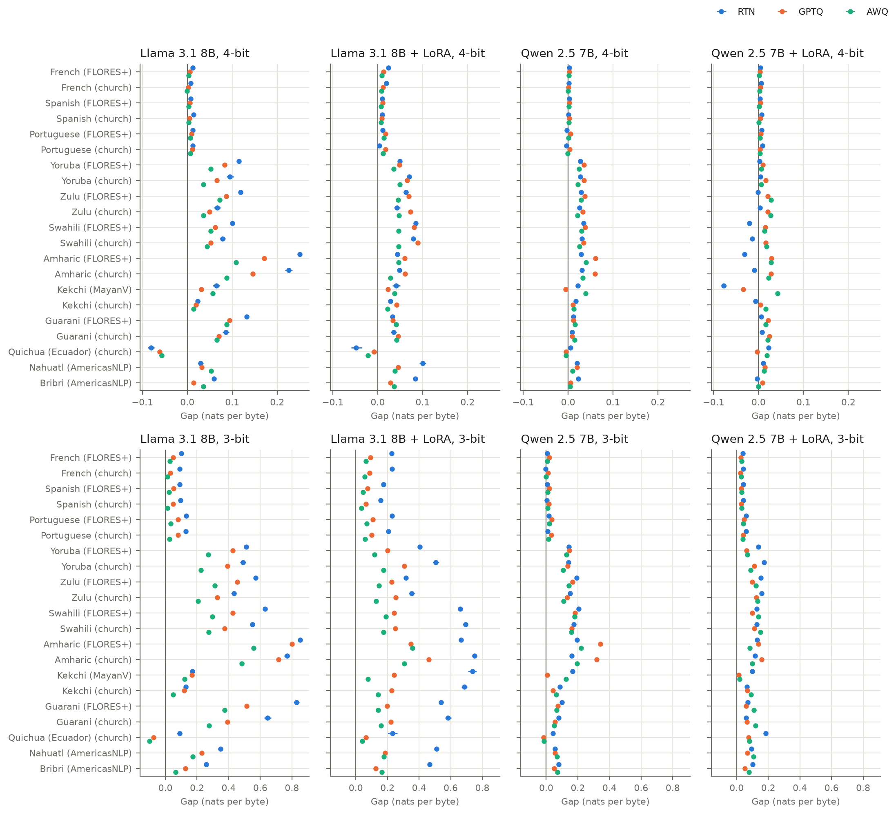

**How to read.** The gap measures how much more quantization hurts a language than English. For each sentence, damage is how much less likely the quantized model finds the reference text than the full-precision model does (nats per byte). The gap is the damage on the language's text minus the damage on its English translation, so a positive gap means the language loses more than English on the same content. One row per language and test set. Each dot is one method (blue RTN, orange GPTQ, green AWQ) and the horizontal line through it is its 95% bootstrap interval. The vertical line is zero. Columns are the four models, the top row is 4 bits and the bottom row 3 bits. The two rows have different x scales.

### Figure 2. Likelihood gap, every configuration at once

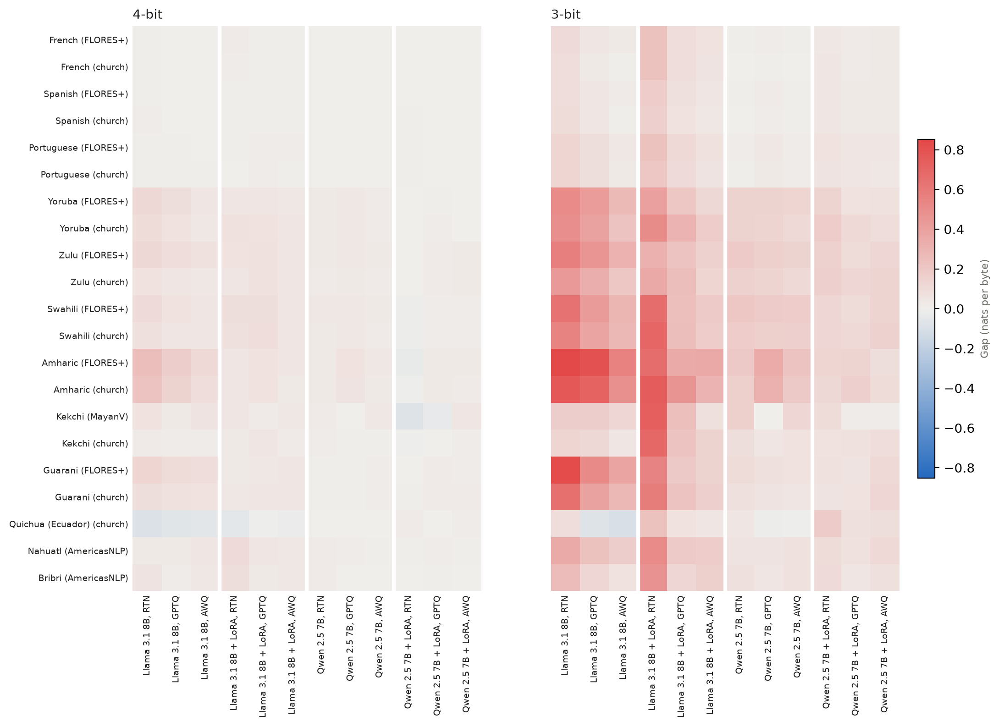

**How to read.** The same gap as the figure above, as colours instead of dots. Rows are languages and test sets, columns are model and method, and white lines separate the four models. Left panel 4 bits, right panel 3 bits. Red means the language loses more than its English side, blue means it loses less, and near white means about the same. The colour bar gives the value, and both panels use the same scale. No intervals are shown here.

### Figure 3. From 4 to 3 bits

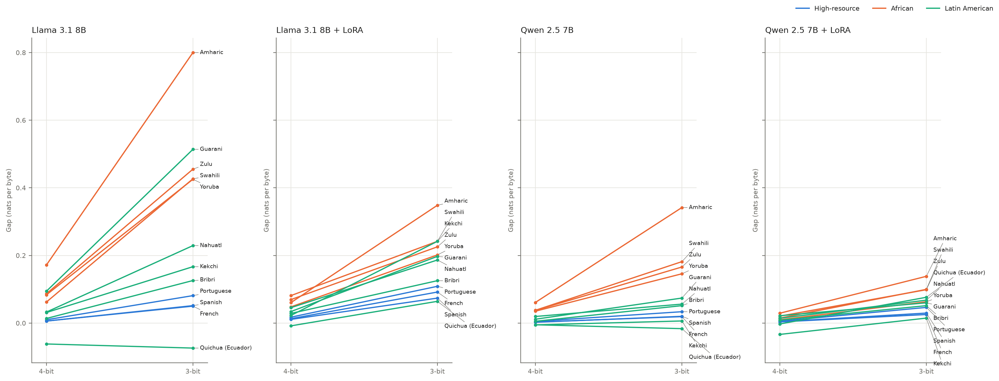

**How to read.** One panel per model. Each line is one language on its first test set (FLORES+ where there is one). The left end is the gap at 4 bits and the right end the gap at 3 bits, both under GPTQ. A steeper line means the language loses more when going from 4 to 3 bits. Colour is the language group (blue high-resource, orange African, green Latin American), and the name of each language is written at the right end of its line.

### Figure 4. Gap against full-precision fit

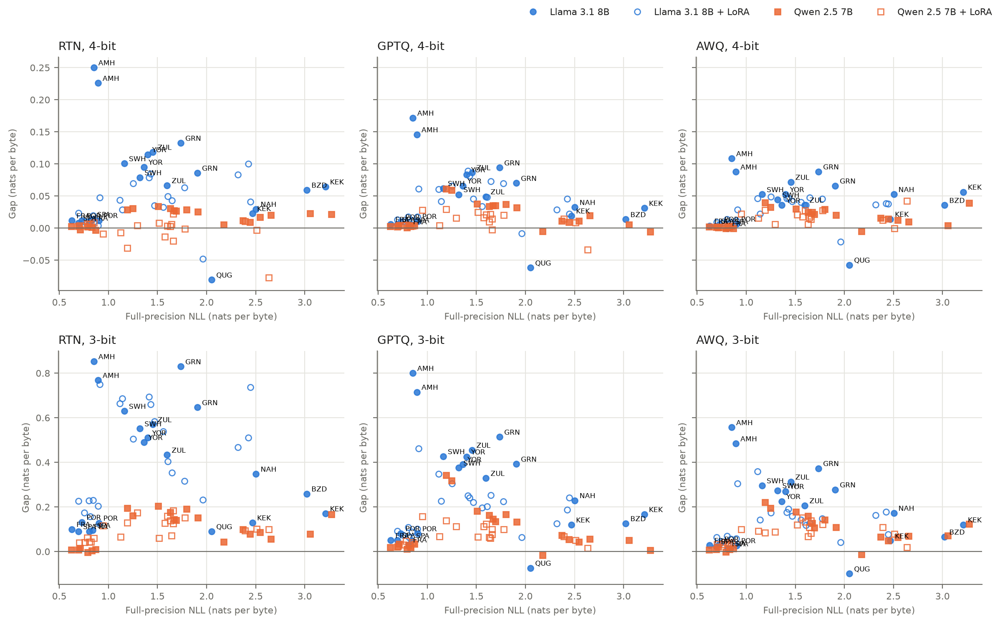

**How to read.** The x axis is the negative log-likelihood per byte of the full-precision model on the language's text. Higher means the model predicts the language worse, so it knows it less. The y axis is the gap. Each point is one model, language and test set. Blue circles are Llama, orange squares Qwen, and a hollow mark is the LoRA version. The three-letter codes label the points of base Llama. Columns are the methods, the top row is 4 bits and the bottom row 3 bits. The horizontal line is zero gap.

### Figure 5. Likelihood gap against translation drop

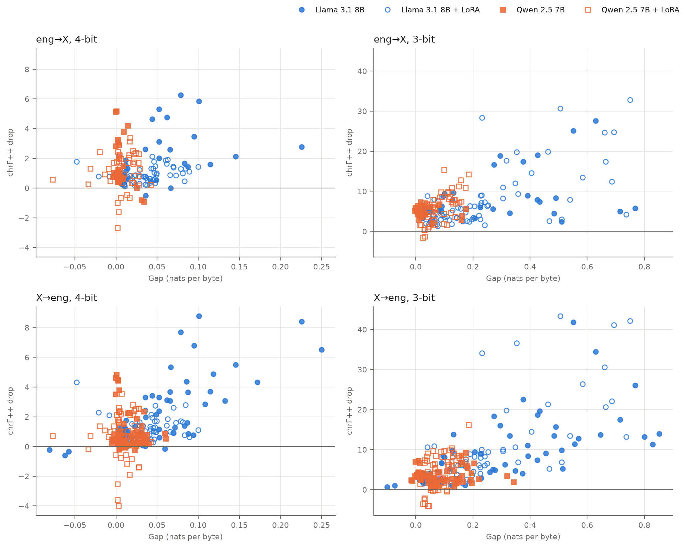

**How to read.** Compares the two ways of measuring damage. The x axis is the likelihood gap and the y axis the chrF++ drop (full-precision score minus quantized score). Each point is one model, method, language and test set, with the same markers as the figure above. Columns are 4 and 3 bits, the top row is English into the language and the bottom row the language into English. Points where the full-precision model scores no better than the floor (defined under the chrF++ drop figures) are left out.

### Figure 6. Gap before and after fine-tuning (Llama)

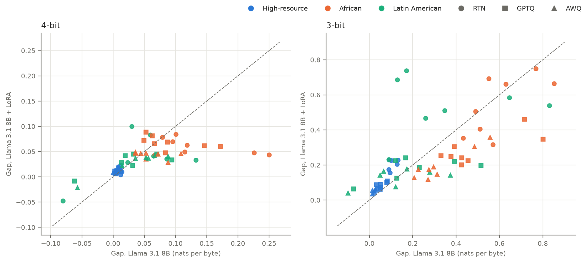

**How to read.** Each point is one language, test set and method. The x axis is its gap in base Llama 3.1 8B and the y axis its gap in the LoRA fine-tuned version. A point on the dashed diagonal has the same gap in both, below it the gap is smaller after fine-tuning, above it larger. Colour is the language group, shape the method (circle RTN, square GPTQ, triangle AWQ). Left panel 4 bits, right panel 3 bits.

### Figure 7. chrF++ drop, English into the language

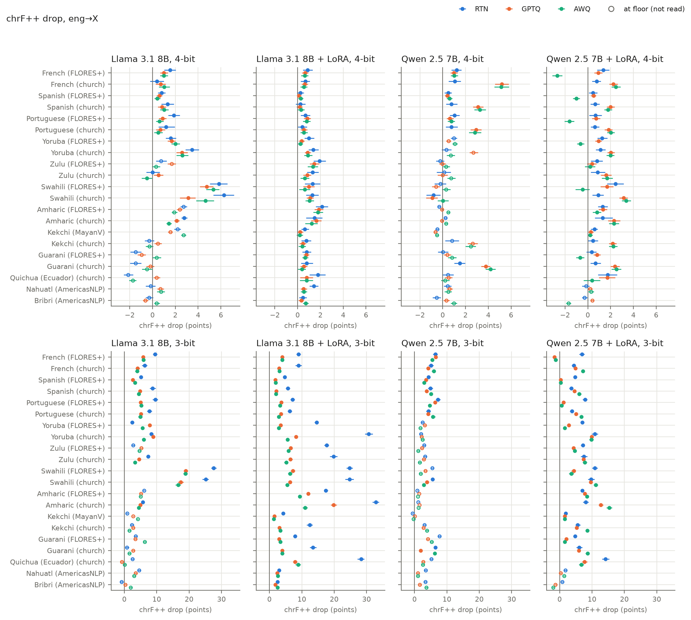

**How to read.** chrF++ scores a translation from 0 to 100 by how many character sequences (and word pairs) it shares with the reference translation. The drop is the full-precision score minus the quantized score, so a positive drop is points lost. One row per language and test set, a dot per method (blue RTN, orange GPTQ, green AWQ) with its 95% bootstrap interval. Columns are models, the top row 4 bits and the bottom row 3 bits, each row with its own x scale. A hollow dot is "at floor". The floor is the score of the reference sentences shuffled, which are in the right language but say the wrong thing. If the full-precision model does not score clearly above that, it does not translate, so its drop is not interpreted.

### Figure 8. chrF++ drop, language into English

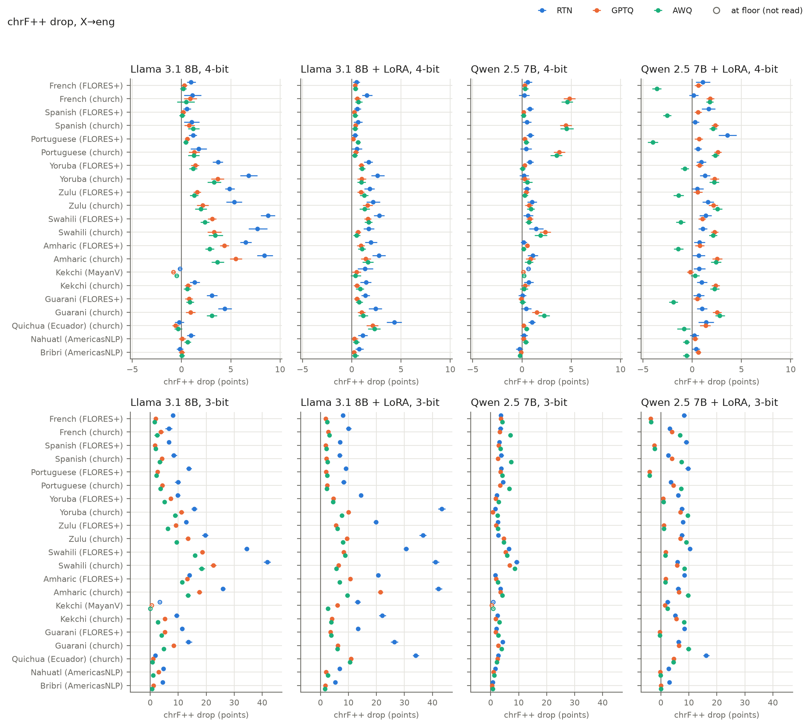

**How to read.** chrF++ drop for translation from the language into English. The drop is the full-precision chrF++ minus the quantized chrF++, in points. One row per language and test set, a dot per method (blue RTN, orange GPTQ, green AWQ) with its 95% bootstrap interval. Columns are models, the top row 4 bits and the bottom row 3 bits. A hollow dot is at the floor (the full-precision model scores no better than shuffled references), so its drop is not interpreted.

### Figure 9. AfriCOMET drop, English into the language

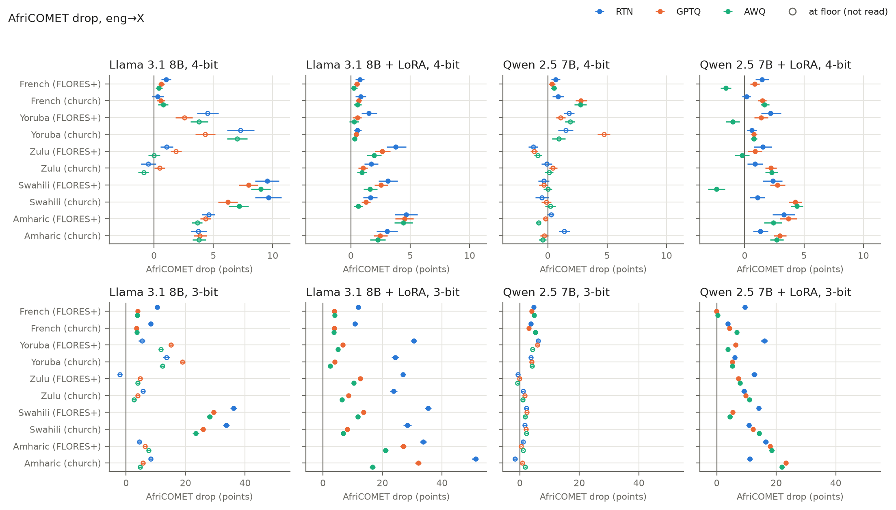

**How to read.** AfriCOMET is a learned metric: a neural model trained on human judgements of translation quality for African languages. It compares the output with the source and the reference and gives a score where higher is better. Only French and the four African languages are scored. The drop is the full-precision score minus the quantized score. One row per language and test set, a dot per method (blue RTN, orange GPTQ, green AWQ) with its 95% bootstrap interval. Columns are models, the top row 4 bits and the bottom row 3 bits. A hollow dot is at the floor, the AfriCOMET score of shuffled references, so its drop is not interpreted.

### Figure 10. AfriCOMET drop, language into English

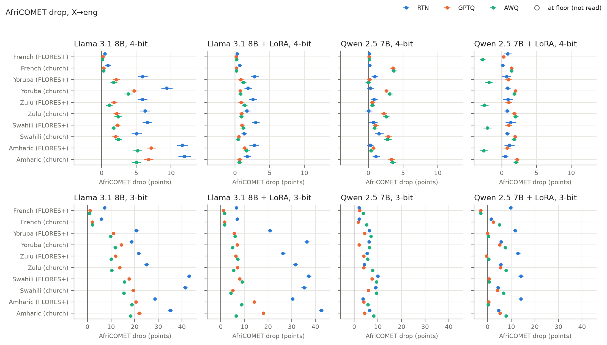

**How to read.** AfriCOMET drop for translation from the language into English, for French and the four African languages. The drop is the full-precision score minus the quantized score. One row per language and test set, a dot per method (blue RTN, orange GPTQ, green AWQ) with its 95% bootstrap interval. Columns are models, the top row 4 bits and the bottom row 3 bits. A hollow dot is at the floor, so its drop is not interpreted.

### Figure 11. chrF++ before and after, English into the language

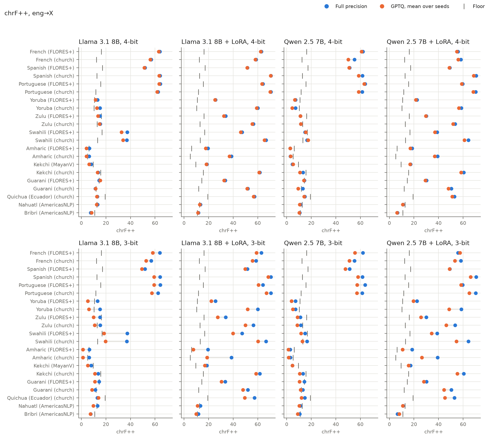

**How to read.** The scores behind the drop. One row per language and test set. The blue dot is the full-precision chrF++, the orange dot the GPTQ chrF++ (mean over the five calibration seeds), and the gray bar between them is the change. The gray tick is the floor, the score of shuffled references. A blue dot at or left of the tick means the full-precision model does not translate that language. Columns are models, the top row 4 bits and the bottom row 3 bits.

### Figure 12. chrF++ before and after, language into English

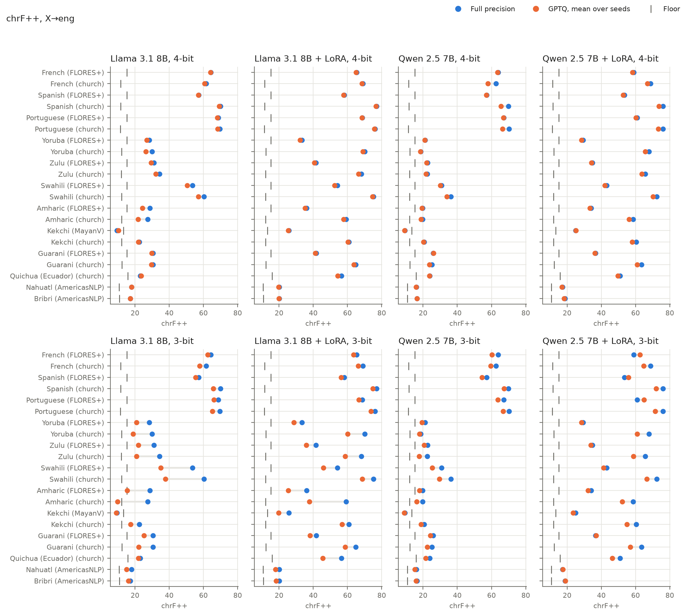

**How to read.** chrF++ for translation into English. Blue is full precision, orange GPTQ (mean over seeds), the gray bar the change between them, and the gray tick the floor (shuffled references). A blue dot at or left of the tick means the full-precision model does not translate. Columns are models, the top row 4 bits and the bottom row 3 bits.

### Figure 13. AfriCOMET before and after, English into the language

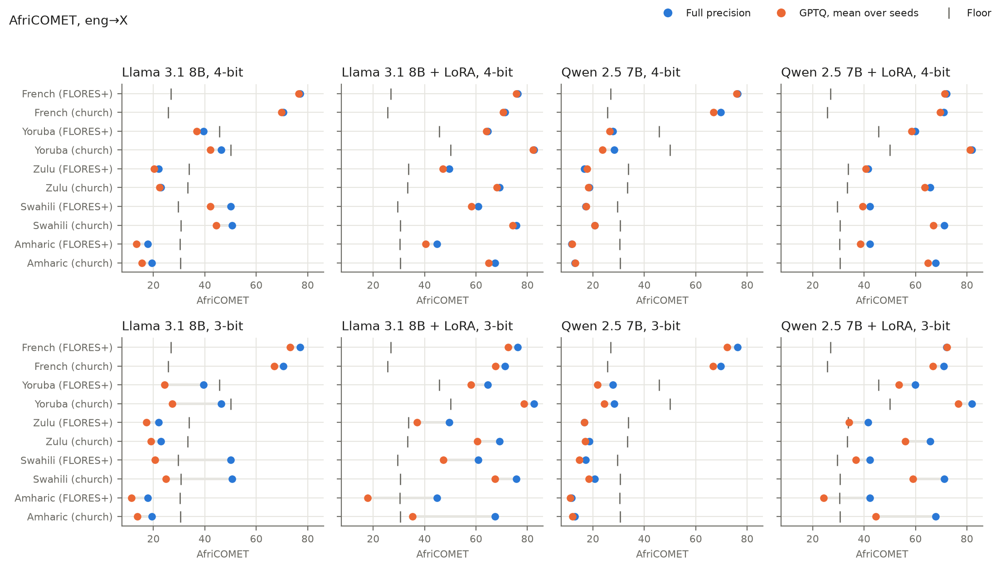

**How to read.** AfriCOMET for French and the four African languages, English into the language. Blue is full precision, orange GPTQ (mean over seeds), the gray bar the change, and the gray tick the floor (AfriCOMET of shuffled references). Columns are models, the top row 4 bits and the bottom row 3 bits.

### Figure 14. AfriCOMET before and after, language into English

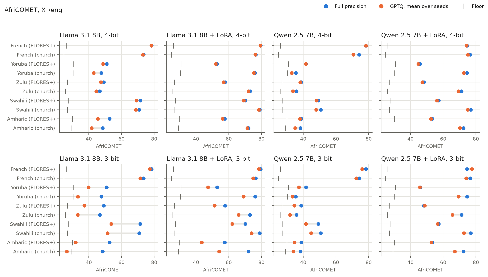

**How to read.** AfriCOMET for French and the four African languages, translated into English. Blue is full precision, orange GPTQ (mean over seeds), the gray bar the change, and the gray tick the floor. Columns are models, the top row 4 bits and the bottom row 3 bits.

### Figure 15. chrF++ drop, every configuration at once

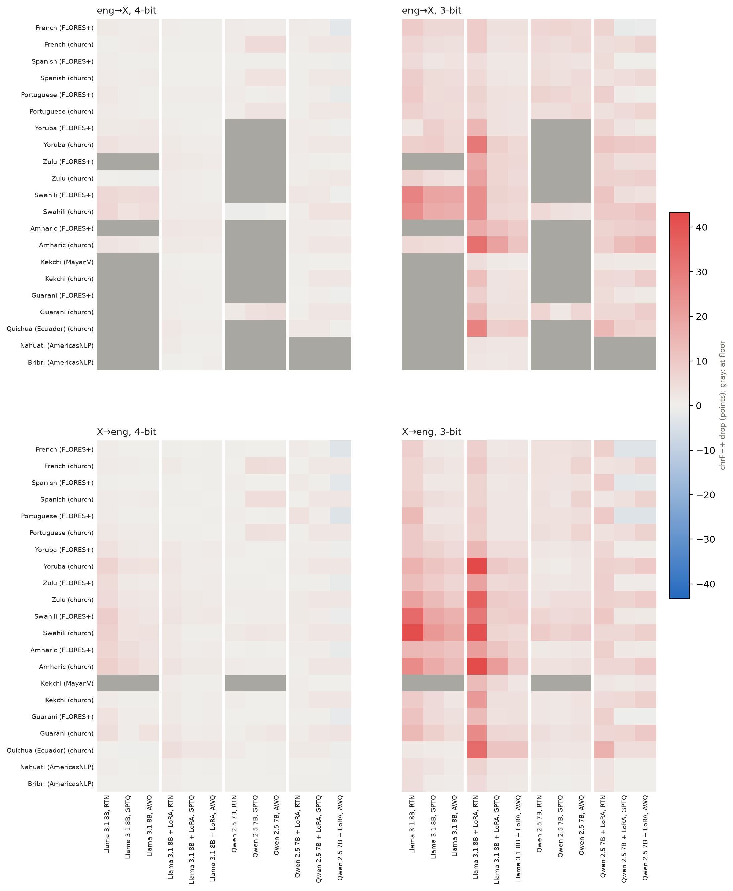

**How to read.** The chrF++ drops of the drop figures, as colours. Rows are languages and test sets, columns model and method, white lines separate the models. One panel per direction (top English into the language, bottom into English) and bit width (left 4, right 3). Red is chrF++ points lost, blue points gained, near white no change. Dark gray cells are at the floor, where the drop is not interpreted. All panels share one colour scale.

### Figure 16. Output in the wrong language

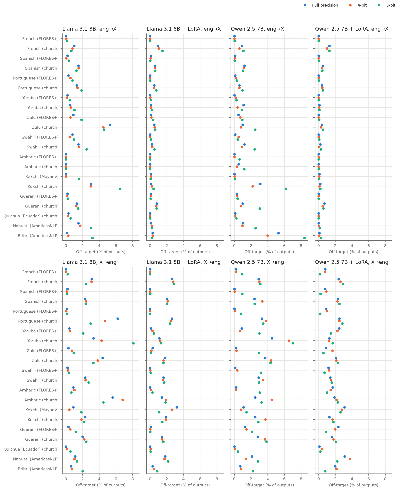

**How to read.** The share of translations written in the wrong language, detected with GlotLID, a language identifier. Translating into the language, an output counts as wrong if it is identified as English. Translating into English, it counts as wrong if it is not identified as English. One row per language and test set. Blue is full precision, orange 4 bits and green 3 bits, both GPTQ mean over seeds. No intervals. Columns are models, the top row English into the language and the bottom row into English.

<!-- /figures -->

## Llama-3.1-8B, rtn-4bit (1 seeds)

| Language | Test set | FP NLL/byte | Gap/byte [95% CI] | chrF++ eng→X | chrF++ X→eng | AfriCOMET eng→X | AfriCOMET X→eng |
|---|---|---|---|---|---|---|---|
| FRA | flores | 0.63 | 0.012 [0.010, 0.013] | 1.5 | 1.0 | 1.0 | 0.5 |
| SPA | flores | 0.69 | 0.008 [0.006, 0.010] | 0.8 | 0.6 | – | – |
| POR | flores | 0.73 | 0.012 [0.010, 0.014] | 1.9 | 1.2 | – | – |
| YOR | flores | 1.40 | 0.115 [0.111, 0.119] | 1.6 | 3.7 | floor | 5.9 |
| ZUL | flores | 1.45 | 0.118 [0.114, 0.122] | floor | 4.9 | floor | 5.9 |
| SWH | flores | 1.16 | 0.101 [0.097, 0.105] | 5.8 | 8.8 | 9.5 | 6.6 |
| AMH | flores | 0.85 | 0.250 [0.245, 0.254] | floor | 6.5 | floor | 11.6 |
| KEK | mayanv | 3.21 | 0.065 [0.057, 0.072] | floor | floor | – | – |
| GRN | flores | 1.74 | 0.133 [0.128, 0.138] | floor | 3.1 | – | – |
| NAH | americasnlp | 2.50 | 0.030 [0.024, 0.035] | floor | 1.0 | – | – |
| BZD | americasnlp | 3.02 | 0.059 [0.056, 0.063] | floor | (-0.2) | – | – |
| QUG | church | 2.05 | -0.081 [-0.088, -0.073] | floor | (-0.2) | – | – |
| FRA | church | 0.81 | 0.008 [0.004, 0.012] | (0.4) | 1.1 | (0.3) | 0.9 |
| SPA | church | 0.84 | 0.014 [0.009, 0.018] | 1.3 | 1.0 | – | – |
| POR | church | 0.90 | 0.012 [0.008, 0.016] | 1.2 | 1.7 | – | – |
| YOR | church | 1.36 | 0.095 [0.088, 0.103] | 3.5 | 6.8 | floor | 9.4 |
| ZUL | church | 1.60 | 0.066 [0.059, 0.074] | (0.0) | 5.3 | floor | 6.2 |
| SWH | church | 1.32 | 0.079 [0.073, 0.085] | 6.3 | 7.7 | 9.7 | 5.0 |
| AMH | church | 0.89 | 0.226 [0.218, 0.234] | 2.8 | 8.4 | floor | 11.9 |
| KEK | church | 2.47 | 0.023 [0.018, 0.028] | floor | 1.3 | – | – |
| GRN | church | 1.91 | 0.086 [0.078, 0.093] | floor | 4.4 | – | – |

## Llama-3.1-8B, gptq-4bit (5 seeds)

| Language | Test set | FP NLL/byte | Gap/byte [95% CI] | chrF++ eng→X | chrF++ X→eng | AfriCOMET eng→X | AfriCOMET X→eng |
|---|---|---|---|---|---|---|---|
| FRA | flores | 0.63 | 0.006 [0.005, 0.007] | 1.0 | 0.3 | 0.6 | 0.2 |
| SPA | flores | 0.69 | 0.006 [0.005, 0.007] | 0.6 | (0.2) | – | – |
| POR | flores | 0.73 | 0.010 [0.008, 0.011] | 0.9 | 0.6 | – | – |
| YOR | flores | 1.40 | 0.083 [0.081, 0.086] | 1.7 | 1.4 | floor | 2.1 |
| ZUL | flores | 1.45 | 0.087 [0.084, 0.089] | floor | 1.6 | floor | 1.8 |
| SWH | flores | 1.16 | 0.062 [0.060, 0.065] | 4.8 | 3.1 | 8.0 | 2.3 |
| AMH | flores | 0.85 | 0.172 [0.169, 0.174] | floor | 4.3 | floor | 7.1 |
| KEK | mayanv | 3.21 | 0.031 [0.026, 0.036] | floor | floor | – | – |
| GRN | flores | 1.74 | 0.094 [0.091, 0.097] | floor | 0.8 | – | – |
| NAH | americasnlp | 2.50 | 0.033 [0.029, 0.036] | floor | (0.1) | – | – |
| BZD | americasnlp | 3.02 | 0.014 [0.012, 0.016] | floor | (0.0) | – | – |
| QUG | church | 2.05 | -0.062 [-0.067, -0.057] | floor | (-0.6) | – | – |
| FRA | church | 0.81 | 0.003 [0.000, 0.005] | 0.7 | 0.9 | 0.6 | (0.3) |
| SPA | church | 0.84 | 0.005 [0.003, 0.007] | 0.8 | 0.8 | – | – |
| POR | church | 0.90 | 0.011 [0.009, 0.013] | 0.7 | 1.3 | – | – |
| YOR | church | 1.36 | 0.066 [0.061, 0.071] | 2.6 | 3.7 | floor | 4.7 |
| ZUL | church | 1.60 | 0.049 [0.044, 0.054] | 0.5 | 2.2 | floor | 2.2 |
| SWH | church | 1.32 | 0.052 [0.049, 0.056] | 3.1 | 3.3 | 6.2 | 2.0 |
| AMH | church | 0.89 | 0.146 [0.140, 0.151] | 2.1 | 5.5 | floor | 6.8 |
| KEK | church | 2.47 | 0.019 [0.016, 0.023] | floor | 0.7 | – | – |
| GRN | church | 1.91 | 0.070 [0.065, 0.075] | floor | 0.9 | – | – |

## Llama-3.1-8B, awq-4bit (5 seeds)

| Language | Test set | FP NLL/byte | Gap/byte [95% CI] | chrF++ eng→X | chrF++ X→eng | AfriCOMET eng→X | AfriCOMET X→eng |
|---|---|---|---|---|---|---|---|
| FRA | flores | 0.63 | 0.003 [0.002, 0.005] | 1.0 | (0.2) | 0.4 | (0.1) |
| SPA | flores | 0.69 | 0.003 [0.002, 0.005] | 0.4 | (0.1) | – | – |
| POR | flores | 0.73 | 0.006 [0.005, 0.008] | 0.6 | 0.4 | – | – |
| YOR | flores | 1.40 | 0.053 [0.050, 0.055] | 2.0 | 1.2 | floor | 1.7 |
| ZUL | flores | 1.45 | 0.072 [0.069, 0.074] | floor | 1.3 | floor | 1.1 |
| SWH | flores | 1.16 | 0.052 [0.050, 0.055] | 5.3 | 2.4 | 9.0 | 1.7 |
| AMH | flores | 0.85 | 0.108 [0.106, 0.111] | floor | 2.8 | floor | 5.2 |
| KEK | mayanv | 3.21 | 0.056 [0.051, 0.061] | floor | floor | – | – |
| GRN | flores | 1.74 | 0.088 [0.084, 0.091] | floor | 0.9 | – | – |
| NAH | americasnlp | 2.50 | 0.053 [0.049, 0.057] | floor | 0.6 | – | – |
| BZD | americasnlp | 3.02 | 0.036 [0.033, 0.038] | floor | (0.0) | – | – |
| QUG | church | 2.05 | -0.057 [-0.063, -0.052] | floor | (-0.3) | – | – |
| FRA | church | 0.81 | -0.000 [-0.003, 0.002] | 1.0 | (0.5) | 0.8 | (0.3) |
| SPA | church | 0.84 | 0.003 [0.000, 0.005] | 1.0 | 1.2 | – | – |
| POR | church | 0.90 | 0.007 [0.004, 0.009] | 0.5 | 1.2 | – | – |
| YOR | church | 1.36 | 0.036 [0.031, 0.041] | 2.6 | 3.3 | floor | 3.8 |
| ZUL | church | 1.60 | 0.036 [0.031, 0.041] | -0.5 | 2.0 | floor | 2.4 |
| SWH | church | 1.32 | 0.044 [0.040, 0.048] | 4.6 | 3.4 | 7.2 | 2.4 |
| AMH | church | 0.89 | 0.088 [0.083, 0.092] | 1.4 | 3.6 | floor | 5.0 |
| KEK | church | 2.47 | 0.014 [0.011, 0.018] | floor | 0.6 | – | – |
| GRN | church | 1.91 | 0.066 [0.061, 0.071] | floor | 3.1 | – | – |

## Llama-3.1-8B, rtn-3bit (1 seeds)

| Language | Test set | FP NLL/byte | Gap/byte [95% CI] | chrF++ eng→X | chrF++ X→eng | AfriCOMET eng→X | AfriCOMET X→eng |
|---|---|---|---|---|---|---|---|
| FRA | flores | 0.63 | 0.100 [0.094, 0.106] | 9.5 | 8.1 | 10.5 | 7.2 |
| SPA | flores | 0.69 | 0.090 [0.085, 0.095] | 5.1 | 6.7 | – | – |
| POR | flores | 0.73 | 0.132 [0.126, 0.138] | 9.6 | 13.8 | – | – |
| YOR | flores | 1.40 | 0.510 [0.501, 0.520] | 2.4 | 9.8 | floor | 20.7 |
| ZUL | flores | 1.45 | 0.570 [0.560, 0.579] | floor | 12.8 | floor | 21.7 |
| SWH | flores | 1.16 | 0.630 [0.619, 0.639] | 27.6 | 34.4 | 36.2 | 43.0 |
| AMH | flores | 0.85 | 0.852 [0.842, 0.861] | floor | 14.0 | floor | 28.6 |
| KEK | mayanv | 3.21 | 0.170 [0.156, 0.184] | floor | floor | – | – |
| GRN | flores | 1.74 | 0.830 [0.812, 0.848] | floor | 11.4 | – | – |
| NAH | americasnlp | 2.50 | 0.348 [0.333, 0.363] | floor | 4.7 | – | – |
| BZD | americasnlp | 3.02 | 0.259 [0.249, 0.268] | floor | 4.4 | – | – |
| QUG | church | 2.05 | 0.090 [0.076, 0.103] | floor | 1.8 | – | – |
| FRA | church | 0.81 | 0.091 [0.080, 0.102] | 6.3 | 6.6 | 8.2 | 5.9 |
| SPA | church | 0.84 | 0.096 [0.086, 0.105] | 8.7 | 8.4 | – | – |
| POR | church | 0.90 | 0.128 [0.118, 0.138] | 7.8 | 9.9 | – | – |
| YOR | church | 1.36 | 0.490 [0.472, 0.508] | 8.3 | 15.7 | floor | 18.7 |
| ZUL | church | 1.60 | 0.433 [0.417, 0.450] | 7.4 | 19.6 | floor | 25.1 |
| SWH | church | 1.32 | 0.551 [0.535, 0.567] | 25.1 | 41.8 | 33.6 | 41.4 |
| AMH | church | 0.89 | 0.768 [0.751, 0.786] | 5.7 | 26.0 | floor | 35.0 |
| KEK | church | 2.47 | 0.129 [0.117, 0.141] | floor | 9.5 | – | – |
| GRN | church | 1.91 | 0.646 [0.625, 0.668] | floor | 13.7 | – | – |

## Llama-3.1-8B, gptq-3bit (5 seeds)

| Language | Test set | FP NLL/byte | Gap/byte [95% CI] | chrF++ eng→X | chrF++ X→eng | AfriCOMET eng→X | AfriCOMET X→eng |
|---|---|---|---|---|---|---|---|
| FRA | flores | 0.63 | 0.050 [0.047, 0.053] | 5.8 | 1.9 | 3.9 | 1.1 |
| SPA | flores | 0.69 | 0.052 [0.048, 0.054] | 2.7 | 1.7 | – | – |
| POR | flores | 0.73 | 0.081 [0.078, 0.085] | 5.1 | 2.6 | – | – |
| YOR | flores | 1.40 | 0.425 [0.417, 0.433] | 7.9 | 7.4 | floor | 11.0 |
| ZUL | flores | 1.45 | 0.455 [0.449, 0.462] | floor | 9.1 | floor | 12.0 |
| SWH | flores | 1.16 | 0.427 [0.420, 0.433] | 19.0 | 18.6 | 29.5 | 17.6 |
| AMH | flores | 0.85 | 0.800 [0.792, 0.807] | floor | 13.2 | floor | 20.6 |
| KEK | mayanv | 3.21 | 0.167 [0.154, 0.178] | floor | floor | – | – |
| GRN | flores | 1.74 | 0.514 [0.504, 0.524] | floor | 5.2 | – | – |
| NAH | americasnlp | 2.50 | 0.229 [0.221, 0.238] | floor | 2.9 | – | – |
| BZD | americasnlp | 3.02 | 0.126 [0.120, 0.131] | floor | 1.1 | – | – |
| QUG | church | 2.05 | -0.074 [-0.086, -0.063] | floor | 1.0 | – | – |
| FRA | church | 0.81 | 0.031 [0.022, 0.039] | 4.1 | 3.8 | 3.5 | 2.0 |
| SPA | church | 0.84 | 0.049 [0.042, 0.056] | 4.8 | 4.1 | – | – |
| POR | church | 0.90 | 0.081 [0.074, 0.088] | 5.1 | 4.3 | – | – |
| YOR | church | 1.36 | 0.391 [0.376, 0.407] | 8.9 | 11.1 | floor | 14.3 |
| ZUL | church | 1.60 | 0.329 [0.315, 0.344] | 4.6 | 13.5 | floor | 13.6 |
| SWH | church | 1.32 | 0.375 [0.363, 0.387] | 17.4 | 22.5 | 25.8 | 19.4 |
| AMH | church | 0.89 | 0.715 [0.699, 0.731] | 4.9 | 17.5 | floor | 21.9 |
| KEK | church | 2.47 | 0.120 [0.110, 0.130] | floor | 5.2 | – | – |
| GRN | church | 1.91 | 0.393 [0.377, 0.407] | floor | 8.4 | – | – |

## Llama-3.1-8B, awq-3bit (5 seeds)

| Language | Test set | FP NLL/byte | Gap/byte [95% CI] | chrF++ eng→X | chrF++ X→eng | AfriCOMET eng→X | AfriCOMET X→eng |
|---|---|---|---|---|---|---|---|
| FRA | flores | 0.63 | 0.028 [0.025, 0.031] | 5.9 | 1.6 | 3.8 | 0.8 |
| SPA | flores | 0.69 | 0.024 [0.020, 0.027] | 3.2 | 1.9 | – | – |
| POR | flores | 0.73 | 0.034 [0.031, 0.037] | 5.2 | 2.2 | – | – |
| YOR | flores | 1.40 | 0.270 [0.263, 0.276] | 5.6 | 5.1 | floor | 9.9 |
| ZUL | flores | 1.45 | 0.312 [0.306, 0.319] | floor | 6.2 | floor | 10.0 |
| SWH | flores | 1.16 | 0.296 [0.290, 0.302] | 18.9 | 16.0 | 28.0 | 15.7 |
| AMH | flores | 0.85 | 0.556 [0.549, 0.563] | floor | 11.4 | floor | 18.8 |
| KEK | mayanv | 3.21 | 0.120 [0.109, 0.131] | floor | floor | – | – |
| GRN | flores | 1.74 | 0.373 [0.365, 0.382] | floor | 4.1 | – | – |
| NAH | americasnlp | 2.50 | 0.172 [0.165, 0.181] | floor | 1.1 | – | – |
| BZD | americasnlp | 3.02 | 0.066 [0.060, 0.071] | floor | 0.7 | – | – |
| QUG | church | 2.05 | -0.100 [-0.112, -0.088] | floor | 0.7 | – | – |
| FRA | church | 0.81 | 0.013 [0.006, 0.021] | 4.0 | 2.4 | 3.6 | 2.1 |
| SPA | church | 0.84 | 0.013 [0.008, 0.019] | 4.5 | 3.4 | – | – |
| POR | church | 0.90 | 0.027 [0.022, 0.033] | 4.9 | 3.7 | – | – |
| YOR | church | 1.36 | 0.225 [0.213, 0.238] | 6.0 | 9.0 | floor | 11.8 |
| ZUL | church | 1.60 | 0.206 [0.193, 0.220] | 3.3 | 9.4 | floor | 10.3 |
| SWH | church | 1.32 | 0.274 [0.263, 0.285] | 16.6 | 18.3 | 23.4 | 15.4 |
| AMH | church | 0.89 | 0.484 [0.470, 0.497] | 4.5 | 13.4 | floor | 18.2 |
| KEK | church | 2.47 | 0.048 [0.040, 0.057] | floor | 2.7 | – | – |
| GRN | church | 1.91 | 0.277 [0.264, 0.290] | floor | 4.9 | – | – |

## Qwen2.5-7B, rtn-4bit (1 seeds)

| Language | Test set | FP NLL/byte | Gap/byte [95% CI] | chrF++ eng→X | chrF++ X→eng | AfriCOMET eng→X | AfriCOMET X→eng |
|---|---|---|---|---|---|---|---|
| FRA | flores | 0.62 | 0.003 [0.001, 0.004] | 1.2 | 0.6 | 0.7 | (0.1) |
| SPA | flores | 0.69 | 0.003 [0.001, 0.004] | 0.5 | 0.8 | – | – |
| POR | flores | 0.71 | -0.003 [-0.004, -0.001] | 1.0 | 0.8 | – | – |
| YOR | flores | 1.67 | 0.028 [0.026, 0.030] | floor | 0.8 | floor | 0.9 |
| ZUL | flores | 1.80 | 0.029 [0.026, 0.031] | floor | 0.5 | floor | 0.8 |
| SWH | flores | 1.51 | 0.034 [0.032, 0.037] | floor | 0.6 | floor | 0.7 |
| AMH | flores | 1.19 | 0.029 [0.027, 0.030] | floor | (0.2) | floor | (0.3) |
| KEK | mayanv | 3.27 | 0.021 [0.016, 0.027] | floor | floor | – | – |
| GRN | flores | 2.37 | 0.012 [0.010, 0.014] | floor | (0.0) | – | – |
| NAH | americasnlp | 2.66 | 0.020 [0.016, 0.024] | floor | (0.2) | – | – |
| BZD | americasnlp | 3.05 | 0.023 [0.019, 0.026] | floor | (-0.3) | – | – |
| QUG | church | 2.17 | 0.005 [0.003, 0.008] | floor | 1.0 | – | – |
| FRA | church | 0.79 | 0.002 [-0.000, 0.004] | 1.1 | (0.2) | 0.9 | (0.2) |
| SPA | church | 0.83 | 0.001 [-0.001, 0.003] | 0.7 | 0.5 | – | – |
| POR | church | 0.87 | -0.003 [-0.005, -0.001] | 0.8 | (0.4) | – | – |
| YOR | church | 1.69 | 0.027 [0.024, 0.030] | floor | (0.2) | floor | (0.3) |
| ZUL | church | 1.91 | 0.026 [0.023, 0.029] | floor | 1.0 | floor | (0.0) |
| SWH | church | 1.63 | 0.031 [0.028, 0.034] | -0.8 | 1.4 | floor | 1.5 |
| AMH | church | 1.25 | 0.031 [0.029, 0.033] | floor | 1.1 | floor | 1.1 |
| KEK | church | 2.54 | 0.017 [0.015, 0.020] | floor | 0.7 | – | – |
| GRN | church | 2.44 | 0.009 [0.007, 0.011] | 1.5 | (0.4) | – | – |

## Qwen2.5-7B, gptq-4bit (5 seeds)

| Language | Test set | FP NLL/byte | Gap/byte [95% CI] | chrF++ eng→X | chrF++ X→eng | AfriCOMET eng→X | AfriCOMET X→eng |
|---|---|---|---|---|---|---|---|
| FRA | flores | 0.62 | 0.003 [0.002, 0.004] | 1.0 | 0.3 | 0.4 | (0.1) |
| SPA | flores | 0.69 | 0.002 [0.002, 0.003] | 0.4 | (0.2) | – | – |
| POR | flores | 0.71 | 0.005 [0.004, 0.006] | 0.6 | 0.3 | – | – |
| YOR | flores | 1.67 | 0.035 [0.034, 0.036] | floor | 0.3 | floor | (0.2) |
| ZUL | flores | 1.80 | 0.037 [0.036, 0.039] | floor | 0.4 | floor | 0.6 |
| SWH | flores | 1.51 | 0.038 [0.036, 0.039] | floor | 0.8 | floor | 1.0 |
| AMH | flores | 1.19 | 0.061 [0.060, 0.062] | floor | 0.5 | floor | 0.7 |
| KEK | mayanv | 3.27 | -0.005 [-0.009, -0.002] | floor | floor | – | – |
| GRN | flores | 2.37 | 0.011 [0.010, 0.013] | floor | (-0.1) | – | – |
| NAH | americasnlp | 2.66 | 0.019 [0.017, 0.022] | floor | (0.2) | – | – |
| BZD | americasnlp | 3.05 | 0.005 [0.004, 0.007] | floor | (-0.1) | – | – |
| QUG | church | 2.17 | -0.005 [-0.007, -0.003] | floor | (0.2) | – | – |
| FRA | church | 0.79 | 0.001 [-0.001, 0.002] | 5.2 | 4.8 | 2.8 | 3.5 |
| SPA | church | 0.83 | 0.003 [0.001, 0.004] | 3.1 | 4.4 | – | – |
| POR | church | 0.87 | 0.004 [0.003, 0.005] | 2.9 | 3.8 | – | – |
| YOR | church | 1.69 | 0.036 [0.034, 0.037] | floor | (0.3) | floor | 2.6 |
| ZUL | church | 1.91 | 0.032 [0.030, 0.034] | floor | 0.7 | floor | 2.2 |
| SWH | church | 1.63 | 0.034 [0.032, 0.036] | -0.9 | 2.4 | floor | 2.9 |
| AMH | church | 1.25 | 0.060 [0.058, 0.061] | floor | 0.9 | floor | 3.3 |
| KEK | church | 2.54 | 0.011 [0.010, 0.013] | floor | (0.3) | – | – |
| GRN | church | 2.44 | 0.009 [0.008, 0.011] | 3.8 | 1.5 | – | – |

## Qwen2.5-7B, awq-4bit (5 seeds)

| Language | Test set | FP NLL/byte | Gap/byte [95% CI] | chrF++ eng→X | chrF++ X→eng | AfriCOMET eng→X | AfriCOMET X→eng |
|---|---|---|---|---|---|---|---|
| FRA | flores | 0.62 | 0.002 [0.001, 0.003] | 1.0 | (0.3) | 0.5 | (0.1) |
| SPA | flores | 0.69 | 0.002 [0.001, 0.003] | 0.6 | (0.2) | – | – |
| POR | flores | 0.71 | 0.001 [-0.000, 0.002] | 0.8 | 0.4 | – | – |
| YOR | flores | 1.67 | 0.025 [0.023, 0.026] | floor | (0.1) | floor | (-0.0) |
| ZUL | flores | 1.80 | 0.029 [0.028, 0.031] | floor | (0.3) | floor | 0.6 |
| SWH | flores | 1.51 | 0.030 [0.028, 0.032] | floor | 0.7 | floor | 0.9 |
| AMH | flores | 1.19 | 0.040 [0.038, 0.041] | floor | (0.2) | floor | (0.4) |
| KEK | mayanv | 3.27 | 0.039 [0.035, 0.043] | floor | floor | – | – |
| GRN | flores | 2.37 | 0.016 [0.014, 0.017] | floor | (0.1) | – | – |
| NAH | americasnlp | 2.66 | 0.010 [0.007, 0.013] | floor | 0.4 | – | – |
| BZD | americasnlp | 3.05 | 0.004 [0.002, 0.006] | floor | (-0.2) | – | – |
| QUG | church | 2.17 | -0.005 [-0.007, -0.003] | floor | 0.5 | – | – |
| FRA | church | 0.79 | -0.000 [-0.002, 0.001] | 5.1 | 4.6 | 2.7 | 3.7 |
| SPA | church | 0.83 | 0.002 [0.001, 0.004] | 3.3 | 4.5 | – | – |
| POR | church | 0.87 | -0.001 [-0.002, 0.001] | 2.8 | 3.5 | – | – |
| YOR | church | 1.69 | 0.022 [0.019, 0.024] | floor | 0.5 | floor | 3.1 |
| ZUL | church | 1.91 | 0.021 [0.018, 0.023] | floor | 0.9 | floor | 2.5 |
| SWH | church | 1.63 | 0.025 [0.023, 0.027] | (0.0) | 1.9 | floor | 2.8 |
| AMH | church | 1.25 | 0.033 [0.031, 0.035] | floor | 0.7 | floor | 3.5 |
| KEK | church | 2.54 | 0.012 [0.010, 0.014] | floor | (0.2) | – | – |
| GRN | church | 2.44 | 0.014 [0.013, 0.016] | 4.2 | 2.2 | – | – |

## Qwen2.5-7B, rtn-3bit (1 seeds)

| Language | Test set | FP NLL/byte | Gap/byte [95% CI] | chrF++ eng→X | chrF++ X→eng | AfriCOMET eng→X | AfriCOMET X→eng |
|---|---|---|---|---|---|---|---|
| FRA | flores | 0.62 | 0.007 [0.004, 0.011] | 6.4 | 3.6 | 4.6 | 2.1 |
| SPA | flores | 0.69 | 0.007 [0.004, 0.010] | 4.3 | 3.1 | – | – |
| POR | flores | 0.71 | 0.016 [0.013, 0.019] | 7.3 | 3.7 | – | – |
| YOR | flores | 1.67 | 0.144 [0.139, 0.150] | floor | 2.1 | floor | 6.4 |
| ZUL | flores | 1.80 | 0.192 [0.186, 0.197] | floor | 2.5 | floor | 5.4 |
| SWH | flores | 1.51 | 0.204 [0.199, 0.210] | floor | 6.6 | floor | 10.0 |
| AMH | flores | 1.19 | 0.195 [0.190, 0.200] | floor | 1.6 | floor | 3.7 |
| KEK | mayanv | 3.27 | 0.166 [0.153, 0.178] | floor | floor | – | – |
| GRN | flores | 2.37 | 0.099 [0.094, 0.104] | floor | 2.1 | – | – |
| NAH | americasnlp | 2.66 | 0.056 [0.046, 0.065] | floor | 1.6 | – | – |
| BZD | americasnlp | 3.05 | 0.079 [0.072, 0.086] | floor | 0.7 | – | – |
| QUG | church | 2.17 | 0.043 [0.036, 0.049] | floor | 2.8 | – | – |
| FRA | church | 0.79 | -0.003 [-0.009, 0.002] | 5.1 | 3.5 | 3.7 | 2.1 |
| SPA | church | 0.83 | 0.004 [-0.002, 0.009] | 4.9 | 3.8 | – | – |
| POR | church | 0.87 | 0.009 [0.004, 0.014] | 4.3 | 4.4 | – | – |
| YOR | church | 1.69 | 0.141 [0.134, 0.148] | floor | 1.7 | floor | 6.2 |
| ZUL | church | 1.91 | 0.152 [0.143, 0.160] | floor | 2.7 | floor | 4.3 |
| SWH | church | 1.63 | 0.175 [0.167, 0.183] | 5.5 | 9.3 | floor | 9.1 |
| AMH | church | 1.25 | 0.162 [0.155, 0.168] | floor | 3.5 | floor | 6.4 |
| KEK | church | 2.54 | 0.085 [0.079, 0.091] | floor | 2.4 | – | – |
| GRN | church | 2.44 | 0.080 [0.072, 0.087] | 6.5 | 4.3 | – | – |

## Qwen2.5-7B, gptq-3bit (5 seeds)

| Language | Test set | FP NLL/byte | Gap/byte [95% CI] | chrF++ eng→X | chrF++ X→eng | AfriCOMET eng→X | AfriCOMET X→eng |
|---|---|---|---|---|---|---|---|
| FRA | flores | 0.62 | 0.019 [0.017, 0.021] | 6.6 | 3.6 | 4.0 | (2.3) |
| SPA | flores | 0.69 | 0.020 [0.018, 0.022] | 3.5 | (2.9) | – | – |
| POR | flores | 0.71 | 0.034 [0.031, 0.036] | 6.3 | (3.4) | – | – |
| YOR | flores | 1.67 | 0.146 [0.142, 0.149] | floor | 1.8 | floor | 4.4 |
| ZUL | flores | 1.80 | 0.166 [0.162, 0.169] | floor | 2.0 | floor | 4.1 |
| SWH | flores | 1.51 | 0.182 [0.178, 0.185] | floor | 5.4 | floor | 7.5 |
| AMH | flores | 1.19 | 0.342 [0.338, 0.345] | floor | 1.9 | floor | 4.1 |
| KEK | mayanv | 3.27 | 0.006 [-0.002, 0.013] | floor | floor | – | – |
| GRN | flores | 2.37 | 0.074 [0.071, 0.077] | floor | 1.7 | – | – |
| NAH | americasnlp | 2.66 | 0.056 [0.051, 0.061] | floor | 1.0 | – | – |
| BZD | americasnlp | 3.05 | 0.052 [0.048, 0.055] | floor | 0.5 | – | – |
| QUG | church | 2.17 | -0.016 [-0.021, -0.012] | floor | 2.4 | – | – |
| FRA | church | 0.79 | 0.011 [0.006, 0.015] | 4.2 | 3.2 | 3.0 | 1.7 |
| SPA | church | 0.83 | 0.017 [0.013, 0.021] | 3.7 | 2.6 | – | – |
| POR | church | 0.87 | 0.033 [0.030, 0.036] | 4.2 | 3.4 | – | – |
| YOR | church | 1.69 | 0.135 [0.129, 0.140] | floor | 0.7 | floor | 2.1 |
| ZUL | church | 1.91 | 0.134 [0.127, 0.139] | floor | 4.6 | floor | 4.0 |
| SWH | church | 1.63 | 0.162 [0.156, 0.168] | 3.9 | 6.8 | floor | 6.0 |
| AMH | church | 1.25 | 0.319 [0.312, 0.325] | floor | 3.5 | floor | 4.4 |
| KEK | church | 2.54 | 0.043 [0.038, 0.047] | floor | 1.8 | – | – |
| GRN | church | 2.44 | 0.055 [0.050, 0.060] | 1.9 | 2.7 | – | – |

## Qwen2.5-7B, awq-3bit (5 seeds)

| Language | Test set | FP NLL/byte | Gap/byte [95% CI] | chrF++ eng→X | chrF++ X→eng | AfriCOMET eng→X | AfriCOMET X→eng |
|---|---|---|---|---|---|---|---|
| FRA | flores | 0.62 | 0.007 [0.005, 0.010] | 5.4 | 4.2 | 4.7 | (3.8) |
| SPA | flores | 0.69 | 0.010 [0.007, 0.013] | 2.9 | 3.5 | – | – |
| POR | flores | 0.71 | 0.020 [0.017, 0.023] | 4.7 | 4.2 | – | – |
| YOR | flores | 1.67 | 0.127 [0.123, 0.131] | floor | 2.8 | floor | 7.1 |
| ZUL | flores | 1.80 | 0.143 [0.139, 0.147] | floor | 2.6 | floor | 5.7 |
| SWH | flores | 1.51 | 0.179 [0.174, 0.183] | floor | 5.9 | floor | 9.4 |
| AMH | flores | 1.19 | 0.220 [0.217, 0.224] | floor | 2.6 | floor | 5.8 |
| KEK | mayanv | 3.27 | 0.124 [0.114, 0.136] | floor | floor | – | – |
| GRN | flores | 2.37 | 0.065 [0.061, 0.069] | floor | 2.8 | – | – |
| NAH | americasnlp | 2.66 | 0.069 [0.061, 0.077] | floor | 1.3 | – | – |
| BZD | americasnlp | 3.05 | 0.071 [0.066, 0.076] | floor | 0.7 | – | – |
| QUG | church | 2.17 | -0.013 [-0.018, -0.008] | floor | 2.2 | – | – |
| FRA | church | 0.79 | -0.002 [-0.006, 0.003] | 5.9 | 7.0 | 5.2 | 5.2 |
| SPA | church | 0.83 | 0.009 [0.005, 0.014] | 5.1 | 7.3 | – | – |
| POR | church | 0.87 | 0.014 [0.010, 0.018] | 5.7 | 6.7 | – | – |
| YOR | church | 1.69 | 0.107 [0.100, 0.114] | floor | 2.5 | floor | 6.3 |
| ZUL | church | 1.91 | 0.109 [0.102, 0.116] | floor | 4.6 | floor | 7.7 |
| SWH | church | 1.63 | 0.159 [0.153, 0.165] | 2.9 | 8.6 | floor | 9.4 |
| AMH | church | 1.25 | 0.194 [0.189, 0.200] | floor | 4.2 | floor | 8.3 |
| KEK | church | 2.54 | 0.064 [0.058, 0.069] | floor | 3.1 | – | – |
| GRN | church | 2.44 | 0.050 [0.044, 0.056] | 6.2 | 3.9 | – | – |

## Llama-3.1-8B-lora, rtn-4bit (1 seeds)

| Language | Test set | FP NLL/byte | Gap/byte [95% CI] | chrF++ eng→X | chrF++ X→eng | AfriCOMET eng→X | AfriCOMET X→eng |
|---|---|---|---|---|---|---|---|
| FRA | flores | 0.70 | 0.024 [0.022, 0.026] | 0.9 | 0.5 | 0.7 | 0.3 |
| SPA | flores | 0.76 | 0.010 [0.008, 0.012] | (0.2) | 0.6 | – | – |
| POR | flores | 0.80 | 0.011 [0.009, 0.013] | 0.7 | (0.3) | – | – |
| YOR | flores | 1.61 | 0.050 [0.046, 0.053] | 1.0 | 1.7 | 1.5 | 2.8 |
| ZUL | flores | 1.77 | 0.063 [0.057, 0.068] | 1.9 | 1.8 | 3.8 | 2.6 |
| SWH | flores | 1.43 | 0.084 [0.080, 0.088] | 1.3 | 2.8 | 3.1 | 3.0 |
| AMH | flores | 1.12 | 0.044 [0.040, 0.047] | 2.1 | 2.0 | 4.6 | 2.8 |
| KEK | mayanv | 2.44 | 0.041 [0.033, 0.050] | 0.6 | 1.3 | – | – |
| GRN | flores | 1.56 | 0.033 [0.029, 0.037] | 0.8 | 1.4 | – | – |
| NAH | americasnlp | 2.42 | 0.100 [0.093, 0.107] | 1.4 | 1.1 | – | – |
| BZD | americasnlp | 2.32 | 0.083 [0.079, 0.088] | 0.5 | 0.8 | – | – |
| QUG | church | 1.96 | -0.048 [-0.059, -0.035] | 1.8 | 4.3 | – | – |
| FRA | church | 0.84 | 0.020 [0.017, 0.023] | 0.7 | 1.5 | 0.8 | 0.7 |
| SPA | church | 0.82 | 0.010 [0.007, 0.012] | (0.2) | 0.6 | – | – |
| POR | church | 0.90 | 0.004 [0.001, 0.007] | 0.4 | (0.5) | – | – |
| YOR | church | 1.25 | 0.070 [0.065, 0.075] | 1.4 | 2.6 | 0.5 | 1.9 |
| ZUL | church | 1.65 | 0.043 [0.036, 0.050] | 1.3 | 2.1 | 1.7 | 1.7 |
| SWH | church | 1.41 | 0.079 [0.073, 0.085] | 1.3 | 1.7 | 1.6 | 1.3 |
| AMH | church | 0.91 | 0.048 [0.044, 0.052] | 1.5 | 2.8 | 3.1 | 1.8 |
| KEK | church | 1.14 | 0.029 [0.024, 0.033] | 0.8 | 1.4 | – | – |
| GRN | church | 1.47 | 0.036 [0.030, 0.042] | 0.8 | 2.4 | – | – |

## Llama-3.1-8B-lora, gptq-4bit (5 seeds)

| Language | Test set | FP NLL/byte | Gap/byte [95% CI] | chrF++ eng→X | chrF++ X→eng | AfriCOMET eng→X | AfriCOMET X→eng |
|---|---|---|---|---|---|---|---|
| FRA | flores | 0.70 | 0.013 [0.012, 0.014] | 0.7 | 0.3 | 0.5 | 0.2 |
| SPA | flores | 0.76 | 0.011 [0.010, 0.012] | (0.1) | 0.3 | – | – |
| POR | flores | 0.80 | 0.017 [0.016, 0.019] | 0.8 | (0.2) | – | – |
| YOR | flores | 1.61 | 0.048 [0.046, 0.050] | 0.4 | 1.0 | 0.5 | 0.8 |
| ZUL | flores | 1.77 | 0.069 [0.066, 0.073] | 1.5 | 0.9 | 2.6 | 0.9 |
| SWH | flores | 1.43 | 0.081 [0.079, 0.084] | 1.0 | 1.6 | 2.5 | 1.0 |
| AMH | flores | 1.12 | 0.060 [0.058, 0.062] | 1.9 | 0.9 | 4.5 | 1.4 |
| KEK | mayanv | 2.44 | 0.023 [0.018, 0.027] | (0.2) | 0.5 | – | – |
| GRN | flores | 1.56 | 0.034 [0.032, 0.036] | 0.8 | 0.5 | – | – |
| NAH | americasnlp | 2.42 | 0.045 [0.042, 0.049] | (0.5) | (0.3) | – | – |
| BZD | americasnlp | 2.32 | 0.029 [0.026, 0.031] | 0.3 | (0.2) | – | – |
| QUG | church | 1.96 | -0.008 [-0.015, -0.001] | 0.8 | 2.1 | – | – |
| FRA | church | 0.84 | 0.012 [0.010, 0.013] | 0.6 | 0.6 | 0.6 | 0.2 |
| SPA | church | 0.82 | 0.009 [0.008, 0.010] | (0.2) | 0.4 | – | – |
| POR | church | 0.90 | 0.017 [0.016, 0.019] | 0.5 | 0.4 | – | – |
| YOR | church | 1.25 | 0.066 [0.063, 0.069] | 0.9 | 1.0 | 0.5 | 0.7 |
| ZUL | church | 1.65 | 0.073 [0.068, 0.077] | 0.9 | 1.6 | 1.0 | 0.9 |
| SWH | church | 1.41 | 0.089 [0.086, 0.093] | 1.1 | 0.6 | 1.3 | 0.5 |
| AMH | church | 0.91 | 0.061 [0.059, 0.064] | 1.6 | 1.4 | 2.5 | 0.7 |
| KEK | church | 1.14 | 0.042 [0.039, 0.044] | 0.5 | 0.5 | – | – |
| GRN | church | 1.47 | 0.046 [0.042, 0.049] | 0.5 | 1.0 | – | – |

## Llama-3.1-8B-lora, awq-4bit (5 seeds)

| Language | Test set | FP NLL/byte | Gap/byte [95% CI] | chrF++ eng→X | chrF++ X→eng | AfriCOMET eng→X | AfriCOMET X→eng |
|---|---|---|---|---|---|---|---|
| FRA | flores | 0.70 | 0.009 [0.008, 0.010] | 0.6 | 0.4 | (0.3) | 0.2 |
| SPA | flores | 0.76 | 0.008 [0.007, 0.009] | 0.3 | 0.4 | – | – |
| POR | flores | 0.80 | 0.014 [0.012, 0.015] | 0.8 | 0.6 | – | – |
| YOR | flores | 1.61 | 0.036 [0.034, 0.038] | 0.2 | 1.0 | (0.3) | 1.2 |
| ZUL | flores | 1.77 | 0.045 [0.042, 0.049] | 1.3 | 1.3 | 1.9 | 1.4 |
| SWH | flores | 1.43 | 0.047 [0.044, 0.049] | 0.6 | 1.7 | 1.6 | 1.2 |
| AMH | flores | 1.12 | 0.046 [0.044, 0.049] | 1.8 | 1.0 | 4.4 | 1.7 |
| KEK | mayanv | 2.44 | 0.038 [0.033, 0.042] | (0.2) | (0.4) | – | – |
| GRN | flores | 1.56 | 0.041 [0.038, 0.044] | 0.7 | 0.8 | – | – |
| NAH | americasnlp | 2.42 | 0.039 [0.035, 0.042] | 0.5 | 0.4 | – | – |
| BZD | americasnlp | 2.32 | 0.037 [0.034, 0.039] | 0.7 | 0.3 | – | – |
| QUG | church | 1.96 | -0.021 [-0.028, -0.015] | 0.8 | 2.3 | – | – |
| FRA | church | 0.84 | 0.009 [0.007, 0.010] | 0.5 | 0.7 | 0.5 | 0.2 |
| SPA | church | 0.82 | 0.007 [0.006, 0.008] | (0.3) | 0.3 | – | – |
| POR | church | 0.90 | 0.012 [0.010, 0.014] | 0.6 | (0.3) | – | – |
| YOR | church | 1.25 | 0.049 [0.046, 0.052] | 0.9 | 1.0 | 0.3 | 0.8 |
| ZUL | church | 1.65 | 0.047 [0.044, 0.051] | 0.6 | 1.3 | 0.9 | 0.9 |
| SWH | church | 1.41 | 0.046 [0.043, 0.050] | 1.1 | 0.5 | 0.6 | 0.4 |
| AMH | church | 0.91 | 0.029 [0.026, 0.031] | 1.2 | 1.6 | 2.3 | 0.6 |
| KEK | church | 1.14 | 0.022 [0.019, 0.025] | 0.4 | 0.8 | – | – |
| GRN | church | 1.47 | 0.042 [0.038, 0.046] | 0.4 | 1.2 | – | – |

## Llama-3.1-8B-lora, rtn-3bit (1 seeds)

| Language | Test set | FP NLL/byte | Gap/byte [95% CI] | chrF++ eng→X | chrF++ X→eng | AfriCOMET eng→X | AfriCOMET X→eng |
|---|---|---|---|---|---|---|---|
| FRA | flores | 0.70 | 0.227 [0.220, 0.233] | 8.9 | 8.0 | 11.8 | 6.5 |
| SPA | flores | 0.76 | 0.174 [0.168, 0.181] | 4.7 | 6.9 | – | – |
| POR | flores | 0.80 | 0.229 [0.222, 0.236] | 7.1 | 9.0 | – | – |
| YOR | flores | 1.61 | 0.405 [0.394, 0.417] | 14.6 | 14.5 | 30.5 | 20.8 |
| ZUL | flores | 1.77 | 0.317 [0.304, 0.330] | 17.7 | 19.8 | 26.9 | 26.3 |
| SWH | flores | 1.43 | 0.661 [0.648, 0.674] | 24.7 | 30.6 | 35.4 | 37.3 |
| AMH | flores | 1.12 | 0.664 [0.652, 0.676] | 17.4 | 20.7 | 33.7 | 30.4 |
| KEK | mayanv | 2.44 | 0.737 [0.709, 0.764] | 4.3 | 13.2 | – | – |
| GRN | flores | 1.56 | 0.539 [0.527, 0.552] | 7.9 | 13.5 | – | – |
| NAH | americasnlp | 2.42 | 0.511 [0.494, 0.526] | 3.0 | 6.9 | – | – |
| BZD | americasnlp | 2.32 | 0.467 [0.455, 0.480] | 2.5 | 5.3 | – | – |
| QUG | church | 1.96 | 0.231 [0.202, 0.263] | 28.3 | 34.1 | – | – |
| FRA | church | 0.84 | 0.230 [0.220, 0.241] | 9.0 | 10.0 | 10.8 | 6.9 |
| SPA | church | 0.82 | 0.157 [0.149, 0.165] | 5.7 | 6.8 | – | – |
| POR | church | 0.90 | 0.205 [0.195, 0.214] | 6.2 | 8.2 | – | – |
| YOR | church | 1.25 | 0.506 [0.487, 0.526] | 30.7 | 43.3 | 24.2 | 36.4 |
| ZUL | church | 1.65 | 0.354 [0.334, 0.374] | 19.8 | 36.6 | 23.7 | 31.6 |
| SWH | church | 1.41 | 0.693 [0.676, 0.711] | 24.8 | 41.1 | 28.4 | 35.2 |
| AMH | church | 0.91 | 0.750 [0.735, 0.766] | 32.8 | 42.2 | 51.3 | 42.5 |
| KEK | church | 1.14 | 0.686 [0.668, 0.704] | 12.5 | 22.1 | – | – |
| GRN | church | 1.47 | 0.584 [0.565, 0.603] | 13.4 | 26.4 | – | – |

## Llama-3.1-8B-lora, gptq-3bit (5 seeds)

| Language | Test set | FP NLL/byte | Gap/byte [95% CI] | chrF++ eng→X | chrF++ X→eng | AfriCOMET eng→X | AfriCOMET X→eng |
|---|---|---|---|---|---|---|---|
| FRA | flores | 0.70 | 0.092 [0.089, 0.095] | 3.9 | 1.8 | 3.8 | 1.1 |
| SPA | flores | 0.76 | 0.074 [0.071, 0.077] | 1.8 | 1.8 | – | – |
| POR | flores | 0.80 | 0.109 [0.105, 0.112] | 3.7 | 2.0 | – | – |
| YOR | flores | 1.61 | 0.202 [0.196, 0.208] | 3.4 | 4.6 | 6.6 | 5.6 |
| ZUL | flores | 1.77 | 0.225 [0.218, 0.233] | 6.5 | 5.6 | 12.6 | 6.3 |
| SWH | flores | 1.43 | 0.242 [0.236, 0.248] | 7.3 | 8.3 | 13.6 | 8.0 |
| AMH | flores | 1.12 | 0.348 [0.341, 0.356] | 12.0 | 10.7 | 26.9 | 14.2 |
| KEK | mayanv | 2.44 | 0.242 [0.228, 0.256] | 1.5 | 6.1 | – | – |
| GRN | flores | 1.56 | 0.197 [0.191, 0.204] | 3.0 | 3.6 | – | – |
| NAH | americasnlp | 2.42 | 0.187 [0.179, 0.194] | 2.4 | 2.0 | – | – |
| BZD | americasnlp | 2.32 | 0.125 [0.120, 0.131] | 1.8 | 1.8 | – | – |
| QUG | church | 1.96 | 0.064 [0.048, 0.083] | 7.9 | 10.9 | – | – |
| FRA | church | 0.84 | 0.087 [0.083, 0.092] | 3.0 | 2.8 | 3.7 | 1.6 |
| SPA | church | 0.82 | 0.063 [0.060, 0.067] | 2.1 | 2.1 | – | – |
| POR | church | 0.90 | 0.100 [0.095, 0.105] | 3.6 | 2.4 | – | – |
| YOR | church | 1.25 | 0.306 [0.294, 0.317] | 8.3 | 10.0 | 4.0 | 7.0 |
| ZUL | church | 1.65 | 0.253 [0.242, 0.264] | 6.5 | 9.4 | 8.6 | 7.0 |
| SWH | church | 1.41 | 0.250 [0.242, 0.259] | 6.4 | 6.5 | 8.2 | 5.0 |
| AMH | church | 0.91 | 0.462 [0.453, 0.472] | 19.9 | 21.4 | 32.0 | 18.0 |
| KEK | church | 1.14 | 0.226 [0.217, 0.233] | 3.0 | 4.0 | – | – |
| GRN | church | 1.47 | 0.221 [0.212, 0.231] | 4.0 | 6.2 | – | – |

## Llama-3.1-8B-lora, awq-3bit (5 seeds)

| Language | Test set | FP NLL/byte | Gap/byte [95% CI] | chrF++ eng→X | chrF++ X→eng | AfriCOMET eng→X | AfriCOMET X→eng |
|---|---|---|---|---|---|---|---|
| FRA | flores | 0.70 | 0.063 [0.061, 0.066] | 3.9 | 2.4 | 4.0 | 1.5 |
| SPA | flores | 0.76 | 0.046 [0.043, 0.049] | 1.9 | 2.2 | – | – |
| POR | flores | 0.80 | 0.069 [0.066, 0.073] | 3.3 | 2.3 | – | – |
| YOR | flores | 1.61 | 0.118 [0.112, 0.123] | 2.8 | 4.5 | 5.0 | 6.0 |
| ZUL | flores | 1.77 | 0.147 [0.140, 0.154] | 5.9 | 6.1 | 10.3 | 7.2 |
| SWH | flores | 1.43 | 0.190 [0.184, 0.195] | 6.3 | 8.9 | 11.7 | 9.1 |
| AMH | flores | 1.12 | 0.358 [0.351, 0.364] | 9.4 | 6.8 | 21.0 | 8.8 |
| KEK | mayanv | 2.44 | 0.076 [0.066, 0.086] | 1.3 | 2.7 | – | – |
| GRN | flores | 1.56 | 0.142 [0.136, 0.149] | 3.4 | 3.8 | – | – |
| NAH | americasnlp | 2.42 | 0.178 [0.170, 0.186] | 2.6 | 2.6 | – | – |
| BZD | americasnlp | 2.32 | 0.164 [0.158, 0.170] | 2.5 | 1.6 | – | – |
| QUG | church | 1.96 | 0.041 [0.027, 0.055] | 8.9 | 10.6 | – | – |
| FRA | church | 0.84 | 0.056 [0.052, 0.060] | 3.1 | 3.1 | 3.6 | 1.6 |
| SPA | church | 0.82 | 0.035 [0.031, 0.039] | 2.0 | 2.5 | – | – |
| POR | church | 0.90 | 0.058 [0.054, 0.063] | 2.9 | 2.3 | – | – |
| YOR | church | 1.25 | 0.175 [0.168, 0.181] | 5.6 | 7.6 | 2.5 | 5.0 |
| ZUL | church | 1.65 | 0.128 [0.118, 0.138] | 5.2 | 8.1 | 6.4 | 5.4 |
| SWH | church | 1.41 | 0.175 [0.167, 0.183] | 5.5 | 5.6 | 6.8 | 4.2 |
| AMH | church | 0.91 | 0.305 [0.297, 0.314] | 11.0 | 9.6 | 16.6 | 6.5 |
| KEK | church | 1.14 | 0.142 [0.136, 0.149] | 3.4 | 3.9 | – | – |
| GRN | church | 1.47 | 0.159 [0.151, 0.169] | 4.0 | 6.1 | – | – |

## Qwen2.5-7B-lora, rtn-4bit (1 seeds)

| Language | Test set | FP NLL/byte | Gap/byte [95% CI] | chrF++ eng→X | chrF++ X→eng | AfriCOMET eng→X | AfriCOMET X→eng |
|---|---|---|---|---|---|---|---|
| FRA | flores | 0.70 | 0.004 [0.003, 0.006] | 1.4 | 1.1 | 1.5 | 0.8 |
| SPA | flores | 0.76 | 0.003 [0.002, 0.005] | 0.5 | 1.7 | – | – |
| POR | flores | 0.78 | 0.007 [0.005, 0.008] | 0.7 | 3.6 | – | – |
| YOR | flores | 1.63 | 0.003 [0.001, 0.005] | 1.3 | 0.9 | 2.2 | 0.7 |
| ZUL | flores | 1.78 | -0.001 [-0.004, 0.001] | 0.8 | (0.5) | 1.5 | 0.9 |
| SWH | flores | 1.66 | -0.020 [-0.023, -0.017] | 2.4 | 1.4 | 2.4 | 1.3 |
| AMH | flores | 1.19 | -0.031 [-0.035, -0.028] | 1.3 | 0.7 | 3.3 | 1.1 |
| KEK | mayanv | 2.64 | -0.077 [-0.083, -0.071] | 0.6 | 0.7 | – | – |
| GRN | flores | 1.64 | 0.006 [0.004, 0.009] | (0.3) | 0.7 | – | – |
| NAH | americasnlp | 2.39 | 0.011 [0.007, 0.014] | floor | (0.2) | – | – |
| BZD | americasnlp | 2.51 | -0.003 [-0.007, 0.001] | floor | (0.4) | – | – |
| QUG | church | 1.66 | 0.023 [0.018, 0.028] | 1.7 | 1.4 | – | – |
| FRA | church | 0.82 | 0.006 [0.004, 0.008] | 0.8 | (0.1) | (0.1) | (0.1) |
| SPA | church | 0.81 | 0.007 [0.005, 0.008] | 0.6 | (0.3) | – | – |
| POR | church | 0.85 | 0.009 [0.007, 0.010] | 0.6 | 0.6 | – | – |
| YOR | church | 1.30 | 0.004 [0.001, 0.007] | 1.1 | 1.3 | 0.6 | 0.8 |
| ZUL | church | 1.60 | 0.003 [0.000, 0.007] | 0.9 | 1.6 | 0.9 | 0.8 |
| SWH | church | 1.57 | -0.014 [-0.017, -0.010] | 0.9 | 1.1 | 1.1 | 0.8 |
| AMH | church | 0.95 | -0.009 [-0.012, -0.006] | 1.3 | 0.6 | 1.3 | 0.5 |
| KEK | church | 1.12 | -0.007 [-0.010, -0.005] | 0.5 | 1.0 | – | – |
| GRN | church | 1.52 | 0.008 [0.005, 0.012] | 0.7 | 1.0 | – | – |

## Qwen2.5-7B-lora, gptq-4bit (5 seeds)

| Language | Test set | FP NLL/byte | Gap/byte [95% CI] | chrF++ eng→X | chrF++ X→eng | AfriCOMET eng→X | AfriCOMET X→eng |
|---|---|---|---|---|---|---|---|
| FRA | flores | 0.70 | 0.003 [0.003, 0.004] | 0.9 | 0.6 | 0.8 | (0.3) |
| SPA | flores | 0.76 | 0.004 [0.003, 0.005] | 0.5 | 0.6 | – | – |
| POR | flores | 0.78 | 0.005 [0.005, 0.006] | 0.7 | 0.7 | – | – |
| YOR | flores | 1.63 | 0.010 [0.008, 0.011] | 0.9 | 0.7 | 1.4 | 1.0 |
| ZUL | flores | 1.78 | 0.021 [0.019, 0.022] | (0.4) | 0.6 | 0.9 | 1.0 |
| SWH | flores | 1.66 | 0.015 [0.013, 0.016] | 1.7 | 1.0 | 2.8 | 1.0 |
| AMH | flores | 1.19 | 0.029 [0.027, 0.031] | 1.3 | 0.8 | 3.7 | 0.8 |
| KEK | mayanv | 2.64 | -0.034 [-0.037, -0.031] | 0.3 | (-0.2) | – | – |
| GRN | flores | 1.64 | 0.022 [0.020, 0.023] | 0.8 | 0.5 | – | – |
| NAH | americasnlp | 2.39 | 0.014 [0.012, 0.016] | floor | (0.3) | – | – |
| BZD | americasnlp | 2.51 | 0.009 [0.007, 0.010] | floor | 0.6 | – | – |
| QUG | church | 1.66 | -0.003 [-0.005, 0.000] | 1.7 | 1.4 | – | – |
| FRA | church | 0.82 | 0.004 [0.003, 0.005] | 2.2 | (1.8) | (1.5) | (1.4) |
| SPA | church | 0.81 | 0.004 [0.003, 0.005] | 2.0 | (2.3) | – | – |
| POR | church | 0.85 | 0.004 [0.003, 0.005] | 1.8 | (2.6) | – | – |
| YOR | church | 1.30 | 0.016 [0.014, 0.017] | 2.0 | 2.3 | 0.8 | (2.0) |
| ZUL | church | 1.60 | 0.021 [0.019, 0.023] | 1.6 | 2.2 | 2.2 | (1.8) |
| SWH | church | 1.57 | 0.016 [0.014, 0.018] | (3.1) | 2.3 | (4.3) | 1.9 |
| AMH | church | 0.95 | 0.028 [0.026, 0.030] | 2.3 | (2.5) | 2.9 | (2.2) |
| KEK | church | 1.12 | 0.004 [0.003, 0.006] | 2.2 | (2.4) | – | – |
| GRN | church | 1.52 | 0.025 [0.022, 0.027] | 2.4 | (2.5) | – | – |

## Qwen2.5-7B-lora, awq-4bit (5 seeds)

| Language | Test set | FP NLL/byte | Gap/byte [95% CI] | chrF++ eng→X | chrF++ X→eng | AfriCOMET eng→X | AfriCOMET X→eng |
|---|---|---|---|---|---|---|---|
| FRA | flores | 0.70 | 0.002 [0.001, 0.003] | (-2.7) | -3.6 | (-1.6) | (-2.7) |
| SPA | flores | 0.76 | 0.002 [0.001, 0.003] | (-1.0) | (-2.5) | – | – |
| POR | flores | 0.78 | 0.003 [0.002, 0.004] | (-1.6) | -4.0 | – | – |
| YOR | flores | 1.63 | 0.006 [0.004, 0.008] | (-0.6) | (-0.7) | (-1.0) | (-1.9) |
| ZUL | flores | 1.78 | 0.028 [0.026, 0.030] | (0.2) | -1.4 | (-0.2) | (-2.5) |
| SWH | flores | 1.66 | 0.014 [0.012, 0.015] | (-0.5) | (-1.2) | (-2.4) | (-2.1) |
| AMH | flores | 1.19 | 0.028 [0.025, 0.031] | 0.8 | (-1.4) | 2.4 | (-2.6) |
| KEK | mayanv | 2.64 | 0.042 [0.038, 0.047] | (0.2) | (0.3) | – | – |
| GRN | flores | 1.64 | 0.016 [0.014, 0.018] | (-0.7) | (-1.9) | – | – |
| NAH | americasnlp | 2.39 | 0.012 [0.010, 0.015] | floor | (-0.6) | – | – |
| BZD | americasnlp | 2.51 | -0.001 [-0.003, 0.002] | floor | (-0.6) | – | – |
| QUG | church | 1.66 | 0.019 [0.015, 0.022] | (0.4) | (-0.8) | – | – |
| FRA | church | 0.82 | 0.002 [0.001, 0.003] | (2.5) | (1.8) | (1.7) | (1.4) |
| SPA | church | 0.81 | 0.001 [-0.000, 0.002] | (1.8) | (2.1) | – | – |
| POR | church | 0.85 | 0.003 [0.002, 0.005] | (2.0) | (2.3) | – | – |
| YOR | church | 1.30 | 0.006 [0.004, 0.008] | 2.0 | 2.2 | 0.8 | (1.8) |
| ZUL | church | 1.60 | 0.027 [0.025, 0.030] | 1.7 | 2.6 | 2.3 | (2.0) |
| SWH | church | 1.57 | 0.018 [0.015, 0.020] | 3.4 | (2.1) | (4.4) | (1.7) |
| AMH | church | 0.95 | 0.022 [0.019, 0.025] | 2.3 | 2.4 | 2.7 | 2.1 |
| KEK | church | 1.12 | 0.016 [0.014, 0.018] | (2.2) | 2.3 | – | – |
| GRN | church | 1.52 | 0.021 [0.018, 0.023] | 2.5 | 2.8 | – | – |

## Qwen2.5-7B-lora, rtn-3bit (1 seeds)

| Language | Test set | FP NLL/byte | Gap/byte [95% CI] | chrF++ eng→X | chrF++ X→eng | AfriCOMET eng→X | AfriCOMET X→eng |
|---|---|---|---|---|---|---|---|
| FRA | flores | 0.70 | 0.039 [0.035, 0.042] | 6.9 | 8.3 | 9.4 | 9.8 |
| SPA | flores | 0.76 | 0.041 [0.038, 0.044] | 4.8 | 9.1 | – | – |
| POR | flores | 0.78 | 0.061 [0.057, 0.065] | 7.9 | 9.7 | – | – |
| YOR | flores | 1.63 | 0.139 [0.133, 0.144] | 7.0 | 6.2 | 16.0 | 11.6 |
| ZUL | flores | 1.78 | 0.152 [0.146, 0.158] | 7.2 | 7.9 | 12.6 | 12.9 |
| SWH | flores | 1.66 | 0.126 [0.121, 0.132] | 10.9 | 10.4 | 14.2 | 14.1 |
| AMH | flores | 1.19 | 0.129 [0.123, 0.136] | 7.0 | 8.4 | 16.4 | 14.1 |
| KEK | mayanv | 2.64 | 0.099 [0.086, 0.111] | 1.9 | 2.4 | – | – |
| GRN | flores | 1.64 | 0.070 [0.065, 0.076] | 4.7 | 8.4 | – | – |
| NAH | americasnlp | 2.39 | 0.094 [0.087, 0.103] | floor | 2.8 | – | – |
| BZD | americasnlp | 2.51 | 0.102 [0.093, 0.109] | floor | 3.1 | – | – |
| QUG | church | 1.66 | 0.184 [0.174, 0.194] | 14.2 | 16.2 | – | – |
| FRA | church | 0.82 | 0.043 [0.039, 0.048] | 4.4 | 3.2 | 3.7 | 1.5 |
| SPA | church | 0.81 | 0.043 [0.038, 0.047] | 3.6 | 2.6 | – | – |
| POR | church | 0.85 | 0.060 [0.055, 0.065] | 3.8 | 3.6 | – | – |
| YOR | church | 1.30 | 0.174 [0.166, 0.181] | 10.9 | 7.5 | 6.1 | 5.7 |
| ZUL | church | 1.60 | 0.159 [0.151, 0.168] | 7.5 | 7.5 | 9.2 | 5.6 |
| SWH | church | 1.57 | 0.126 [0.119, 0.134] | 9.7 | 6.0 | 10.9 | 4.4 |
| AMH | church | 0.95 | 0.116 [0.110, 0.123] | 8.1 | 6.1 | 11.1 | 4.7 |
| KEK | church | 1.12 | 0.065 [0.059, 0.071] | 5.6 | 5.2 | – | – |
| GRN | church | 1.52 | 0.059 [0.051, 0.067] | 6.1 | 6.3 | – | – |

## Qwen2.5-7B-lora, gptq-3bit (5 seeds)

| Language | Test set | FP NLL/byte | Gap/byte [95% CI] | chrF++ eng→X | chrF++ X→eng | AfriCOMET eng→X | AfriCOMET X→eng |
|---|---|---|---|---|---|---|---|
| FRA | flores | 0.70 | 0.025 [0.024, 0.027] | (-1.6) | (-3.6) | (-0.1) | (-2.9) |
| SPA | flores | 0.76 | 0.030 [0.028, 0.031] | (0.3) | (-2.4) | – | – |
| POR | flores | 0.78 | 0.046 [0.044, 0.048] | (1.2) | -4.0 | – | – |
| YOR | flores | 1.63 | 0.063 [0.059, 0.066] | 2.9 | (0.8) | 6.4 | (0.0) |
| ZUL | flores | 1.78 | 0.099 [0.095, 0.102] | 4.3 | (1.0) | 7.3 | (-0.4) |
| SWH | flores | 1.66 | 0.100 [0.096, 0.103] | 4.4 | (1.7) | 5.4 | (0.6) |
| AMH | flores | 1.19 | 0.138 [0.134, 0.143] | 7.8 | (1.7) | 17.9 | (0.5) |
| KEK | mayanv | 2.64 | 0.015 [0.007, 0.022] | 1.5 | 1.4 | – | – |
| GRN | flores | 1.64 | 0.060 [0.057, 0.063] | 2.1 | (-0.4) | – | – |
| NAH | americasnlp | 2.39 | 0.068 [0.063, 0.072] | floor | (-0.2) | – | – |
| BZD | americasnlp | 2.51 | 0.052 [0.047, 0.056] | floor | (-0.0) | – | – |
| QUG | church | 1.66 | 0.076 [0.070, 0.083] | 7.7 | 4.6 | – | – |
| FRA | church | 0.82 | 0.024 [0.022, 0.027] | 4.9 | 3.9 | 4.3 | 2.5 |
| SPA | church | 0.81 | 0.029 [0.026, 0.031] | 4.5 | 4.0 | – | – |
| POR | church | 0.85 | 0.042 [0.039, 0.045] | 5.1 | 4.5 | – | – |
| YOR | church | 1.30 | 0.112 [0.107, 0.117] | 9.9 | 7.0 | 5.3 | 5.2 |
| ZUL | church | 1.60 | 0.124 [0.119, 0.129] | 7.4 | 7.0 | 9.7 | 5.5 |
| SWH | church | 1.57 | 0.113 [0.108, 0.118] | 9.6 | 5.8 | 12.2 | 4.1 |
| AMH | church | 0.95 | 0.157 [0.153, 0.162] | 12.7 | 6.4 | 23.2 | 5.2 |
| KEK | church | 1.12 | 0.068 [0.064, 0.072] | 5.3 | 5.5 | – | – |
| GRN | church | 1.52 | 0.066 [0.061, 0.070] | 5.9 | 6.4 | – | – |

## Qwen2.5-7B-lora, awq-3bit (5 seeds)

| Language | Test set | FP NLL/byte | Gap/byte [95% CI] | chrF++ eng→X | chrF++ X→eng | AfriCOMET eng→X | AfriCOMET X→eng |
|---|---|---|---|---|---|---|---|
| FRA | flores | 0.70 | 0.032 [0.029, 0.034] | (-1.3) | (-3.5) | (0.4) | -2.9 |
| SPA | flores | 0.76 | 0.031 [0.029, 0.034] | (0.4) | (-2.2) | – | – |
| POR | flores | 0.78 | 0.042 [0.039, 0.044] | (0.6) | -4.0 | – | – |
| YOR | flores | 1.63 | 0.067 [0.063, 0.071] | 1.6 | (0.9) | 3.7 | (0.3) |
| ZUL | flores | 1.78 | 0.123 [0.118, 0.127] | 4.6 | (1.0) | 7.8 | (0.5) |
| SWH | flores | 1.66 | 0.138 [0.133, 0.142] | 3.6 | (1.6) | 4.5 | (0.6) |
| AMH | flores | 1.19 | 0.084 [0.079, 0.090] | 8.5 | 1.6 | 18.5 | (0.3) |
| KEK | mayanv | 2.64 | 0.018 [0.008, 0.030] | 1.6 | 2.4 | – | – |
| GRN | flores | 1.64 | 0.109 [0.105, 0.113] | 1.6 | (-0.4) | – | – |
| NAH | americasnlp | 2.39 | 0.108 [0.101, 0.113] | floor | (-0.2) | – | – |
| BZD | americasnlp | 2.51 | 0.079 [0.073, 0.084] | floor | (-0.0) | – | – |
| QUG | church | 1.66 | 0.082 [0.074, 0.089] | 6.7 | 4.5 | – | – |
| FRA | church | 0.82 | 0.030 [0.027, 0.034] | 7.2 | 6.8 | 6.8 | 5.0 |
| SPA | church | 0.81 | 0.031 [0.028, 0.034] | 6.1 | 7.4 | – | – |
| POR | church | 0.85 | 0.039 [0.035, 0.042] | 6.7 | 7.2 | – | – |
| YOR | church | 1.30 | 0.088 [0.083, 0.093] | 9.8 | 9.5 | 5.2 | 7.5 |
| ZUL | church | 1.60 | 0.133 [0.127, 0.140] | 7.8 | 9.0 | 11.0 | 7.8 |
| SWH | church | 1.57 | 0.151 [0.145, 0.158] | 11.2 | 8.4 | 14.2 | 6.8 |
| AMH | church | 0.95 | 0.100 [0.094, 0.105] | 15.3 | 9.7 | 21.9 | 7.9 |
| KEK | church | 1.12 | 0.092 [0.087, 0.096] | 8.5 | 8.2 | – | – |
| GRN | church | 1.52 | 0.120 [0.114, 0.127] | 8.6 | 9.8 | – | – |
